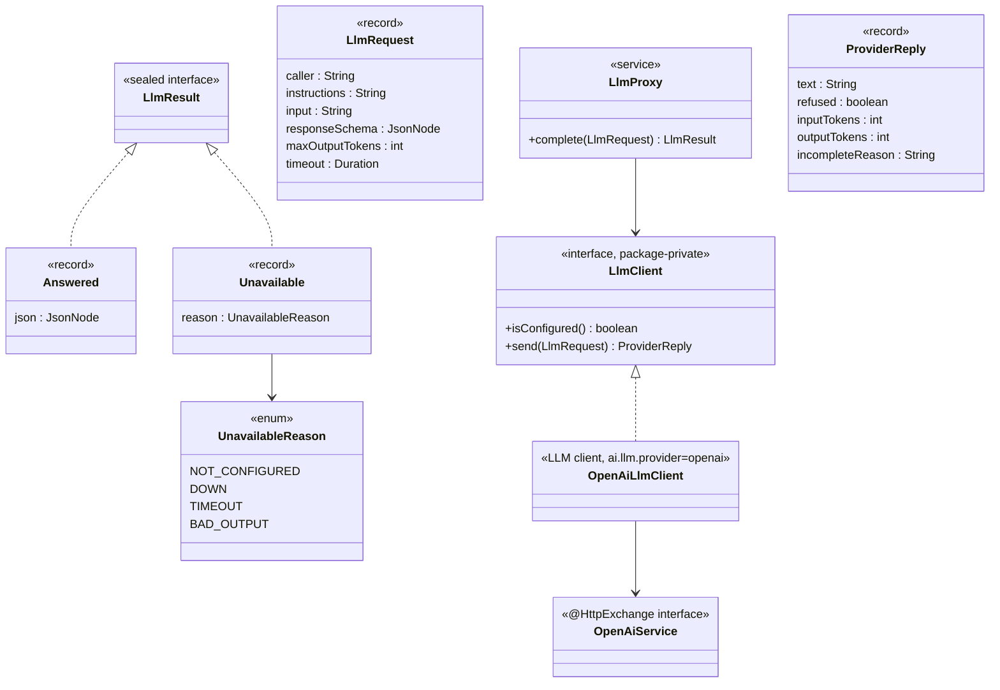
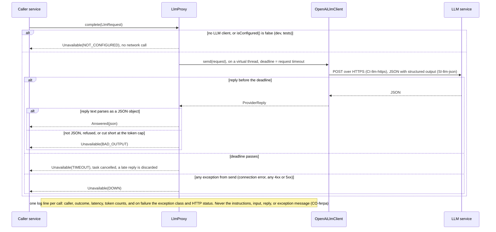

# AI (AI) Design

> Realizes: FR-AI-degradation, SI-llm-proxy-only, SI-llm-context (the AI proxy's half), SI-llm-json, SI-llm-credentials, SI-llm-degradation, CI-llm-https (the AI proxy)
> Depends on: CO-server-side-llm-proxy, SEC-llm-proxy, SEC-llm-data-minimization, CO-ferpa, PER-ai-response-time, AVL-llm-degradation, MNT-feature-locality, DE-llm-service, AS-llm-api-stable, AS-llm-cost-effective
> See: [SRS AI/LLM integration requirements](../requirements/software-requirements-specification.md#aillm-integration-requirements), [SRS software interfaces](../requirements/software-requirements-specification.md#software-interfaces), [architectural-design.md](architectural-design.md#ram-components) (RAM component view, RAM cross-cutting subsystems, QS-llm-outage, RISK-llm-dependency)
> Designed against `main` at `99c4e32` (2026-11-22). The AI assistants (`UC-AI-*`, `UC-CFG-*`) extend this doc when they are designed.

## Overview

This area will hold the AI assistants and their configuration; so far it holds the one piece every AI feature shares, the **AI proxy**: the only code in Project Pulse that talks to the external LLM service (CO-server-side-llm-proxy). A caller hands it instructions, an input, and the shape of JSON it wants back; the proxy sends that to the configured provider and returns either the answer or the fact that AI is unavailable, and why. It knows nothing about teaching context, documents, or artifact keys: assembling what to send is the caller's job (SI-llm-context).

The proxy is its own package, `ram/llm`, not part of `ram/ai`. `ai` will depend on `document`, and `document` on `requirement`; the first caller is `requirement` itself (the artifact key suggestion in UC-ART-create-artifact), so a proxy inside `ai` would close a dependency cycle (MNT-feature-locality). As a leaf with no RAM dependencies, `llm` can serve both. The RAM component view in the architecture-of-record shows it.

Callers, in the order they will be built: the artifact key suggestion (UC-ART-create-artifact, designed in [`art.md`](art.md)), then the assistants (`UC-AI-*`).

## Components & classes

All in [`backend/src/main/java/team/projectpulse/ram/llm/`](../../backend/src/main/java/team/projectpulse/ram/llm/): [`LlmProxy`](../../backend/src/main/java/team/projectpulse/ram/llm/LlmProxy.java), [`LlmRequest`](../../backend/src/main/java/team/projectpulse/ram/llm/LlmRequest.java), [`LlmResult`](../../backend/src/main/java/team/projectpulse/ram/llm/LlmResult.java) (with `Answered` and `Unavailable` nested), [`UnavailableReason`](../../backend/src/main/java/team/projectpulse/ram/llm/UnavailableReason.java), [`LlmClient`](../../backend/src/main/java/team/projectpulse/ram/llm/LlmClient.java), [`ProviderReply`](../../backend/src/main/java/team/projectpulse/ram/llm/ProviderReply.java), [`LlmProperties`](../../backend/src/main/java/team/projectpulse/ram/llm/LlmProperties.java), [`LlmProxyConfiguration`](../../backend/src/main/java/team/projectpulse/ram/llm/LlmProxyConfiguration.java), and for OpenAI [`OpenAiConfiguration`](../../backend/src/main/java/team/projectpulse/ram/llm/OpenAiConfiguration.java), [`OpenAiService`](../../backend/src/main/java/team/projectpulse/ram/llm/OpenAiService.java), [`OpenAiRequest`](../../backend/src/main/java/team/projectpulse/ram/llm/OpenAiRequest.java), [`OpenAiLlmClient`](../../backend/src/main/java/team/projectpulse/ram/llm/OpenAiLlmClient.java).

- **`LlmProxy`**: the one entry point and, with the records, the only public types in `ram/llm`. Enforces the deadline, parses the reply as JSON, turns every failure into `Unavailable`, and logs. It owns one virtual-thread-per-task executor, closed on shutdown.
- **`LlmRequest` / `LlmResult`** (Jackson 3 `tools.jackson.databind.JsonNode`): the provider-neutral contract. No message roles, no model names, no provider fields, and no field for who is asking (SEC-llm-data-minimization). The compact constructor rejects a null or blank `instructions`, a null or blank `input` (OpenAI answers an empty input with a 400, which would log as a false `DOWN`), a null schema, and a `caller` that is not a short `[a-z0-9-]+` constant (it is logged; one value per AI caller, such as `artifact-key-suggestion` or `critique`, not named "feature" because the glossary's Feature is a `FEAT-*` capability theme). A null `timeout` means the default; a timeout of zero or less, or over 15 s, is a programming error (`IllegalArgumentException`). `maxOutputTokens` is the caller's cap on the reply's length.
- **The response schema is strict.** Each caller supplies a schema every provider's strict structured-output mode accepts: an object, `additionalProperties: false`, every property required. The LLM client names it after `caller`.
- **`LlmClient`** (package-private, with the LLM clients and `LlmProperties`, so the compiler keeps every other package off the LLM: SI-llm-proxy-only): the interface every LLM client implements, one LLM client per provider. `isConfigured()` is false when the LLM client has no API key or no model. `send` returns a `ProviderReply` (the provider's raw words; the proxy's verdict on them is the `LlmResult` callers get), with `refused` set when the provider declined or cut the reply short at the token cap, and `incompleteReason` carrying the provider's short code for a cut (`max_output_tokens`, or the status itself, such as `failed`, when there is no cut reason; anything that is not a short lowercase code becomes `other`, so no provider text reaches the log), and throws on any transport or HTTP error.
- **`OpenAiLlmClient` + `OpenAiService`**: the first LLM client. `OpenAiService` is a declarative `@HttpExchange` interface for OpenAI's wire format (a Spring Framework 7 HTTP service group over `RestClient` on the JDK `HttpClient`, connect timeout 5 s, read timeout 20 s); `OpenAiLlmClient` maps `LlmRequest` to it: instructions into the provider's system-prompt slot, the schema into its strict structured-output setting, `maxOutputTokens` into its output cap (raised to OpenAI's minimum of 16 when lower), and the provider's response storage switched off (`store: false` for OpenAI). Temperature stays at the provider's default. A reasoning model's hidden reasoning tokens count against `max_output_tokens`, so `ai.llm.openai.reasoning-effort` is sent as `reasoning.effort` when set, and left out when blank, because a model without reasoning answers the field with a 400 (`unsupported_parameter`). The first live calls (2026-11-24, `gpt-6-luna`) showed why: at its default effort the model spent the key suggestion's 50-token cap on reasoning in 2 of 3 runs and answered `BAD_OUTPUT`; with `none`, every run answered in about 20 tokens. `OpenAiConfiguration` registers the group (`@ImportHttpServices(group = "openai")`) only when `ai.llm.provider=openai`. Boot builds the group's client from `spring.http.serviceclient.openai.connect-timeout` and `.read-timeout`, and a `RestClientHttpServiceGroupConfigurer` adds the base URL and bearer key from `LlmProperties`, so the HTTPS check and the key stay in one place. The JDK client is pinned app-wide with `spring.http.clients.imperative.factory: jdk`, because Reactor Netty is on the classpath (through the Azure Key Vault starter) and Boot's detection prefers it. A later `AnthropicLlmClient` or `GeminiLlmClient` is one LLM client, one `@HttpExchange` interface, and configuration; no caller changes.
- **`LlmProperties`** (`@ConfigurationProperties("ai.llm")`, `@Validated`): provider, default timeout (validated at most 15 s), and per-provider key, base URL (validated to start with `https://`, so a plain-HTTP URL fails startup: CI-llm-https), model, and reasoning effort (lowercase letters, so a typo fails startup).
- **Wiring:** `ai.llm.provider` selects the LLM client (`@ConditionalOnProperty`). With no provider set, no LLM client exists and `LlmProxy` (taking an `Optional<LlmClient>`) answers `NOT_CONFIGURED`; an unknown provider value fails startup. In `application-staging.yml` and `application-prod.yml` the key maps from Key Vault the way the database password does: `ai.llm.openai.api-key: ${openai-api-key:}`; a blank key is `NOT_CONFIGURED`. `application-dev.yml` sets nothing, so dev and the test suite never call an LLM unless a developer sets a provider and a key locally.

## Sequence

### AI proxy

The caller decides what `Unavailable` looks like to the student (SI-llm-degradation, AVL-llm-degradation): the key suggestion shows no suggestion; an assistant shows that AI is temporarily unavailable and offers a retry (QS-llm-outage).

## API contract

The AI proxy adds **no HTTP endpoint and no scheduled job.** Its contract is the Java one above, `LlmProxy.complete(LlmRequest) → LlmResult`, used by other services; each caller's own endpoint is designed with that caller.

| Contract | Caller | Request | Success | Unavailable, by reason |
|---|---|---|---|---|
| `LlmProxy.complete` | Any RAM service (first: the artifact key suggestion) | caller name (for logs), instructions, input, strict response JSON schema, output token cap, timeout (above 0 and at most 15 s; null means the 15 s default) | `Answered`: the reply as a JSON object | `NOT_CONFIGURED`: no provider, or no API key or model. `DOWN`: connection error, or any 4xx or 5xx from the provider. `TIMEOUT`: no reply by the deadline. `BAD_OUTPUT`: the reply is not a JSON object, or the provider refused or cut it short |

Configuration (no secrets in source): `ai.llm.provider` (`openai` in staging and prod; unset in dev; an unknown value fails startup); `ai.llm.default-timeout` (15 s); `ai.llm.openai.api-key` (the Key Vault secret `openai-api-key` in staging and prod, absent in dev and tests), `ai.llm.openai.base-url` (`https://api.openai.com/v1`), `ai.llm.openai.model` (`gpt-6-luna` in staging since 2026-11-24, with reasoning effort `none`; blank in prod until chosen at deploy; blank is `NOT_CONFIGURED`), `ai.llm.openai.reasoning-effort` (set with the model: `none` for a reasoning model, blank for one without). The HTTP client's settings are Boot's: `spring.http.clients.imperative.factory` (`jdk`), `spring.http.serviceclient.openai.connect-timeout` (5 s) and `.read-timeout` (20 s, a backstop above the longest deadline).

## Key decisions

- **Unavailable is a result, not an exception.** A caller cannot forget the outage case, and an unavailable LLM never reaches `ExceptionHandlerAdvice` as an error: it is a normal state (FR-AI-degradation). *Rejected* throwing an `LlmUnavailableException`: any caller that forgot to catch it would show the student a 500.
- **Provider failures never leave the proxy.** A provider's 401 (a bad or rotated key) must not become a 401 to the browser, because the shared Axios instance treats any 401 as an expired session and logs the student out. So `ExceptionHandlerAdvice.handleRestClientException`, which forwards an outbound `RestClient` error's status and message to the browser and which nothing called, was deleted with the proxy. *Rejected* keeping it as a safety net: it is the exact path that would log students out.
- **A leaf package, `ram/llm`.** *Rejected* `ram/ai`: a dependency cycle with `requirement` (Overview). *Rejected* `system/`: no foundation feature calls an LLM, and placing it there is a platform-tier change; it can move if one does.
- **The proxy is transport only.** It takes instructions, input, and a schema; assembling teaching context and graph content is each assistant's job (SI-llm-context). *Rejected* a proxy that assembles assistant context: the key suggestion would carry assistant baggage, and the proxy would depend on most of RAM.
- **A provider-neutral `LlmClient` interface with one LLM client per provider, over a declarative HTTP interface; no Spring AI.** One call shape is needed (instructions and input in, JSON out). That interface is the "provider abstraction" RISK-llm-dependency calls for, and a switch to Claude or Gemini is one new LLM client. *Rejected* Spring AI: a large dependency for one call shape, with its release pace tied to ours. *Rejected* an interface in OpenAI's wire format (roles, `choices[0]`): every caller would change on a provider switch.
- **Every provider error is `DOWN`.** That includes 400, 403, and 404 (a schema the provider rejects, a wrong model name), which are usually our bugs rather than outages: they fail every call alike, and they log at `error` because someone must act. A 400 can also come from one input (an input too long for the model's context), so a lone 400 among answered calls points at that input, not at the deploy. Timeouts, connection errors, 429, and 5xx log at `warn`. *Rejected* a separate reason per HTTP status: no caller acts differently on them, and the log line already carries the status.
- **Log lines carry the exception class and HTTP status, not the exception object.** The Logging convention logs the exception object in every catch that does not rethrow, but a Spring HTTP client exception's message carries the provider's response body, which can echo the input; the same convention's "log identifiers, never content" wins here. Each catch carries a short comment giving that reason. Levels: `info` for `Answered`, `warn` for `TIMEOUT`, `BAD_OUTPUT`, and transient `DOWN`, `error` for a 400, 401, 403, or 404, `debug` for `NOT_CONFIGURED`, the normal state in dev. Because that line is silent in prod, `OpenAiLlmClient` also logs one `warn` at startup when OpenAI is the selected provider but its key or model is blank, printing the settings through the `toString()` that hides the key. Token counts are 0 when the provider omits them.
- **A per-call deadline, 15 s at most, 1 ms at least.** The proxy runs the call on a virtual thread (an executor wrapped with Micrometer context propagation, so the outbound call stays in the student's request trace) and stops waiting at the request's timeout; on timeout it cancels the task, and a reply that arrives later is discarded, because an HTTP client's read timeout is per client, not per call; the client's own read timeout is a backstop at 20 s, above the 15 s ceiling (PER-ai-response-time), so it never races the deadline: a hang is always `TIMEOUT`, never a `DOWN` from the HTTP client. The key suggestion asks for a shorter one ([`art.md`](art.md)). *Rejected* one global timeout: a convenience suggestion should not hold a request for 15 s.
- **No circuit breaker, and no automatic retry.** Each call stands alone: it either answers or ends at its own deadline, and nothing one call does changes the next. At Project Pulse's scale (one class, one caller now, run only when a student asks, the assistants later) a breaker would save a few calls during a rare outage, and it cost the proxy most of its complexity: shared state, a half-open probe, and rules for short timeouts and late reports. Without one, a provider that hangs costs each caller its own timeout (at most 15 s, within QS-llm-outage), and a provider that errors fails fast anyway. No retry inside the proxy, because retries multiply load during an outage and QS-llm-outage gives the student the retry. *Rejected* a minimal breaker (3 failures open it for 30 s, then one probe): built, then removed in review as more caution than the scale needs; OI-84 records the signals that would bring it back, as one class around `send` that changes no caller. *Rejected* Resilience4j: a dependency and its configuration, for the same reason.
- **No request limit yet.** Spend is capped by a monthly budget on the provider account, set at deploy; a per-user limit waits for the assistants (OI-83). *Rejected* a per-user limiter now: speculative for one caller that runs only when a student asks and costs a few dollars a year.
- **No identity leaves, and nothing is kept.** `LlmRequest` has no user field and the LLM client sets none of the provider's optional end-user or tracking fields (for OpenAI: `user`, `safety_identifier`, `metadata`, `prompt_cache_key`); what a caller puts in `input` is limited to requirement content (SEC-llm-data-minimization), which each caller's design states. The LLM client also turns the provider's response storage off, so the provider does not keep the exchange for later retrieval (a provider may still hold API traffic for a limited time under its own data policy; `/implement` records the current terms in the deploy notes).
- **Model, reasoning effort, and key are configuration.** The model and its reasoning effort are chosen together at deploy time per provider; no caller names either. *Rejected for now* a per-request reasoning setting: the key suggestion is the only caller, and it wants none; move it onto `LlmRequest` when an assistant needs a different value.

## Data model

None. The proxy stores nothing; no table and no migration.

## Reuse & cross-cutting

- **Secrets:** the existing Azure Key Vault property source (`application-prod.yml`, `application-staging.yml`) supplies `ai.llm.openai.api-key`.
- **Logging:** the SLF4J convention, identifiers only (Architectural conventions, Logging).
- **Time:** latency is elapsed time, read from `System.nanoTime()`, never the injected `Clock` (Architectural conventions, Time).
- **Checked when built (2026-11-22):** the Boot property names and the `jdk` factory value against the backend's Spring Boot 4.0.2 jars (the newest 4.0.x was then 4.0.10); `@ImportHttpServices` and `RestClientHttpServiceGroupConfigurer` in Spring Framework 7.0.3; OpenAI's Responses API (`POST /v1/responses`, which OpenAI recommends for new projects) with `text.format` `json_schema` and `strict: true`. These move faster than this design, so recheck them when the OpenAI LLM client changes.

## Tests

| Requirement, flow | Level | Asserts |
|---|---|---|
| SI-llm-json, answered | unit, `LlmProxy` with a fake `LlmClient` | a reply that parses as a JSON object returns `Answered` with that JSON |
| SI-llm-json, bad output | unit | a reply that is not a JSON object, a reply marked refused, and a null reply each return `Unavailable(BAD_OUTPUT)`; a cut-short reply logs `incompleteReason=max_output_tokens`, a refusal `incompleteReason=-`, and an odd provider reason becomes `other` |
| SI-llm-degradation, timeout | unit | with a 200 ms request timeout and a fake client that sleeps 5 s, `complete` returns `Unavailable(TIMEOUT)` in under 1 s, and the call is cancelled (the fake's sleep is interrupted) |
| SI-llm-degradation, FR-AI-degradation, down | unit | a connection error, a 400, a 401, a 404, a 429, and a 500 each return `Unavailable(DOWN)`; after shutdown a call is `DOWN` too |
| Provider failure stays inside | unit | no exception escapes `complete`; a provider 401 reaches the caller only as `Unavailable(DOWN)` |
| SI-llm-credentials, not configured | unit | with no LLM client, and with one whose `isConfigured()` is false, `complete` returns `Unavailable(NOT_CONFIGURED)`, and never calls `send`; an LLM client built without a key or model logs one startup `warn` that never shows the key, and a configured one logs nothing |
| Request validation | unit | a blank `instructions`, a null or blank `input`, a `caller` outside `[a-z0-9-]+`, a timeout of zero, and a timeout over 15 s each throw `IllegalArgumentException`; a null timeout uses the default |
| CI-llm-https, OpenAI request shape | unit, `MockRestServiceServer` bound to a hand-built `OpenAiService` | the request goes to the configured base URL with the bearer key, the configured model, the instructions in the system slot, the schema as strict structured output named after `caller`, the output cap, and `reasoning.effort` when configured (absent when blank) |
| CI-llm-https, plain HTTP refused | unit, properties binding | a `base-url` starting with `http://` fails validation |
| SEC-llm-data-minimization, request | unit, `MockRestServiceServer` | the request body's top-level keys are exactly the expected set; `store` is false; `user`, `safety_identifier`, `metadata`, and `prompt_cache_key` are absent |
| SEC-llm-data-minimization, CO-ferpa, logs | unit, log capture | an answered call and a failed call each log one line with caller, outcome, latency, token counts (and, on failure, the exception class and status), and never the instructions, input, reply, or provider message |
| Trace context | unit | the call's virtual thread sees the request thread's context, so the outbound call appears inside the student's request trace |
| SI-llm-proxy-only, SEC-llm-proxy | compiler | `LlmClient`, the LLM clients, `OpenAiService`, and `LlmProperties` are package-private, so no class outside `ram/llm` can reach the LLM; review checks no other package adds an HTTP client |
| Provider selection | unit, `ApplicationContextRunner` | with `ai.llm.provider=openai` the context holds one `LlmClient`, an `OpenAiLlmClient`; with no provider it holds none and `complete` returns `NOT_CONFIGURED`; an unknown provider fails startup |
| QS-llm-outage | integration, with the first caller ([`art.md`](art.md)) | with the LLM down, creating an artifact still succeeds and the suggestion request answers success with no suggestion (the backend half; the screen is the caller's test) |
| Removed handler | unit, existing advice tests | after `handleRestClientException` is deleted, the advice tests still pass (none covers it today) |

## Open questions / risks

- **Provider-side budget is an operations step,** not code: set it before the key goes into Key Vault (deploy notes below).

## Deploy notes

- **Turning AI on** in a slot takes three steps, in order: set a monthly budget on the OpenAI account; add the Key Vault secret `openai-api-key`; set `ai.llm.openai.model` and, with it, `ai.llm.openai.reasoning-effort`. Until both the key and the model are set, every call answers `NOT_CONFIGURED`, so a deploy without them is safe. For a reasoning model set the effort to `none` (OpenAI's cheapest current models reason by default, and a small cap then ends as `BAD_OUTPUT`); for a model without reasoning leave it blank, or every call is a 400. A run of `BAD_OUTPUT` lines with `incompleteReason=max_output_tokens` after a deploy points here.
- **What OpenAI keeps** (its API data-controls page, read 2026-11-22; the page shows no date): API data is not used for training unless the account opts in. Abuse-monitoring logs are kept up to 30 days for every request, whatever `store` says. Responses API application state is kept at least 30 days by default or with `store: true`; the page does not say plainly what `store: false` changes for an ordinary request. Zero Data Retention removes content from those logs and forces `store` off, but it needs OpenAI's prior approval through its sales team. Revisit before the assistants send more than requirement content.
- **`BAD_OUTPUT` is a coarse check** (the reply parses as a JSON object). Checking it against the full schema would need a JSON Schema library; each caller validates the fields it reads instead. Revisit if the assistants need more.
