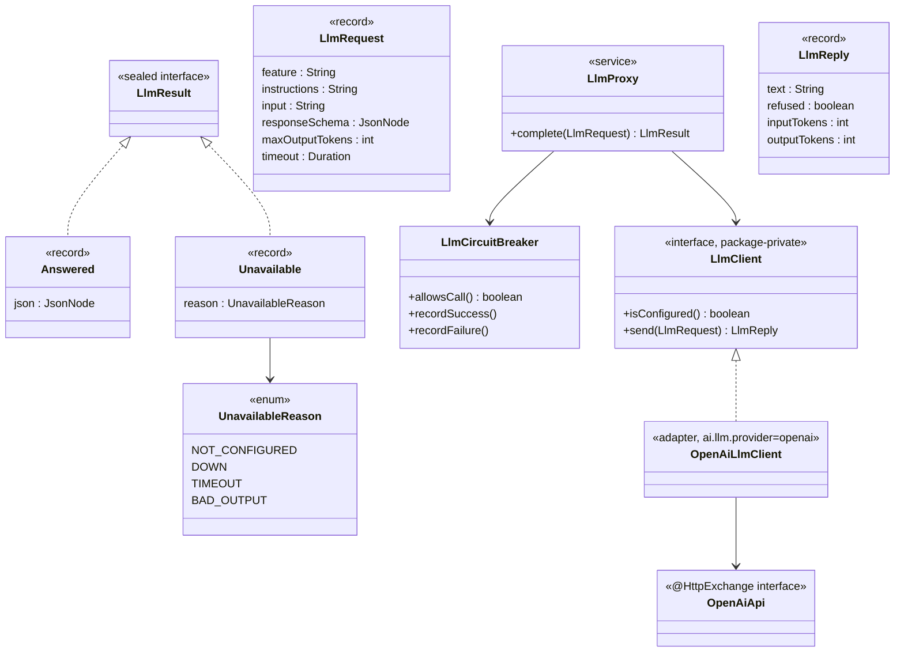
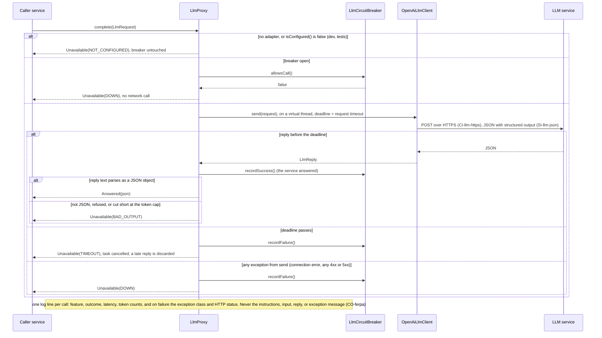

# AI (AI) Design

> Realizes: FR-AI-degradation, SI-llm-proxy-only, SI-llm-context (the AI proxy's half), SI-llm-json, SI-llm-credentials, SI-llm-degradation, CI-llm-https (the AI proxy)
> Depends on: CO-server-side-llm-proxy, SEC-llm-proxy, SEC-llm-data-minimization, CO-ferpa, PER-ai-response-time, AVL-llm-degradation, MNT-feature-locality, DE-llm-service, AS-llm-api-stable, AS-llm-cost-effective
> See: [SRS AI/LLM integration requirements](../requirements/software-requirements-specification.md#aillm-integration-requirements), [SRS software interfaces](../requirements/software-requirements-specification.md#software-interfaces), [architectural-design.md](architectural-design.md#ram-components) (RAM component view, RAM cross-cutting subsystems, QS-llm-outage, RISK-llm-dependency)
> Designed against `main` at `99c4e32` (2026-11-22). The AI assistants (`UC-AI-*`, `UC-CFG-*`) extend this doc when they are designed.

## Overview

This area will hold the AI assistants and their configuration; so far it holds the one piece every AI feature shares, the **AI proxy**: the only code in Project Pulse that talks to the external LLM service (CO-server-side-llm-proxy). A caller hands it instructions, an input, and the shape of JSON it wants back; the proxy sends that to the configured provider and returns either the answer or the fact that AI is unavailable, and why. It knows nothing about teaching context, documents, or artifact keys: assembling what to send is the caller's job (SI-llm-context).

The proxy is its own package, `ram/llm`, not part of `ram/ai`. `ai` will depend on `document`, and `document` on `requirement`; the first caller is `requirement` itself (the artifact key suggestion in UC-ART-create-artifact), so a proxy inside `ai` would close a dependency cycle (MNT-feature-locality). As a leaf with no RAM dependencies, `llm` can serve both. The RAM component view in the architecture-of-record shows it.

Callers, in the order they will be built: the artifact key suggestion (UC-ART-create-artifact, designed in [`art.md`](art.md)), then the assistants (`UC-AI-*`).

## Components & classes

All new, in `backend/src/main/java/team/projectpulse/ram/llm/`. Nothing exists yet; `/implement` fills in the file links.

- **`LlmProxy`**: the one entry point and, with the records, the only public types in `ram/llm`. Enforces the deadline, consults the circuit breaker, parses the reply as JSON, turns every failure into `Unavailable`, and logs. It owns one virtual-thread-per-task executor, closed on shutdown.
- **`LlmRequest` / `LlmResult`** (Jackson 3 `tools.jackson.databind.JsonNode`): the provider-neutral contract. No message roles, no model names, no provider fields, and no field for who is asking (SEC-llm-data-minimization). The compact constructor rejects a null or blank `instructions`, a null `input` or schema, and a `feature` that is not a short `[a-z0-9-]+` constant (it is logged). A null `timeout` means the default; a timeout of zero or less, or over 15 s, is a programming error (`IllegalArgumentException`). `maxOutputTokens` is the caller's cap on the reply's length.
- **The response schema is strict.** Each caller supplies a schema every provider's strict structured-output mode accepts: an object, `additionalProperties: false`, every property required. The adapter names it after `feature`.
- **`LlmClient`** (package-private, with the adapters and `LlmProperties`, so the compiler keeps every other package off the LLM: SI-llm-proxy-only): the port one provider adapter implements. `isConfigured()` is false when the adapter has no API key. `send` returns an `LlmReply`, with `refused` set when the provider declined or cut the reply short at the token cap, and throws on any transport or HTTP error.
- **`OpenAiLlmClient` + `OpenAiApi`**: the first adapter. `OpenAiApi` is a declarative `@HttpExchange` interface for OpenAI's wire format (a Spring Framework 7 HTTP service group over `RestClient` on the JDK `HttpClient`, connect timeout 5 s, read timeout 15 s); `OpenAiLlmClient` maps `LlmRequest` to it: instructions into the provider's system-prompt slot, the schema into its strict structured-output setting, `maxOutputTokens` into its output cap, and the provider's response storage switched off (`store: false` for OpenAI). Temperature stays at the provider's default. A later `AnthropicLlmClient` or `GeminiLlmClient` is one adapter, one `@HttpExchange` interface, and configuration; no caller changes.
- **`LlmCircuitBreaker`**: one small thread-safe class; see the decision below.
- **`LlmProperties`** (`@ConfigurationProperties("ai.llm")`, `@Validated`): provider, default timeout (validated at most 15 s), breaker settings, and per-provider key, base URL (validated to start with `https://`, so a plain-HTTP URL fails startup: CI-llm-https), and model.
- **Wiring:** `ai.llm.provider` selects the adapter (`@ConditionalOnProperty`). With no provider set, no adapter exists and `LlmProxy` (taking an `Optional<LlmClient>`) answers `NOT_CONFIGURED`; an unknown provider value fails startup. In `application-staging.yml` and `application-prod.yml` the key maps from Key Vault the way the database password does: `ai.llm.openai.api-key: ${openai-api-key:}`; a blank key is `NOT_CONFIGURED`. `application-dev.yml` sets nothing, so dev and the test suite never call an LLM unless a developer sets a provider and a key locally.

## Sequence

### AI proxy

The caller decides what `Unavailable` looks like to the student (SI-llm-degradation, AVL-llm-degradation): the key suggestion shows no suggestion; an assistant shows that AI is temporarily unavailable and offers a retry (QS-llm-outage).

## API contract

The AI proxy adds **no HTTP endpoint and no scheduled job.** Its contract is the Java one above, `LlmProxy.complete(LlmRequest) → LlmResult`, used by other services; each caller's own endpoint is designed with that caller.

| Contract | Caller | Request | Success | Unavailable, by reason |
|---|---|---|---|---|
| `LlmProxy.complete` | Any RAM service (first: the artifact key suggestion) | feature name (for logs), instructions, input, strict response JSON schema, output token cap, timeout (above 0 and at most 15 s; null means the 15 s default) | `Answered`: the reply as a JSON object | `NOT_CONFIGURED`: no provider or no API key. `DOWN`: breaker open, connection error, or any 4xx or 5xx from the provider. `TIMEOUT`: no reply by the deadline. `BAD_OUTPUT`: the reply is not a JSON object, or the provider refused or cut it short |

Configuration (no secrets in source): `ai.llm.provider` (`openai` in staging and prod; unset in dev); `ai.llm.default-timeout` (15 s); `ai.llm.breaker.failures` (3); `ai.llm.breaker.open-for` (30 s); `ai.llm.openai.api-key` (the Key Vault secret `openai-api-key` in staging and prod, absent in dev and tests), `ai.llm.openai.base-url`, `ai.llm.openai.model`.

## Key decisions

- **Unavailable is a result, not an exception.** A caller cannot forget the outage case, and an unavailable LLM never reaches `ExceptionHandlerAdvice` as an error: it is a normal state (FR-AI-degradation). *Rejected* throwing an `LlmUnavailableException`: any caller that forgot to catch it would show the student a 500.
- **Provider failures never leave the proxy.** A provider's 401 (a bad or rotated key) must not become a 401 to the browser, because the shared Axios instance treats any 401 as an expired session and logs the student out. So `ExceptionHandlerAdvice.handleRestClientException`, which forwards an outbound `RestClient` error's status and message to the browser and which nothing calls today, is deleted when the proxy is built. *Rejected* keeping it as a safety net: it is the exact path that would log students out.
- **A leaf package, `ram/llm`.** *Rejected* `ram/ai`: a dependency cycle with `requirement` (Overview). *Rejected* `system/`: no foundation feature calls an LLM, and placing it there is a platform-tier change; it can move if one does.
- **The proxy is transport only.** It takes instructions, input, and a schema; assembling teaching context and graph content is each assistant's job (SI-llm-context). *Rejected* a proxy that assembles assistant context: the key suggestion would carry assistant baggage, and the proxy would depend on most of RAM.
- **A provider-neutral port with one adapter per provider, over a declarative HTTP interface; no Spring AI.** One call shape is needed (instructions and input in, JSON out). The port is the "provider abstraction" RISK-llm-dependency calls for, and a switch to Claude or Gemini is one new adapter. *Rejected* Spring AI: a large dependency for one call shape, with its release pace tied to ours. *Rejected* an interface in OpenAI's wire format (roles, `choices[0]`): every caller would change on a provider switch.
- **Every provider error is `DOWN`, and every one counts toward the breaker.** That includes 400, 403, and 404 (a schema the provider rejects, a wrong model name), which are our bugs rather than outages: they fail every call alike, so opening the breaker saves pointless calls, and they log at `error` because someone must act. Timeouts, connection errors, 429, and 5xx log at `warn`. *Rejected* a separate reason per HTTP status: no caller acts differently on them, and the log line already carries the status.
- **Log lines carry the exception class and HTTP status, not the exception object.** The Logging convention logs the exception object in every catch that does not rethrow, but a Spring HTTP client exception's message carries the provider's response body, which can echo the input; the same convention's "log identifiers, never content" wins here. The catch carries a `// NOPMD`-style comment giving that reason. Levels: `info` for `Answered`, `warn` for `TIMEOUT`, `BAD_OUTPUT`, and transient `DOWN`, `error` for a 400, 401, 403, or 404, `debug` for `NOT_CONFIGURED`. Token counts are 0 when the provider omits them.
- **A per-call deadline, 15 s at most.** The proxy runs the call on a virtual thread and stops waiting at the request's timeout; on timeout it cancels the task, and a reply that arrives later is discarded and records nothing, because an HTTP client's read timeout is per client, not per call; the client's own read timeout is set to the 15 s ceiling as a backstop (PER-ai-response-time). The key suggestion asks for a shorter one ([`art.md`](art.md)). *Rejected* one global timeout: a convenience suggestion should not hold a request for 15 s.
- **A minimal circuit breaker, no automatic retry.** After 3 consecutive failures (a timeout, or any exception from the adapter) the breaker opens: for 30 s every call returns `Unavailable(DOWN)` without touching the network. Then exactly one caller's call goes through as a probe while the others still get `DOWN`; a reply closes the breaker, a failure reopens it for another 30 s. Any reply resets the count, including one that ends as `BAD_OUTPUT` (the service answered); `NOT_CONFIGURED` never touches the breaker. The class is thread-safe (one lock around its state). Three, not one, so a single blip does not switch AI off; the probe means recovery needs no restart. **The breaker's time is elapsed time, so it uses the real clock** (Architectural conventions, Time). It holds an `InstantSource` that production wiring sets to `InstantSource.system()` directly, never by injecting a bean by type: the `dev` profile's fixed `Clock` bean is an `InstantSource` too, and a breaker on a frozen clock would never close. Tests construct it with a controllable source. No retry inside the proxy, because retries multiply load during an outage and QS-llm-outage gives the student the retry. *Rejected* no breaker: during an outage every debounced key suggestion would wait out its timeout. *Rejected* Resilience4j: a dependency and its configuration for one breaker, on one instance (CO-single-instance).
- **No request limit yet.** Spend is capped by a monthly budget on the provider account, set at deploy; a per-user limit waits for the assistants (OI-83). *Rejected* a per-user limiter now: speculative for one debounced caller that costs a few dollars a year.
- **No identity leaves, and nothing is kept.** `LlmRequest` has no user field and the adapter sets none of the provider's optional end-user or tracking fields (for OpenAI: `user`, `safety_identifier`, `metadata`, `prompt_cache_key`); what a caller puts in `input` is limited to requirement content (SEC-llm-data-minimization), which each caller's design states. The adapter also turns the provider's response storage off, so the provider does not keep the exchange for later retrieval (a provider may still hold API traffic for a limited time under its own data policy; `/implement` records the current terms in the deploy notes).
- **Model and key are configuration.** The model is chosen at deploy time per provider; no caller names one.

## Data model

None. The proxy stores nothing; no table and no migration.

## Reuse & cross-cutting

- **Secrets:** the existing Azure Key Vault property source (`application-prod.yml`, `application-staging.yml`) supplies `ai.llm.openai.api-key`.
- **Logging:** the SLF4J convention, identifiers only (Architectural conventions, Logging).
- **Time:** elapsed time through an injected `InstantSource` (Architectural conventions, Time).
- **Before coding, `/implement` checks** the latest Spring Boot 4.0.x patch (the backend is on 4.0.2), the Boot 4 property names for HTTP service group timeouts, and OpenAI's currently recommended endpoint and structured-output format. This design does not pin them, because they move faster than it does.

## Tests

| Requirement, flow | Level | Asserts |
|---|---|---|
| SI-llm-json, answered | unit, `LlmProxy` with a fake `LlmClient` | a reply that parses as a JSON object returns `Answered` with that JSON |
| SI-llm-json, bad output | unit | a reply that is not a JSON object, and a reply marked refused, each return `Unavailable(BAD_OUTPUT)` and reset the breaker's failure count |
| SI-llm-degradation, timeout | unit | with a 200 ms request timeout and a fake client that sleeps 5 s, `complete` returns `Unavailable(TIMEOUT)` in under 1 s, and the late reply changes nothing |
| SI-llm-degradation, FR-AI-degradation, down | unit | a connection error, a 400, a 401, a 404, a 429, and a 500 each return `Unavailable(DOWN)` and count as a breaker failure |
| Provider failure stays inside | unit | no exception escapes `complete`; a provider 401 reaches the caller only as `Unavailable(DOWN)` |
| SI-llm-credentials, not configured | unit | with no adapter, and with an adapter whose `isConfigured()` is false, `complete` returns `Unavailable(NOT_CONFIGURED)`, never calls `send`, and leaves the breaker closed |
| Request validation | unit | a blank `instructions`, a `feature` outside `[a-z0-9-]+`, a timeout of zero, and a timeout over 15 s each throw `IllegalArgumentException`; a null timeout uses the default |
| Circuit breaker | unit, controllable `InstantSource` | 3 consecutive failures open it; while open the client is never called; after 30 s exactly one of two concurrent callers gets the probe and the other gets `DOWN`; a successful probe closes it, a failed one reopens it; a reply resets the count |
| CI-llm-https, OpenAI request shape | unit, `MockRestServiceServer` bound to a hand-built `OpenAiApi` | the request goes to the configured base URL with the bearer key, the configured model, the instructions in the system slot, the schema as strict structured output named after `feature`, and the output cap |
| CI-llm-https, plain HTTP refused | unit, properties binding | a `base-url` starting with `http://` fails validation |
| SEC-llm-data-minimization, request | unit, `MockRestServiceServer` | the request body's top-level keys are exactly the expected set; `store` is false; `user`, `safety_identifier`, `metadata`, and `prompt_cache_key` are absent |
| SEC-llm-data-minimization, CO-ferpa, logs | unit, log capture | an answered call and a failed call each log one line with feature, outcome, latency, token counts (and, on failure, the exception class and status), and never the instructions, input, reply, or provider message |
| SI-llm-proxy-only, SEC-llm-proxy | compiler | `LlmClient`, the adapters, `OpenAiApi`, and `LlmProperties` are package-private, so no class outside `ram/llm` can reach the LLM; review checks no other package adds an HTTP client |
| Provider selection | unit, `ApplicationContextRunner` | with `ai.llm.provider=openai` the context holds one `LlmClient`, an `OpenAiLlmClient`; with no provider it holds none and `complete` returns `NOT_CONFIGURED`; an unknown provider fails startup |
| QS-llm-outage | integration, with the first caller ([`art.md`](art.md)) | with the LLM down, creating an artifact still succeeds and the suggestion request answers success with no suggestion (the backend half; the screen is the caller's test) |
| Removed handler | unit, existing advice tests | after `handleRestClientException` is deleted, the advice tests still pass (none covers it today) |

## Open questions / risks

- **Provider-side budget is an operations step,** not code: the deploy notes must say to set it before the key goes into Key Vault.
- **`BAD_OUTPUT` is a coarse check** (the reply parses as a JSON object). Checking it against the full schema would need a JSON Schema library; each caller validates the fields it reads instead. Revisit if the assistants need more.
