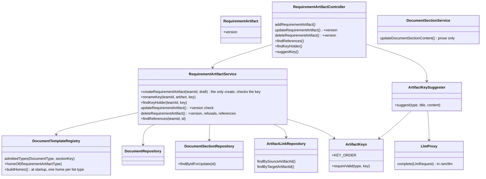
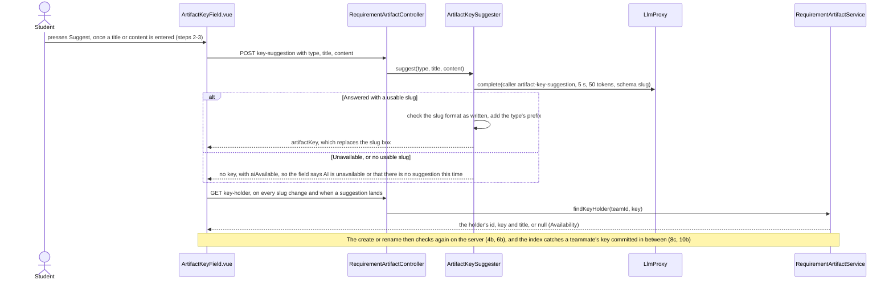
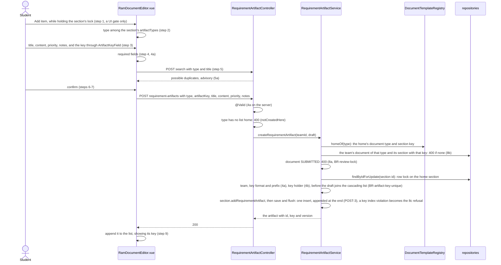
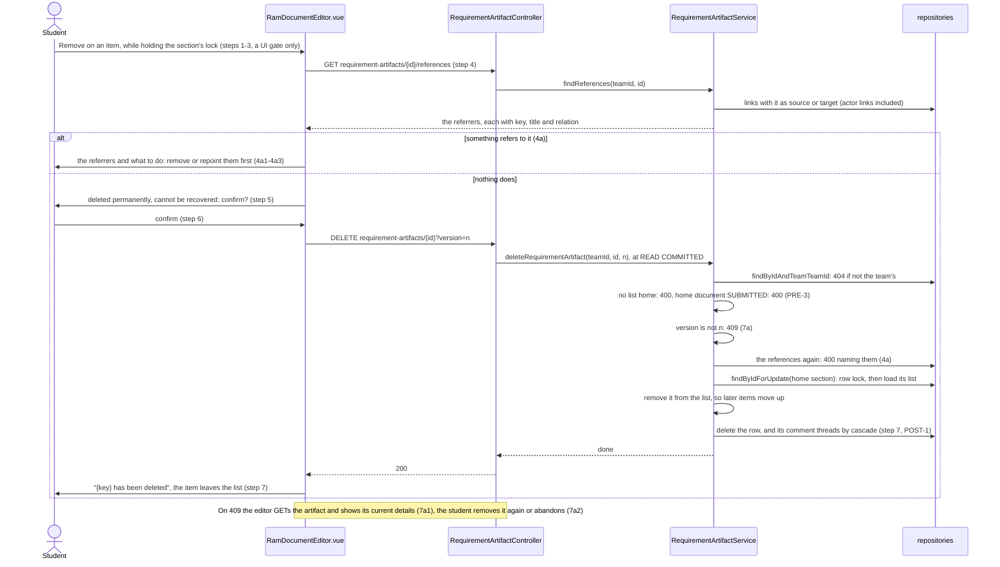

# Requirement Artifacts (ART) Design

> Realizes: UC-ART-create-artifact, UC-ART-edit-artifact (the artifact key rename), UC-ART-delete-artifact, and the artifact key machinery that UC-GLO-create-term, UC-GLO-rename-term, UC-DOC-create-use-case and UC-DOC-edit-use-case use
> Depends on: BR-artifact-home, BR-artifact-key-unique, BR-deletion-integrity, BR-section-artifact-removal, BR-edit-lock-required, BR-review-lock, BR-team-scoped-access, DI-concurrency-control, DI-artifact-key-assignment, DI-referential-integrity, FR-AI-degradation, SI-llm-degradation, SEC-llm-data-minimization, AVL-llm-degradation, MNT-feature-locality, OI-46 (no ids from the request body)
> See: [use cases](../requirements/use-cases.md#requirement-artifacts), [Business Domain Model](../requirements/software-requirements-specification.md#business-domain-model) (the artifact type → authoring home table), [architectural-design.md](architectural-design.md#domain--aggregate-model) (Domain & aggregate model, Transactions & consistency, Authorization), [doc.md](doc.md) (the DOC area, which owns the document section editor)
> History: first designed 2026-11-16 with new items saved inside the document section save. Revised 2026-11-17 after the spec made requirement artifacts first-class (OI-23): an artifact is created on its own, stored at once, and guarded by versioning instead of the document section's lock. Revised 2026-11-19 to add UC-ART-delete-artifact, after the spec changed deletion from logical to physical (BR-deletion-integrity). Revised 2026-11-20: a use case's actors are links now (spec PR #149), so the references are links only. Revised 2026-11-24 for name-based artifact keys (spec PRs #159 and #164): the student chooses every key, with a suggestion on request, and the key counter is retired.

## Scope

This doc is the ART area's design-of-record. It covers the artifact key every type shares (its format, uniqueness, suggestion and editor field), creating a requirement artifact from any authoring surface, resolving its home document section from its type, deleting it (refused while anything refers to it), and the cutover the new model needs in the document section editor: items are created, edited and removed through the artifact endpoints, and the document section save stores prose only.

Not covered here, each to be designed on its own:
- **Deleting a glossary term** belongs to UC-GLO-delete-term, which follows the same rule (BR-deletion-integrity) but has its own editor.
- **Reordering items** (UC-DOC-edit-document 6b) and the order version it needs. Until then the order is creation order.
- **The artifact catalog page** belongs to UC-ART-find-artifacts. The create endpoint already serves it.
- **Creating a use case's actor** from the use case editor (UC-DOC-create-use-case 3a, UC-DOC-edit-use-case 6c) calls the same create endpoint with no change; its picker and dialog are designed in [doc.md](doc.md#creating-an-actor-from-the-picker-3a-6c).

## Overview

There is one create endpoint, `POST /teams/{teamId}/requirement-artifacts`, for every surface. The request names the artifact type, and the type alone names the home: every type has exactly one. The section view offers only its own section's types, so the artifact lands in the list the student is looking at. The server resolves the home: the template registry maps the type to one (document type, section key) pair, and the team's document of that type holds the section with that key. No document or section id travels in the body.

The service checks the key the request carries (format and prefix, then whether another artifact of the team holds it; see [Artifact keys](#artifact-keys)), locks the home document section's row, appends the artifact to the section's list (which sets its home), and saves and flushes it, so the row is inserted once with its key and home and `artifact_index` is written at the end. The key is checked first because the holder lookup runs a query, which may flush pending changes, and the draft must not be in the cascading list by then. It does not check the document section's lock: the section view offers Add and Edit only to the lock holder, as a UI gate (UC-DOC-edit-document, BR-edit-lock-required).

A delete is physical and refused while the artifact is referenced. Before the confirm, the editor asks `GET …/requirement-artifacts/{id}/references` what refers to the artifact: a link with it at either end. A use case naming it as an actor is one of these, a `PRIMARY_ACTOR` or `SECONDARY_ACTOR` link from the use case (see [doc.md, Actors as links](doc.md#actors-as-links)). If anything does, the student sees extension 4a and nothing is deleted. Otherwise, after the confirm, `DELETE …/requirement-artifacts/{id}?version=n` checks the version (7a), the same refusals as the PUT, and the references again. It then takes the item out of its home list under the same row lock a create takes, and removes the row. The artifact's comment threads go with it; no link can, because a referenced artifact is refused.

## Components & classes

`+` marks what this design adds. Files:

- **Changed:** [`RequirementArtifact`](../../backend/src/main/java/team/projectpulse/ram/requirement/RequirementArtifact.java) (`@Version`), [`RequirementArtifactDto`](../../backend/src/main/java/team/projectpulse/ram/requirement/dto/RequirementArtifactDto.java) (adds `homeDocumentType`, response only, and `version`; drops `sourceSectionId`), [`RequirementArtifactDtoToRequirementArtifactConverter`](../../backend/src/main/java/team/projectpulse/ram/requirement/converter/RequirementArtifactDtoToRequirementArtifactConverter.java) (no section lookup), [`RequirementArtifactService`](../../backend/src/main/java/team/projectpulse/ram/requirement/RequirementArtifactService.java), [`RequirementArtifactController`](../../backend/src/main/java/team/projectpulse/ram/requirement/RequirementArtifactController.java), [`DocumentSectionRepository`](../../backend/src/main/java/team/projectpulse/ram/document/DocumentSectionRepository.java), [`DocumentTemplateRegistry`](../../backend/src/main/java/team/projectpulse/ram/document/template/DocumentTemplateRegistry.java), [`DocumentSectionService`](../../backend/src/main/java/team/projectpulse/ram/document/DocumentSectionService.java), [`DocumentSectionDto`](../../backend/src/main/java/team/projectpulse/ram/document/dto/DocumentSectionDto.java) (`requirementArtifacts` read-only), [`RequirementArtifactType`](../../backend/src/main/java/team/projectpulse/ram/requirement/RequirementArtifactType.java) (`hasListHome()`, the four interface types, the two business-level types, no `OTHER`) and [`ArtifactKeyPrefix`](../../backend/src/main/java/team/projectpulse/ram/requirement/ArtifactKeyPrefix.java), [`SRS.yml`](../../backend/src/main/resources/requirement-document-templates/SRS.yml), [`VISION_SCOPE.yml`](../../backend/src/main/resources/requirement-document-templates/VISION_SCOPE.yml).
- **Removed:** `resolveSectionItems`, `applySectionItems` and `ResolvedItem` from the document section save, and `DocumentSection.replaceAllRequirementArtifacts`, which has no caller left. `SectionItemRejectedException` is renamed `RequirementArtifactRejectedException` (see Refusals).
- **New:** migration `V11` (see Data model).
- **Changed for the delete:** [`RequirementArtifact`](../../backend/src/main/java/team/projectpulse/ram/requirement/RequirementArtifact.java) (no cascade or orphan removal on its two link sets), [`SecurityConfiguration`](../../backend/src/main/java/team/projectpulse/security/SecurityConfiguration.java) (one team-membership rule for the references GET), [`RequirementArtifactRejectedException`](../../backend/src/main/java/team/projectpulse/system/exception/RequirementArtifactRejectedException.java) and [`ExceptionHandlerAdvice`](../../backend/src/main/java/team/projectpulse/system/exception/ExceptionHandlerAdvice.java) (an optional payload for 4a), and a new `ArtifactReferrerDto` in `ram/requirement/dto`. The test for the old delete is the only caller of the `DELETE` route today. No schema change.
- **Changed for actor links (2026-11-20):** `ArtifactReferrerDto.Relation` loses `PRIMARY_ACTOR` and `SECONDARY_ACTOR`; [`types.ts`](../../frontend/src/apis/ram/types.ts) drops them from the relation type and `describeReferrer` in [`RamDocumentEditor.vue`](../../frontend/src/pages/ram/RamDocumentEditor.vue) drops their two cases, since an actor now reads as a link ("the link UC-1 PRIMARY_ACTOR STK-1"). The frontend has no link pages yet, so nothing else shows the actor links.
- **Frontend, shared:** [`utils/request.ts`](../../frontend/src/utils/request.ts) gains the `handleNotFound` request flag (no toast, no not-found routing for a 404 the caller handles).
- **Frontend, changed:** [`RamDocumentEditor.vue`](../../frontend/src/pages/ram/RamDocumentEditor.vue) (Add creates through the POST, Edit saves through the PUT with the version, Remove checks the references and deletes through the DELETE with the version, the section save sends prose only), [`apis/ram/index.ts`](../../frontend/src/apis/ram/index.ts) and [`apis/ram/types.ts`](../../frontend/src/apis/ram/types.ts).
- **Changed for artifact keys (2026-11-24):** [`RequirementArtifactService`](../../backend/src/main/java/team/projectpulse/ram/requirement/RequirementArtifactService.java) (the key from the draft for every type, `renameKey`, `findKeyHolder`, `BY_ARTIFACT_KEY` in key order), [`RequirementArtifactController`](../../backend/src/main/java/team/projectpulse/ram/requirement/RequirementArtifactController.java) (the key-holder and key-suggestion routes; the PUT reads `artifactKey`), [`RequirementArtifactRepository`](../../backend/src/main/java/team/projectpulse/ram/requirement/RequirementArtifactRepository.java) (`findByTeamTeamIdAndArtifactKey`), the DTO-to-entity converter (maps `artifactKey`), [`ArtifactKeyPrefix`](../../backend/src/main/java/team/projectpulse/ram/requirement/ArtifactKeyPrefix.java) (`PRE` and `POST` for conditions, see [doc.md](doc.md#key-decisions)), `SecurityConfiguration` (two team-membership rules), `DataInitializer` (a slug key for every seeded artifact). New: `ArtifactKeys` and `ArtifactKeySuggester` in `ram/requirement`, the records `ArtifactKeyHolderDto`, `ArtifactKeySuggestionRequest` and `ArtifactKeySuggestionDto` in `ram/requirement/dto`, and migration `V14`. Removed: `ArtifactKeySequence`, `ArtifactKeySequenceRepository`, `generateNextArtifactKey`. Frontend: new [`components/ArtifactKeyField.vue`](../../frontend/src/components/ArtifactKeyField.vue) and [`utils/artifactKeys.ts`](../../frontend/src/utils/artifactKeys.ts) (the prefix map, the slug rule and the key order); changed `RequirementArtifactCreateDialog.vue`, `RamDocumentEditor.vue` (create and edit), `apis/ram/index.ts` (two calls) and `apis/ram/types.ts` (the type-to-prefix map).
- **Reused unchanged:** the artifact search (the duplicate warning), `createRequirementArtifact` as the only create method (since OI-73: a type with no list home is only checked and inserted), [`ArtifactLinkRepository`](../../backend/src/main/java/team/projectpulse/ram/requirement/ArtifactLinkRepository.java)'s outgoing and incoming link queries, the 409 mapping for `OptimisticLockException` in `ExceptionHandlerAdvice`, the document section lock for the prose save, the cascade that removes an artifact's comment threads, and the team route rules in `SecurityConfiguration`.

## Homes

Each list section declares the types it admits in its template (`artifactTypes`), and the registry inverts that into each type's homes. Which types belong in a list is said once, on the enum: `RequirementArtifactType.hasListHome()` is false for the five types below and true for every other. The registry and the create path both read it. Every list type has exactly one home. At startup the registry refuses a list type with no home or more than one, and a template that admits a type whose `hasListHome()` is false.

| Template | Section key | Admits |
|---|---|---|
| Vision and Scope | `BUSINESS_OPPORTUNITY` | `BUSINESS_PROBLEM`, `BUSINESS_OPPORTUNITY` |
| Vision and Scope | `BUSINESS_OBJECTIVES` | `BUSINESS_OBJECTIVE` |
| Vision and Scope | `SUCCESS_METRICS` | `SUCCESS_METRIC` |
| Vision and Scope | `RISKS` | `RISK` |
| Vision and Scope | `ASSUMPTIONS_DEPENDENCIES` | `BUSINESS_ASSUMPTION`, `BUSINESS_DEPENDENCY` |
| Vision and Scope | `STAKEHOLDER_PROFILES` | `STAKEHOLDER` |
| Vision and Scope | `EXTERNAL_SYSTEMS` | `EXTERNAL_SYSTEM` |
| Vision and Scope | `MAJOR_FEATURES` | `FEATURE` |
| SRS | `OPERATING_ENVIRONMENT` | `OPERATING_ENVIRONMENT` |
| SRS | `DESIGN_CONSTRAINTS` | `CONSTRAINT` |
| SRS | `ASSUMPTIONS_DEPENDENCIES` | `ASSUMPTION`, `DEPENDENCY` |
| SRS | `NON_USE_CASE_FUNCTIONAL_REQUIREMENTS` | `FUNCTIONAL_REQUIREMENT` |
| SRS | `DATA_REQUIREMENTS` | `DATA_REQUIREMENT` |
| SRS | `USER_INTERFACES` | `USER_INTERFACE` |
| SRS | `SOFTWARE_INTERFACES` | `SOFTWARE_INTERFACE` |
| SRS | `HARDWARE_INTERFACES` | `HARDWARE_INTERFACE` |
| SRS | `COMMUNICATION_INTERFACES` | `COMMUNICATIONS_INTERFACE` |
| SRS | `QUALITY_ATTRIBUTES` | `QUALITY_ATTRIBUTE` |
| Business Rules | `BUSINESS_RULES` | `BUSINESS_RULE` |
| Architectural Design | `KEY_DECISIONS` | `KEY_DECISION` |
| Architectural Design | `QUALITY_SCENARIOS` | `QUALITY_SCENARIO` |
| Architectural Design | `RISKS_AND_TECHNICAL_DEBT` | `TECHNICAL_RISK`, `TECHNICAL_DEBT` |

`GLOSSARY_TERM`, `USE_CASE`, `PRECONDITION` and `POSTCONDITION` have no list home and are created through their own use cases; `USER_STORY` is deferred. The create endpoint refuses all five.

## Artifact keys

Every requirement artifact's key is `<PREFIX>-<slug>`, chosen by the student (BR-artifact-key-unique, DI-artifact-key-assignment, UC-ART-create-artifact's "Artifact key rules"). This section is the machinery every type shares; the entry points are designed where their editors are: the artifact dialogs here, the use case and its new conditions in [doc.md](doc.md#artifact-keys-of-a-use-case-and-its-conditions), and glossary terms in [glo.md](glo.md). The numbered key counter (`ArtifactKeySequence`) is retired: nothing mints a key any more.

- **The format** lives in one place, `ArtifactKeys`: the prefix `ArtifactKeyPrefix` gives the type, then a slug of lowercase letters, digits and single hyphens, starting with a letter, at most 40 characters. Every create and every key rename calls `ArtifactKeys.requireValid(type, key)` in the service, whichever route it came through. `FR-export-csv` passes; `FR-Export`, `FR-2fa-login`, `FR--x`, `FR-x-` and `RI-x` on a functional requirement do not.
- **The guard** is a check, then the unique index `uk_requirement_artifact_team_key` on `(team, artifact_key)` behind it. The service first looks up the holder (`findKeyHolder`) and refuses with the holder's key and title. A teammate can commit the same key between that check and this transaction's commit, so the insert or rename is flushed at once; an index violation on that one constraint (recognized by its name, which Hibernate's `ConstraintViolationException` inside the `DataIntegrityViolationException` carries; any other integrity error is left alone) becomes a refusal that names the key only, since the failed transaction can only roll back and reads nothing more; the editor then asks the key-holder lookup again, in a request of its own, and shows the holder. The whole request rolls back, so a use case save with a taken condition key stores nothing.
- **The suggestion** is `ArtifactKeySuggester`, the AI proxy's first caller. It runs only when the student presses Suggest. It sends the type's label, the title and the content (each cut at 2,000 characters), and nothing else (SEC-llm-data-minimization): no team, no user, no other keys. It asks for `{slug}` within 5 s and 50 output tokens, uses the answer only if it is already in the slug format, exactly as the model wrote it, and adds the prefix. It never repairs an answer: `Export CSV`, `FR-export-csv` or `2fa-login` gives no key (changed in review, 2026-11-25: repairing the model's output is not this code's job). It says whether AI was available, so the field can tell the student either that AI suggestions are temporarily unavailable (`Unavailable`; FR-AI-degradation, AVL-llm-degradation) or that there is no suggestion this time. Every type uses the same call: a glossary term sends its term and definition, a use case its name and description, a condition its wording as content with an empty title.
- **The key field** is one component, `ArtifactKeyField.vue`, used by every editor that sets a key: the fixed prefix, the slug box, the Suggest button (enabled once the title or content has text; a spinner while it waits; a suggestion replaces the slug box), and an availability line that asks `GET …/key-holder` whenever the slug changes, naming the holder with an "open it" link. Given the artifact's own id, it reads the artifact's current key as free. It has a compact mode for a condition row, where a holder that is a condition of the same type (the holder carries its `type`) also offers "use that condition": choosing it replaces the new row with an entry carrying the holder's `id`, exactly as picking it from the team's list does. A rename shows the reminder that mentions of the old key in free text keep it (UC-ART-edit-artifact).
- **Order.** Keys sort alphabetically, a missing key last, through `ArtifactKeys.KEY_ORDER`, which `BY_ARTIFACT_KEY` uses; the frontend compares the same way (`compareArtifactKeys`). Keys are names, so the prefix groups them by type and the slug orders them within it; no number handling is needed (changed in review, 2026-11-25).

## Sequence

### UC-ART-create-artifact: creating an artifact in its home

Editing an item from the section view uses `PUT …/requirement-artifacts/{id}` with the item's `version`. A stale version is refused with 409 (UC-ART-edit-artifact 10a), and the editor reloads the item. The PUT carries `artifactKey`; when it differs from the stored key, `renameKey` checks it as a create does (6a, 6b), and the index catches a teammate's key committed in between (10b). Links connect artifacts, not keys, so a rename touches no link.

### UC-ART-delete-artifact: deleting an artifact nothing refers to

## API contract

All routes are under the API base URL and return the `Result` envelope. "Team member" is the existing route rule for requirement artifacts and document sections.

| Endpoint | Caller (who may) | Request | Success | Errors, by extension |
|---|---|---|---|---|
| `POST /teams/{teamId}/requirement-artifacts` (changed) | team member | `type`, `artifactKey` (required, checked, see [Artifact keys](#artifact-keys)), `title`, `content`, `priority`, `notes`. Any `id`, `version` or `homeDocumentType` in the body is ignored: the type alone names the home | the artifact with its `id`, `artifactKey`, `version` and `homeDocumentType` | 400 field errors (4a); 400 "The request is malformed." for an unknown `type` value (the existing handler); 400 with a message (see Refusals) for a type with no list home, a home document not created (8b), or a home document locked for review (8a); 400 a missing or malformed key, or one with another type's prefix (4a); 400 a key another artifact of the team holds, with the holder as `data` (4b, 8c) |
| `PUT /teams/{teamId}/requirement-artifacts/{requirementArtifactId}` (changed) | team member | `version` (required), `artifactKey` (required: the current key, or a new one to rename it) and the editable fields `title`, `content`, `priority`, `notes`; type and home are ignored | the artifact with its new `version` | 400 no `version`; 400 field errors; 400 a type with no list home (a glossary term, use case or condition is edited through its own use case and lock); 400 home document locked for review (UC-ART-edit-artifact PRE-3); 409 stale version (10a); 404 not in the team; 400 a malformed new key (6a); 400 a new key another artifact holds, with the holder as `data` (6b, 10b) |
| `GET /teams/{teamId}/requirement-artifacts/key-holder?artifactKey=` (new) | team member | the exact key | the artifact of the team that holds it (`id`, `artifactKey`, `title`, `type`), or no data | none: a malformed key simply has no holder; another team's key is never found |
| `POST /teams/{teamId}/requirement-artifacts/key-suggestion` (new) | team member | `type`, `title`, `content`; at least one of the two is not blank. Any type, since every type's editor uses it | `artifactKey` (a suggested key with the type's prefix, or null) and `aiAvailable` (false when the AI proxy answered `Unavailable`; true with a null key when the answer was unusable). Always a success: no suggestion is a normal state (FR-AI-degradation) | 400 both blank |
| `GET …/document-sections/{documentSectionId}` (changed) | team member | none | each nested item now also carries its `version`, which the editor sends back on the PUT | unchanged |
| `PUT /teams/{teamId}/documents/{documentId}/document-sections/{documentSectionId}` (changed) | team member holding the document section's lock | `version` and `content`; `requirementArtifacts` is no longer read | the stored document section | the existing lock and version errors |
| `GET /teams/{teamId}/requirement-artifacts/{requirementArtifactId}/references` (new) | team member | none | a list of referrers (`ArtifactReferrerDto`), one per reference: `id`, `artifactKey` and `title` of the other artifact, `relation`, and `linkType` (the link's type). `relation` is `LINK_FROM` when the artifact being deleted is the link's source and `LINK_TO` when it is the target; an actor named by a use case is `LINK_TO` with `linkType` `PRIMARY_ACTOR` or `SECONDARY_ACTOR`, and its other artifact is the use case's own artifact, which shares the use case's id. A self-link is one entry, `LINK_FROM`. An empty list if none | 404 not in the team |
| `DELETE /teams/{teamId}/requirement-artifacts/{requirementArtifactId}?version=n` (changed) | team member | `version` (query parameter, optional at the binding so its absence gets the message below; a non-numeric value gets the existing "The request is malformed.") | no data, message "Delete requirement artifact successfully" | 400 no `version`; 400 a type with no list home; 400 home document locked for review (PRE-3); 400 referenced (4a), with the referrers as `data`, the same shape as the GET; 409 stale version (7a); 404 not in the team |
| `POST /teams/{teamId}/requirement-artifacts/search` (reused) | team member | criteria `type` and `title`, page `size=5` | the team's artifacts of that type whose title contains the text (SQL `LIKE`, case-insensitive through the column's MySQL collation) | none new |

A caller who belongs to the team but whose team has no home document gets the 8b 400, not a 404: the team exists and the student needs the message.

"Team member" admits an instructor of the team's course section, as on every artifact route (the Instructor test pins it for the create), so an instructor may delete too. The references GET gets the same rule as its sibling artifact routes in `SecurityConfiguration`.

### Refusals

One exception, `RequirementArtifactRejectedException` (the renamed `SectionItemRejectedException`, mapped as it is today: HTTP 400, `StatusCode.INVALID_ARGUMENT`, the message shown to the student). The editor shows the message; it does not branch on the cause. Messages, with the document's title filled in:

| Cause | Message |
|---|---|
| Type with no list home | "A {type label} is not created here: glossary terms are created in the glossary, and use cases and their conditions in the use case editor." |
| 8b | "The team's {home title} has not been created yet. The course admin creates the team's documents." |
| 8a | "The {home title} is locked for review, so it cannot be changed." |
| Home document predates its list (a document created from an older template, staging only) | "The team's {home title} was created from an older template and has no list for {a type label}." |
| PUT with no `version` | "The requirement artifact's version is required to save a change." |
| PUT on a type with no list home | "{A type label} is not edited here: glossary terms are edited in the glossary, and use cases and their conditions in the use case editor." |
| DELETE with no `version` | "The requirement artifact's version is required to delete it." |
| DELETE on a type with no list home | "{A type label} is not deleted here: glossary terms are deleted in the glossary, and use cases and their conditions in the use case editor." |
| Key missing or malformed (4a, 6a) | "The artifact key must be {PREFIX}- followed by a name of lowercase letters, digits and single hyphens, starting with a letter, at most 40 characters." |
| Key with another type's prefix (4a) | "The artifact key of {a type label} starts with {PREFIX}-." |
| Key held (4b, 6b, 8c, 10b, and the glossary and use case siblings) | "{key} is already used by {holder key}: {holder title}." The holder (`id`, `artifactKey`, `title`, `type`) goes back as `data`, so the editor can offer to open it. |
| Suggestion with neither title nor content | "Enter a title or content first, so there is something to suggest a key from." |
| DELETE of a referenced artifact (4a) | "{key} cannot be deleted while other artifacts refer to it: {referrers}. Remove or repoint these references first." Every reference is a link, in artifact-key order, joined with "; ", never truncated. A link always reads source, type, target ("the link FR-1 DERIVES_FROM UC-1", "the link UC-1 DERIVES_FROM BO-1", "the link UC-1 PRIMARY_ACTOR STK-1"). |

For the delete's 4a and for a held key, `RequirementArtifactRejectedException` carries a payload, and `ExceptionHandlerAdvice` puts it in `Result.data`; every other refusal carries none, as today.

The DELETE under review uses the 8a message, and a stale DELETE gets the existing 409 message ("This requirement artifact has been changed by someone else. Please refresh and try again.").

### Item rules

- **Required:** `type`, `artifactKey` (checked in the service, see [Artifact keys](#artifact-keys)), `title` and `content` (`@NotBlank`, so only spaces counts as missing). `title` is at most 255 characters, the column's size (`@Size`). **Optional:** `priority` (one of the `Priority` values; the editor preselects `MEDIUM`) and `notes`. Links are added afterwards through UC-LNK-create-link. The use case's Details table leaves these rules blank, so this design fixes them.
- **Order of checks:** field validation, then the key's format and prefix (4a), then the home (type, document, review lock), then the row lock, the key holder (4b), and the write, flushed so a key index violation is refused as 8c. Nothing is written until every check passes.
- **The editor's dialog is steps 2 to 7.** Pressing Add in it confirms (steps 6 and 7). It first asks the key holder once more (4b, shown as a possible duplicate with "open it"), then runs the duplicate search for the chosen type and title; with no match the artifact is created on that one confirm, and with matches they are shown as a non-blocking warning and a second press creates it anyway (5a2). Changing the type or the title runs the search again. "Open the existing artifact" opens it read-only in a dialog.
- **A stale edit (10a):** on a 409 the editor GETs the artifact, puts its current details in the dialog with a warning that a teammate changed it, and the student reapplies what she still needs.
- **Delete, order of checks:** the artifact (404), its type (no list home), its home document (review lock), the version (409), then the references (4a), then the row lock and the delete. A refusal changes nothing. The review-lock check reads the home section and its document but must not touch the section's `requirementArtifacts` before the row lock, as on the create. A list-type artifact with no home cannot exist since OI-73; if one is found, it is deleted without the list step.
- **The editor's Remove is steps 1 to 7.** It is enabled exactly when Add and Edit are (`canEdit`), so the section view is the one place to delete until the catalog page (UC-ART-find-artifacts) exists. The item as the list shows it (key, title, content) is step 2's view. Remove first GETs the references. If there are any, a dialog lists them with the 4a message and offers only Close (4a2 is that instruction; it links to no other editor). If there are none, it asks: "{key} {title} and its comment threads will be deleted permanently and cannot be recovered. Delete it?"
- **Refusals from the DELETE reach the student through the shared toast** that the Axios instance shows for every error, and the editor opens no second dialog. On a 4a refusal (a teammate linked the artifact after the check) the toast carries the full message. On a 409 the editor re-reads just that artifact and puts it in the list, so the item shows its current details (7a1), and the student may press Remove again (7a2). It does not reload the document section, which would also reset the lock holder's unsaved prose (changed during the build, 2026-11-19). A 404 (a teammate deleted it first) is the editor's to handle: both calls pass the shared request instance's `handleNotFound` flag, so the interceptor neither toasts nor leaves the page, and the editor drops the item with a short message, keeping any unsaved prose (changed during the build, 2026-11-19, after review). Remove finds its item again by id after every wait, and only one Remove runs at a time.
- **The editor's list mirrors the server.** `draftArtifacts` no longer holds unsaved items: a create appends the returned artifact, an edit replaces the item with the returned one, a delete removes it, and loading the section refreshes it. Only the prose is a draft, so UC-DOC-edit-document's leave prompt (6a), when it is built, tracks unsaved prose only.

## Key decisions

- **One create endpoint, the home resolved from the type alone.** Every type has exactly one home, so the request names neither a document nor a section. Rejected: letting an assumption or dependency live in either document, which made the request name a document, added two refusals, and needed a move between homes; the business-level kinds became their own types instead (decided 2026-11-18). Also rejected: a nested `POST …/document-sections/{id}/requirement-artifacts`, which needs a second route for the catalog and puts a section id in the request (OI-46).
- **Append under a row lock on the home document section.** Two concurrent creates would otherwise both read the same item count and write the same `artifact_index`. `DocumentSectionRepository.findByIdForUpdate` carries `@Lock(PESSIMISTIC_WRITE)` on a one-table `@Query`. The service finds the home with a plain team-scoped lookup, then locks it by id, because a lock taken through a join would also lock the document and team rows. The item list is touched only after the lock: the lookup must not initialize `requirementArtifacts` (no fetch join, no access to the list), or the list would be read before the lock and the race would return. **The create runs at `READ COMMITTED`** (`@Transactional(isolation = READ_COMMITTED)` on `createRequirementArtifact`): under MySQL's default `REPEATABLE READ`, the first plain read fixes the transaction's snapshot, so the list loaded after the lock could miss a create committed while this one waited. At `READ COMMITTED` every read sees the latest commit, so the list includes every create that held the lock before. `@OrderColumn` then writes the new item's index from its position in that list, not from a count. The section row is the only lock a create takes (the key sequence's lock went with it), and no other path locks a section, so no deadlock cycle exists. Rejected: force-incrementing the section's version, which would make the lock holder's next prose save fail after any teammate's create; and an order-version column, which only reorder needs and which turns a harmless append into a 409 the student must retry.
- **A create does not change the document section's version.** A requirement artifact is its own aggregate (it carries its own `@Version`), so a create is a save of the artifact, not of the document section, and the architecture's rule that the version changes on every accepted save that changes the aggregate applies to the artifact. `DocumentSection.requirementArtifacts` is the `mappedBy` side, and Hibernate does not increment the owner's version for a change to an inverse collection; the old section save had to force the increment for exactly this reason. So nothing needs to opt out, and the "Lock holder undisturbed" test pins it.
- **Locked for review means `SUBMITTED`** (and `ACCEPTED`, once the review use cases add it), per BR-review-lock; `DRAFT` and `RETURNED` are open. Both the create and the PUT check it, on the artifact's home document.
- **The document section lock is a UI gate for items, not a server check,** as BR-edit-lock-required specifies. Rejected: also checking the lock on the artifact endpoints, which would block the catalog and the future graph view.
- **The document section save stores prose only, and the whole-list replace is deleted.** Rejected: keeping the list in the save for its order, which would unlink an artifact created elsewhere by a stale editor.
- **A delete is physical and refused while referenced** (BR-deletion-integrity, as changed 2026-11-19). Because nothing can refer to a deleted artifact, removing the row breaks nothing, and its key is free for a new artifact (DI-artifact-key-assignment). Rejected: a logical delete (a `deleted_at` marker and an entity-wide `@SQLRestriction`), which kept an audit trail the user decided the course does not need, at the cost of a migration and a filter on every read.
- **A reference is a link with the artifact at either end.** A use case's actors are links too (`PRIMARY_ACTOR`, `SECONDARY_ACTOR`), so they need no query of their own. A link needs both its ends, so either end being deleted would break it (the foreign key refuses that, since links are not cascaded; see below). Comment threads are not references: they belong to the artifact and go with it, comments included. An artifact key written in prose (a document section's content, a use case step, notes) is not a reference either: the model does not track it, and the student can edit the text. Rejected: counting only incoming links, which would let a delete silently drop the artifact's own trace links.
- **Links are not cascaded from the artifact; the foreign key is the backstop.** `RequirementArtifact.outgoingArtifactLinks` and `incomingArtifactLinks` lose `cascade = ALL` and `orphanRemoval = true` and stay plain `mappedBy` sets. Link creation and deletion already save and delete the `ArtifactLink` themselves, so neither needs the cascade; its only effect was to delete every link touching an artifact when the artifact was deleted, which BR-deletion-integrity forbids. Without it, a delete that slips past the reference check (a future delete path, or OI-75's race) fails on the `artifact_link` foreign key instead of losing the link, as an actor reference already does. `commentThreads` keeps its cascade: threads belong to the artifact. Rejected: keeping the cascade and relying on the reference check alone, which turns any missed check into silent data loss.
- **The references GET is advisory; the DELETE checks again.** Step 4 needs the answer before the confirm, so the editor asks first. The DELETE re-checks inside its own transaction at `READ COMMITTED`, so a link a teammate created between the GET and the confirm is still refused. Rejected: checking only in the DELETE, which would ask the student to confirm a delete and then refuse it, against the use case's order. A reference committed during the delete's own transaction is not seen; that window is OI-75.
- **The delete runs at `READ COMMITTED` and takes the home section's row lock before loading its list,** as the create does, for the same reason: under `REPEATABLE READ` the list could come from a snapshot that misses a create committed while the delete waited, and the rewritten indexes would leave a gap that loads as a null item. Locks are taken in the same order as the create's, so no deadlock cycle exists.
- **The DELETE carries the version as a query parameter** and compares it before deleting (7a): a mismatch throws `OptimisticLockException`, which the existing handler maps to 409, and the versioned `DELETE … WHERE version = ?` Hibernate issues catches an edit that commits between the compare and the delete. Only a change to the artifact's own fields bumps its version; a new comment or link does not (both are the `mappedBy` side), and a link blocks the delete anyway. Like the create, the delete leaves the home document section's version alone. The row goes by removing it from the section's list and then deleting it, as today's code does. Rejected: a request body, which clients and proxies handle unreliably on DELETE; and no version check, which would let a student delete content a teammate just rewrote.
- **The DELETE refuses what the PUT refuses:** a type with no list home (glossary terms, use cases and conditions have their own delete use cases and rules) and a home document locked for review. Like Add and Edit, it does not check the document section lock (BR-edit-lock-required).
- **`RequirementArtifact` carries `@Version`, and the PUT compares it with the request** before writing, as the document section save compares its own. Rejected: relying on the merge alone, which has no client version to compare.
- **The interface split and the removal of `OTHER` ship with this design,** because the registry's homes must be unique per type.
- **Every key is checked, then guarded by a unique index.** The check gives the refusal the use cases ask for, naming the holder (4b, 6b). The index makes BR-artifact-key-unique true even on a write path that forgets the check, and closes the window between the check and the commit (8c, 10b). Rejected: a per-team lock (a lock row, or `FOR UPDATE` on the team), which queues every key write in a team and adds a lock-order rule across the document section lock and the use case lock; and leaning on the home section's row lock, which glossary terms, use cases and conditions do not have. In the race the refusal names only the key, and the editor shows the holder by asking the key-holder lookup again. Rejected: naming the holder in the race's refusal through a lookup in a transaction of its own (`REQUIRES_NEW`), built and removed in review on 2026-11-25: a class of its own and the trickiest transaction handling in the change, for a race between two teammates saving one key at once.
- **The full key travels, and its prefix is checked against the type.** The student, the refusals and the key-holder lookup all speak full keys. Rejected: sending the slug alone, which gives the same property two shapes in request and response.
- **The format is checked in the service, not with `@Pattern` on the DTO.** `RequirementArtifactDto` is shared by the artifact, glossary and document section routes, and the right prefix depends on the type. Rejected: a DTO constraint, which cannot know the prefix and would reject the document section save's nested items.
- **The key counter is retired, with no fallback.** A key is required, and a slug never is a bare number, so there is nothing left for a counter to do; prod and staging hold no numbered keys to migrate. Rejected: minting a numbered key when the key box is left empty, which the spec forbids.
- **One suggestion call for every type, fed the title and content.** Every type's own words map onto those two fields, so one prompt and one endpoint serve all of them. The deadline is 5 s because the first live calls took 1 to 4 s. Rejected: sending the team's existing keys so the model avoids them, which sends more data out (SEC-llm-data-minimization) and still needs the check.
- **A suggestion reserves nothing.** The server keeps no state between Suggest and the save; a teammate taking the key first is what extensions 8c, 10b and their siblings handle.
- **The prefix map is mirrored in `types.ts`.** The field shows the prefix before any call. A drift shows up as a 4a refusal, never as a stored wrong key. Rejected: an endpoint for a constant with one entry per type. `ArtifactKeyPrefix` stays the source, and the mirror copies it entry for entry.

## Data model

The home stays `requirement_artifact.source_document_section_id`, nullable at the column because glossary terms, use cases and conditions have none. "Every list type has a home" is enforced by the create path, not the schema. Migration `V11`:

- adds `requirement_artifact.version` (`INT NOT NULL DEFAULT 0`);
- changes the `type` enum on `requirement_artifact` and `artifact_key_sequence`: drops `EXTERNAL_INTERFACE_REQUIREMENT` and `OTHER`, adds `USER_INTERFACE`, `SOFTWARE_INTERFACE`, `HARDWARE_INTERFACE`, `COMMUNICATIONS_INTERFACE`, `BUSINESS_ASSUMPTION` and `BUSINESS_DEPENDENCY`. It converts no row.
- **Before deploying V11,** confirm on staging and production that no row holds a dropped type; production holds no requirement artifacts.

Migration `V14` (artifact keys):

- drops `artifact_key_sequence`;
- makes `requirement_artifact.artifact_key` `NOT NULL`, and adds the unique index `uk_requirement_artifact_team_key` on `(team_team_id, artifact_key)`, the backstop of the key guard. The column stays `VARCHAR(255)`, room for any prefix and a 40-character slug. `RequirementArtifact` declares the same index (`@Table(uniqueConstraints = …)`) and `@Column(nullable = false)`, because dev and the tests build their schema from the entities (`ddl-auto: create`), so without them the index would exist only in staging and production (changed during the build, 2026-11-24). The column's `_ai_ci` collation makes it case-insensitive, which changes nothing, since slugs are lowercase.
- **Before the swap,** confirm on staging and production that no key is null and no team holds a key twice; the counter guaranteed both, and neither slot holds requirement artifacts. No key is rewritten.

`ArtifactKeyPrefix` maps the four interface types to `UI`, `SI`, `HI` and `CI`; `ASSUMPTION` and `DEPENDENCY` take `AS` and `DE` (`ASM` and `DEP` until 2026-11-26, when the six prefixes that differed from the course's requirements templates were renamed; the SRS's artifact type table lists every prefix), and `BUSINESS_ASSUMPTION` and `BUSINESS_DEPENDENCY` take `BAS` and `BDE`. `frontend/src/apis/ram/types.ts` follows the enum.

## Tests

Keys such as FR-1, FR-3, UC-1, BO-1 and STK-1 below name the seeded artifacts as they are today. `DataInitializer` gives each a slug key (chosen in `/implement`), and the tests name them by those.

| Use case, flow | Level | Asserts |
|---|---|---|
| Main flow, from a section | integration, `RequirementArtifactControllerTest` | A `RISK` sent with `RI-data-loss` lands at the end of Vision and Scope `RISKS` with that key and version 0, and the caller holds no document section lock |
| Main flow, from the catalog | integration | A `FEATURE` lands in `MAJOR_FEATURES` |
| Assumptions and dependencies | integration | An `ASSUMPTION` lands in the SRS's `ASSUMPTIONS_DEPENDENCIES`, and a `BUSINESS_DEPENDENCY` in the Vision and Scope's, each with the key it was sent |
| Type with no list home | integration | `GLOSSARY_TERM`, `USE_CASE`, `PRECONDITION`, `POSTCONDITION` and `USER_STORY` are each refused with 400 and the no-list-home message |
| Unknown enum value | integration | A `type` of `OTHER` gets 400 "The request is malformed." |
| Title length | integration | A 256-character title is refused with a field error |
| Home in the body ignored | integration | A `RISK` sent with `homeDocumentType` `SRS` still lands in the Vision and Scope's `RISKS` |
| Extension 4a | integration | A blank title, a blank content or no type is refused with 400 and field errors |
| Extension 5a | integration | A search by type and part of an existing title, in another letter case, returns that artifact |
| Extension 8a | integration | A home document whose status is `SUBMITTED` refuses the create with 400; nothing is stored |
| Extension 8b | integration | For a team with no SRS, a `FUNCTIONAL_REQUIREMENT` is refused with 400 naming the SRS |
| Append order and body ids | integration | Two creates in a row get positions n and n+1; an id in the body is ignored, so a new row is created and another team's row is untouched |
| Concurrent creates | not automated | Dropped as allowed: `AbstractIntegrationTest` runs each test in one rolled-back transaction, so two concurrent transactions cannot be staged there. The row lock and `READ COMMITTED` are covered by review, and "Append order" pins the sequential case |
| Lock holder undisturbed | integration | A teammate's create leaves the document section's version unchanged, and the lock holder's prose save still succeeds |
| UC-ART-edit-artifact 10a | integration | A PUT with a stale version is refused with 409; with the current one it succeeds and returns the next version; with no version it is refused with 400 |
| PUT under review | integration | A PUT on an artifact whose home document is `SUBMITTED` is refused with 400 |
| Versions in the section GET | integration | Each nested item of a list section carries its `version` |
| Prose-only section save | integration | A `requirementArtifacts` list sent in the document section PUT changes nothing in the list |
| Cross-team | integration | A non-member is refused with 403 |
| PUT on a type with no list home | integration | A glossary term, a use case and a precondition are each refused with 400 |
| UC-ART-delete-artifact, main flow | integration | Deleting FR-3 (the one seeded functional requirement with no link) at its version returns 200; the row is gone from the database, the search and the GET (404); the functional requirement list (`NON_USE_CASE_FUNCTIONAL_REQUIREMENTS`) reloads as FR-1, FR-2 with no null |
| Delete, references none | integration | The seeded external system (no link, no actor use) has an empty references list |
| Delete, references listed | integration | FR-1 lists its link to UC-1 as `LINK_FROM`; BO-1 lists UC-1's link to it as `LINK_TO`; stakeholder 1 lists the seeded use case as `LINK_TO` with link type `PRIMARY_ACTOR`, stakeholder 2 with `SECONDARY_ACTOR` |
| Delete, extension 4a | integration | Deleting FR-1 or stakeholder 1 is refused with 400 naming each referrer and carrying them as data; the artifact and its links are unchanged |
| Delete, 4a after the check | integration | With an empty references list, a link to the artifact is created, then the DELETE is refused with 400 |
| Delete, extension 7a | integration | A DELETE with a stale version is refused with 409 and the artifact is unchanged; with no version it is refused with 400 |
| Delete under review (PRE-3) | integration | With the SRS `SUBMITTED`, deleting FR-3 is refused with 400 |
| Delete, type with no list home | integration | Deleting the glossary term, the use case's artifact and a precondition is each refused with 400; nothing changes |
| Delete, cross-team | integration | A non-member is refused with 403; a member of team 2 naming team 1's artifact through team 2's URL gets 404, on both the DELETE and the references GET |
| No link cascade | integration | Deleting a linked artifact through the repository, past the service's check, fails on the foreign key and leaves the link in place |
| Delete, comment threads | integration | A functional requirement created in the test, with a comment thread and a comment, is deleted; the thread and the comment are gone |
| Delete, instructor | integration | An instructor of the team's course section can delete FR-3 |
| Delete, lock holder undisturbed | integration | A teammate's delete leaves the document section's version unchanged, and the lock holder's prose save still succeeds |
| Delete, key reusable | integration | After FR-3 is deleted, a new functional requirement can take FR-3's key (DI-artifact-key-assignment) |
| Delete leaves no gap | integration | Create a fourth functional requirement, delete FR-3 from the middle of the list, reload from the database: FR-1, FR-2 and the new one, in that order |
| Key format (4a) | integration | A missing key, `RI-Data`, `RI-1abc`, `RI--x`, `RI-x-`, a 41-character slug and `FR-x` on a `RISK` are each refused with 400; nothing is stored |
| Key held (4b) | integration | A key another artifact of the team holds is refused with 400 naming it, the holder as data; the same key in another team is stored |
| Key race (8c) | unit, `RequirementArtifactServiceTest` | An insert that breaks the key index after the check found the key free becomes a 400 naming the key, with no data and the violation as its cause; any other integrity error propagates unchanged. A unit test because every integration test runs in one rolled-back transaction, where the check always sees the holder first, so the index can never be reached through the API (changed during the build, 2026-11-24) |
| Key index | integration | A duplicate (team, key) saved straight through the repository, past the service, fails on `uk_requirement_artifact_team_key`, and `ArtifactKeys.isKeyIndexViolation` recognizes it |
| Rename (UC-ART-edit-artifact 6a, 6b, 10a) | integration | A malformed new key and a held one are refused; a free new key is saved and the artifact's links are unchanged; the current key saves as before; a stale version with a new key is 409 and the key stays |
| Key holder GET | integration | The team's key gives its holder; a free key and another team's key give no data; a non-member is refused with 403 |
| Suggestion | unit, `ArtifactKeySuggester` with a fake `LlmProxy` | An answer `export-csv` for a functional requirement gives `FR-export-csv`; an answer not already a slug (`Export CSV`, `FR-export-csv`, `2fa-login`, 41 characters) gives no key and is never repaired; each `Unavailable` reason gives nothing; the request carries only the type's label, the title and the content (each cut at 2,000 characters), with a 5 s timeout; `Unavailable` gives `aiAvailable` false and an unusable answer gives true, both with no key |
| Suggestion, AI unavailable (QS-llm-outage) | integration (no provider in tests) | The suggestion route answers success with no data, and a create then succeeds |
| Suggestion, nothing to go on | integration | A blank title and blank content are refused with 400 |
| Key order | unit, `ArtifactKeysTest` | Keys sort alphabetically, grouped by prefix, a missing key last |
| V14 | integration, at startup | Flyway applies V1 to V14 on each test run's fresh database; `artifact_key_sequence` is gone |
| Instructor | integration | An instructor of the team's course section can create an artifact; an instructor of another course section is refused with 403 |
| Homes | unit | Every type with `hasListHome()` has exactly one home and every other type none; the business-level kinds map to the Vision and Scope and the plain ones to the SRS; each interface type maps to its own SRS section; no template admits a type without a list home |
| V11 | integration, at startup | Flyway applies V1 to V11 on each test run's fresh database |
| Key field | manual, recorded in the PR | In both artifact dialogs: Suggest fills the slug and is disabled with no title or content; the availability line names a holder with "open it"; the edit dialog reads the artifact's own key as free and shows the rename reminder; with AI off, the field says to name it yourself |
| Editor | manual, recorded in the PR | Add, Edit and Remove are offered only while holding the lock; a new item shows its key at once; a stale edit or delete reloads the item; a referenced item's Remove shows the referrers and deletes nothing; a confirmed Remove takes the item out of the list |

## Open questions / risks

- **Seed data must follow.** `DataInitializer` must hold no `OTHER` or `EXTERNAL_INTERFACE_REQUIREMENT` row; `/implement` checks.
- **The review lock (8a)** reads `RequirementDocument.status`; review itself is not built, so the test sets the status directly.
- **Whether a reorder bumps each artifact's version** is unverified. It matters to the reorder design, not to this one.
- **Reorder and its order version are deferred.** DI-concurrency-control's order version is realized by the reorder design; V11 adds no order column. The editor has no reorder controls today, so nothing needs hiding.
- **`requirement` read `usecase`'s repository** to find actor references (OI-76), against MNT-feature-locality. Resolved by design on 2026-11-20: actors are now links ([doc.md](doc.md#actors-as-links)), so the delete's link queries find them and `RequirementArtifactService` no longer depends on `UseCaseRepository`. Closed when that is built.
- **A reference committed during the delete's own transaction is not seen by the re-check** (OI-75). With the link cascade removed, nothing is lost: the delete fails on the foreign key of the new link or actor reference, and the student gets a 500 instead of the 4a message. The proposed fix is a `FOR SHARE` read of the referenced artifacts in link creation and actor resolution.
- **The audit trail is gone by decision.** A deleted artifact cannot be recovered by anyone, including an instructor (BR-deletion-integrity, changed 2026-11-19).
- **The UI lock gate can be stale.** If the student's document section lock expires while the Add dialog is open, the create still succeeds, because the server does not check the lock for items. This is the specified behavior (BR-edit-lock-required); the next prose save is what the expired lock refuses.
- **A saved condition's key rename and rewording have no route yet.** The PUT still refuses conditions; the guarded path for both is "Edit for all" (UC-DOC-edit-use-case 6b2, OI-72). `renameKey` is the rule it will call.
- **The suggestion's quality on conditions** (wording only, no title) is unmeasured; the student can always edit it.
- **Cost:** one LLM call per press of Suggest; a per-user limit still waits on OI-83.
- **Teammates' creates do not appear live.** An artifact created from the catalog shows in an open section view only when that view reloads, since real-time collaboration (UC-COL-collaborative-edit) is deferred.
