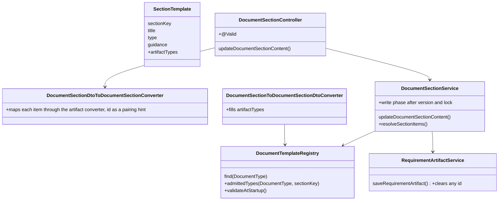
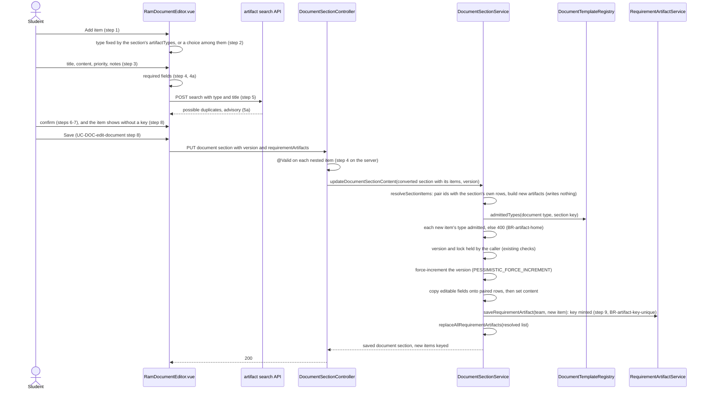

# Requirement Artifacts (ART) Design

> Realizes: UC-ART-create-artifact
> Depends on: BR-artifact-home, BR-artifact-key-unique, BR-edit-lock-required, BR-team-scoped-access, DI-artifact-key-assignment, OI-21 and OI-22 (template and type changes, the part listed under Data model), OI-46 (request-body ids)
> See: [use cases](../requirements/use-cases.md#requirement-artifacts), [Business Domain Model](../requirements/software-requirements-specification.md#business-domain-model) (the artifact type → authoring home table), [architectural-design.md](architectural-design.md#domain--aggregate-model) (Domain & aggregate model, Authorization), [doc.md](doc.md) (the DOC area, which owns the document-section editor)
> History: designed through `/design` on 2026-11-16. Saving new items in a list-type document section and minting their keys was already built; where this doc describes that code, it records the design as built.

## Scope

This doc is the ART area's design-of-record. It covers creating a requirement artifact in a list-type document section: which types a document section admits, validating a new item, the advisory duplicate warning, and minting the artifact key when the document section is saved. It also covers the template and type changes that give every artifact type in the SRS's homes table a list to be created in.

Not covered here, each to be designed on its own:
- **Removing an item** (it deletes the artifact, UC-DOC-edit-document 9a) and the logical delete behind it belong to UC-ART-delete-artifact. Until that ships, a removed item is unlinked from its document section, not deleted (OI-23).
- **The lock precondition on the standalone artifact edit and delete endpoints** (UC-ART-edit-artifact and UC-ART-delete-artifact PRE-4).
- **The editor's leave prompt and lock-expiry handling** (UC-DOC-edit-document 6a and 9b), including the editor reloading the document section on every 409.
- **The standalone `POST /teams/{teamId}/requirement-artifacts`** and its converter's handling of `sourceSectionId` stay as they are; they belong to OI-46.

## Overview

A new requirement artifact is never sent on its own. UC-ART-create-artifact runs inside UC-DOC-edit-document, so the student adds the item in the editor's list, and it reaches the server in the next save of the whole document section (`PUT …/document-sections/{id}`). The save pairs each submitted item by id with the document section's own rows only, updates the paired ones, and stores the rest as new artifacts with freshly minted keys. It runs in the two phases the use case save uses for its conditions (`UseCaseService.resolveConditions`, then `saveNewConditions`): first resolve and check every item while writing nothing, including the one new check that a new item's type is one the document section admits (BR-artifact-home); then check the version and the lock, then write.

A document section's admitted types come from its template. Each LIST section in the YAML templates declares `artifactTypes`, the types the SRS's homes table assigns to it. The server reads them at save time, and the document section's GET returns them so the editor can offer only those types.

## Components & classes

`+` marks what this design adds to an existing class; `mergeSubmittedArtifacts` is replaced by `resolveSectionItems` and the write phase. Files:

- **Changed:** [`DocumentSectionService`](../../backend/src/main/java/team/projectpulse/ram/document/DocumentSectionService.java), [`DocumentSectionController`](../../backend/src/main/java/team/projectpulse/ram/document/DocumentSectionController.java) (`@Valid`), [`DocumentSectionDtoToDocumentSectionConverter`](../../backend/src/main/java/team/projectpulse/ram/document/converter/DocumentSectionDtoToDocumentSectionConverter.java) (maps the items), [`RequirementArtifactDtoToRequirementArtifactConverter`](../../backend/src/main/java/team/projectpulse/ram/requirement/converter/RequirementArtifactDtoToRequirementArtifactConverter.java) (maps the id) and [`RequirementArtifactService`](../../backend/src/main/java/team/projectpulse/ram/requirement/RequirementArtifactService.java) (`saveRequirementArtifact` clears it), [`DocumentSectionDto`](../../backend/src/main/java/team/projectpulse/ram/document/dto/DocumentSectionDto.java) (`List<@Valid RequirementArtifactDto>`, read-only `artifactTypes`), [`DocumentSectionToDocumentSectionDtoConverter`](../../backend/src/main/java/team/projectpulse/ram/document/converter/DocumentSectionToDocumentSectionDtoConverter.java), [`DocumentTemplate`](../../backend/src/main/java/team/projectpulse/ram/document/template/DocumentTemplate.java) and [`DocumentTemplateRegistry`](../../backend/src/main/java/team/projectpulse/ram/document/template/DocumentTemplateRegistry.java), [`RequirementArtifactType`](../../backend/src/main/java/team/projectpulse/ram/requirement/RequirementArtifactType.java) and [`ArtifactKeyPrefix`](../../backend/src/main/java/team/projectpulse/ram/requirement/ArtifactKeyPrefix.java), the templates [`VISION_SCOPE.yml`](../../backend/src/main/resources/requirement-document-templates/VISION_SCOPE.yml) and [`SRS.yml`](../../backend/src/main/resources/requirement-document-templates/SRS.yml).
- **New:** `BUSINESS_RULES.yml` (one LIST section), and migration `V10__list_section_homes.sql`.
- **Frontend, changed:** [`RamDocumentEditor.vue`](../../frontend/src/pages/ram/RamDocumentEditor.vue) and [`apis/ram/types.ts`](../../frontend/src/apis/ram/types.ts).
- **Reused unchanged:** the document-section lock, `RequirementArtifactService.saveRequirementArtifact`, `DocumentSection.replaceAllRequirementArtifacts`, and the artifact search (`RequirementArtifactSpecs.hasType`, `hasTitleLike`).

## Admitted types

Each LIST section declares these `artifactTypes`, one row per SRS homes-table entry. A type with two homes is admitted by both, and a section with two types lets the student choose between them (step 2).

| Template | Section key | Admits |
|---|---|---|
| Vision and Scope | `BUSINESS_OPPORTUNITY` | `BUSINESS_PROBLEM`, `BUSINESS_OPPORTUNITY` |
| Vision and Scope | `BUSINESS_OBJECTIVES` | `BUSINESS_OBJECTIVE` |
| Vision and Scope | `SUCCESS_METRICS` | `SUCCESS_METRIC` |
| Vision and Scope | `RISKS` | `RISK` |
| Vision and Scope | `ASSUMPTIONS_DEPENDENCIES` | `ASSUMPTION`, `DEPENDENCY` |
| Vision and Scope | `STAKEHOLDER_PROFILES` | `STAKEHOLDER` |
| Vision and Scope | `EXTERNAL_SYSTEMS` | `EXTERNAL_SYSTEM` |
| Vision and Scope | `MAJOR_FEATURES` | `FEATURE` |
| SRS | `OPERATING_ENVIRONMENT` | `OPERATING_ENVIRONMENT` |
| SRS | `DESIGN_CONSTRAINTS` | `CONSTRAINT` |
| SRS | `ASSUMPTIONS_DEPENDENCIES` | `ASSUMPTION`, `DEPENDENCY` |
| SRS | `NON_USE_CASE_FUNCTIONAL_REQUIREMENTS` | `FUNCTIONAL_REQUIREMENT` |
| SRS | `DATA_REQUIREMENTS` | `DATA_REQUIREMENT` |
| SRS | `USER_INTERFACES`, `SOFTWARE_INTERFACES`, `HARDWARE_INTERFACES`, `COMMUNICATION_INTERFACES` | `EXTERNAL_INTERFACE_REQUIREMENT` |
| SRS | `QUALITY_ATTRIBUTES` | `QUALITY_ATTRIBUTE` |
| Business Rules | `BUSINESS_RULES` | `BUSINESS_RULE` |

No list admits `OTHER`, `USER_STORY` (deferred), `GLOSSARY_TERM` (authored in the glossary), or `USE_CASE`, `PRECONDITION` and `POSTCONDITION` (authored in the use case editor).

## Sequence

### UC-ART-create-artifact: adding an item and saving the document section

A new item is one whose `id` names none of the document section's current rows, or that has no id. A forged id cannot reach another team's row: the id is only ever looked up among this section's own rows, never through a repository, and an id that names nothing there becomes a new artifact in the caller's team. That includes the id of one of the team's artifacts in another document section: it becomes a new copy with a new key, never a move, as an unpaired use case step becomes a new step. The same id twice in one save is refused, as `resolveConditions` refuses a repeated condition.

## API contract

All routes are under the API base URL and return the `Result` envelope. "Team member" is the existing route rule for document sections.

| Endpoint | Caller (who may) | Request | Success | Errors, by extension |
|---|---|---|---|---|
| `GET /teams/{teamId}/documents/{documentId}/document-sections/{documentSectionId}` (changed) | team member | none | The document section, now with `artifactTypes`: the admitted types, empty for a RICH_TEXT section | unchanged |
| `PUT /teams/{teamId}/documents/{documentId}/document-sections/{documentSectionId}` (changed) | team member holding the document section's lock (a student on the team, or an instructor of its course section, as today) | `version`, `content`, and `requirementArtifacts` in display order: an existing item sends its `id` with its editable fields (the editor already does); a new item sends `type`, `title`, `content`, `priority`, `notes` and no id. `sourceSectionId` is no longer sent | The stored document section, new items with their keys, and the new `version` | 400 with field errors keyed by item position, for example `requirementArtifacts[2].title` (4a); 400 a new item's type not admitted, naming the type and the document section's title (BR-artifact-home); 400 an item whose id repeats an earlier item's, naming its position; lock and version errors as today |
| `POST /teams/{teamId}/requirement-artifacts/search` (reused) | team member | `type` and `title` | A page of the team's artifacts of that type whose title contains the text, case-insensitive | none new |

### Item rules

The use case's Details table names the fields but leaves their rules blank, so the design fixes them:

- **Required on every item:** `type`, `title` and `content`, through the constraints `RequirementArtifactDto` carries; a title or content of only spaces counts as missing (`@NotBlank`). Every item is checked, existing ones included: the editor sends an existing item's type back with it, and it has never let an item be stored without a title or content.
- **Optional:** `priority` (one of the `Priority` values; the editor preselects `MEDIUM`) and `notes`. No length limits beyond the columns.
- **Not set here:** links are added afterwards through UC-LNK-create-link.
- **Order of checks:** item validation (`@Valid`) runs first, then the admitted-type check while the items are resolved, then the version and lock checks, the same order the use case save uses (references before version and lock). A request with several faults gets the first of these, and nothing is written until all of them pass.
- **A RICH_TEXT section ignores `requirementArtifacts`,** as it does today.

### The editor

- The type control lists the section's `artifactTypes` in template order, preselects the first, and is hidden when there is only one. An existing item's type is read-only.
- The item dialog is steps 2 to 7: it shows the details, runs the duplicate search for the chosen type when the student confirms, shows up to five matches as a non-blocking warning, and adds the item on a second confirm. Only saved artifacts are searched; other unsaved items in the same list are not.
- "Open the existing artifact" (5a2) opens it read-only in a dialog, so the student never leaves the editor with unsaved items.

## Key decisions

- **Admitted types live in the template YAML and are read at save time.** Rejected: copying them into a `document_section` column at provisioning. The templates are fixed and built in, so a copy would only add a second source that every template change has to migrate. At startup the registry refuses a LIST section with no `artifactTypes` and a RICH_TEXT section with some.
- **The check applies to new items only.** An existing item keeps its type even if the document section does not admit it, such as the `OTHER` rows the old editor created by default. Rejected: refusing the save until such items are fixed, which would block every team with old data. "The type never changes" already holds, because an existing item takes only its four editable fields.
- **The server validates the nested items with `@Valid`**, so a bad item is a 400 with field errors rather than a 500, as the use case editor does since #136. Rejected: trusting the editor's own check.
- **The section save follows the use case save's two phases.** The section converter maps each item through the requirement-artifact converter, which now maps the id as a pairing hint, as the use case converter keeps step ids; the controller passes the converted section on whole. That converter's other callers are creates, so `saveRequirementArtifact` clears the id before saving: every create inserts, and a body id can never merge over another team's row (OI-46). Those items are request data, never saved or attached: `resolveSectionItems` is their only reader. `resolveSectionItems` pairs items with the section's own rows by id, builds each new artifact fresh from the accepted fields, and checks admitted types, writing nothing. Only after the version and lock checks does the save copy the editable fields, store new items through `RequirementArtifactService.saveRequirementArtifact` (which sets the team and mints the key, as for a new condition), and hand the list to `replaceAllRequirementArtifacts`. Rejected: keeping `mergeSubmittedArtifacts`, which checks a new item after the lock and after the content is set, attaches the converter-built object itself, and mints keys by hand; pulling the items out in the controller as plain records (as `UseCaseController` builds `SubmittedCondition`), which would let the compiler stop a submitted item being saved but splits the request into two inputs; and keeping the pairing by artifact key. Both are safe, since either is looked up only among the section's own rows, but the key was chosen only because the converter still mapped it after the id mapping was removed (`dd0fa8d`); id matches the use case save, needs no editor change, and still pairs a row whose key is blank, which key pairing would silently duplicate.
- **Every accepted save increments the document section's version,** through `PESSIMISTIC_FORCE_INCREMENT` after the lock check, as `UseCaseService.updateUseCase` does. `requirementArtifacts` is the `mappedBy` side, so Hibernate does not increment the version when only the list or its rows change, and a list-only save would otherwise leave the version as it was and let the next stale save through. Rejected: relying on `@Version` alone, which covers only a change to `content`.
- **The save's item refusals raise one exception of their own,** `SectionItemRejectedException`, mapped to 400 with a message written for the student: a new item's type the document section does not admit, and an id repeated in one save. Rejected: `IllegalArgumentException`, whose message text reaches the client from many unrelated places (issue #84), and which `resolveConditions` still uses; and one class per refusal, which adds classes without changing what the client gets.
- **An artifact appears only in the document section it was created in,** even when its type has a second home (an assumption created in Vision and Scope does not appear in the SRS list). POST-3's "any other document view its type maps to" is met by the requirements graph and the artifact search, not by a second list. Rejected: showing it in both lists, which the one owning section per artifact cannot express, and which would let a save of one list unlink an item the other list holds.
- **The duplicate warning reuses the artifact search** with the item's type and title. Rejected: a dedicated duplicate-check endpoint with a similarity score, more than an advisory warning needs. The use case's "similar content" is narrowed to "same type, title contains, case-insensitive", and its Associated Information says so.
- **The template changes reach existing documents through one Flyway migration**, with each new section's guidance copied into the SQL, the same snapshot provisioning takes. Rejected: serving guidance from the registry at read time, a wider change than this needs.
- **The editor stops sending `sourceSectionId` in the document section save.** The save never needed it, since the document section comes from the URL. The converter that reads it, and the standalone create endpoint, are left alone for OI-46.

## Data model

No entity gains a column. The changes are to templates, the type enum, and the rows of documents that already exist.

- `RequirementArtifactType` gains `OPERATING_ENVIRONMENT` (key prefix `OE`, OI-22) and loses `VISION_STATEMENT` (a vision statement is narrative). `frontend/src/apis/ram/types.ts` follows.
- `V10__list_section_homes.sql`:
  - **Vision and Scope documents:** `BUSINESS_OPPORTUNITY` becomes LIST; `SUCCESS_METRICS` (LIST) is inserted after `BUSINESS_OBJECTIVES` and `EXTERNAL_SYSTEMS` (LIST) after `PRODUCT_PERSPECTIVE`, each with its lock row, shifting the later `section_index` values.
  - **SRS documents:** `OPERATING_ENVIRONMENT`, `DATA_REQUIREMENTS` and `HARDWARE_INTERFACES` become LIST; `BUSINESS_RULES` becomes RICH_TEXT, and any artifacts it held are unlinked from it.
  - **Types:** `VISION_STATEMENT` rows become `OTHER` and keep their `VS-n` keys; that type's `artifact_key_sequence` rows are deleted; both enum columns drop `VISION_STATEMENT` and add `OPERATING_ENVIRONMENT`.
  - A section that becomes LIST keeps its old `content` column untouched, so no text is lost even though a list does not show it. SRS `BUSINESS_RULES` keeps its content too. Each converted section's `guidance` is replaced with its new template text, copied once from the YAML.
  - Existing locks are untouched; only `section_index` values shift.
- **Before deploying V10,** run read-only counts as for V9: non-empty `content` in the four sections that become lists, artifacts in SRS `BUSINESS_RULES`, and `VISION_STATEMENT` rows.
- `BUSINESS_RULES.yml` is the first template for the existing `BUSINESS_RULES` document type: one LIST section, so a team can create the Business Rules document that the SRS now points to.

The rest of OI-21 (the `ARCHITECTURAL_DESIGN` document and the added and reordered SRS sections) is not part of this change.

## Tests

| Use case, flow | Level | Asserts |
|---|---|---|
| UC-ART-create-artifact, main flow | integration, `DocumentSectionControllerTest` | A new item saved in a list gets the next key for its type, keeps its position, and is found by the artifact search; the save, which changes only the list, returns a higher version, and a second save with the old version is refused with 409 |
| Step 2, a section with two types | integration | Vision and Scope `ASSUMPTIONS_DEPENDENCIES` accepts one `ASSUMPTION` and one `DEPENDENCY` in the same save |
| BR-artifact-home, type not admitted | integration | A new `RISK` in `BUSINESS_OBJECTIVES` is refused with 400 naming the type; nothing is stored and the version is unchanged |
| Extension 4a | integration | A new item with an empty title, an empty content or no type is refused with 400 and field errors, not 500 |
| Existing item of a type not admitted | integration | A save that keeps a legacy `OTHER` item succeeds, and its type and key are unchanged |
| Extension 5a | integration, `RequirementArtifactControllerTest` | A search with a type and part of an existing title, in a different letter case, returns that artifact |
| Cross-team | integration | A non-member is refused with 403; another team's artifact id sent through the caller's own URL becomes a new row in the caller's team, and the other team's row is untouched |
| Repeated id | integration | Two items with the same id in one save are refused with 400 naming the second position; nothing is written |
| Admitted types in the GET | integration | A LIST section returns its `artifactTypes`; a RICH_TEXT section returns none |
| Templates match the homes table | unit | Every LIST section's `artifactTypes` equals the table in [Admitted types](#admitted-types), and every RICH_TEXT section has none |
| Registry startup check | unit | A LIST section with no types, or a RICH_TEXT section with some, is refused |
| V10 | staging, recorded in the PR | Read-only queries before and after the staging deploy (Flyway runs at startup there; tests use `ddl-auto: create` and never run migrations): the new sections exist in order with unlocked lock rows, the four sections are LIST, SRS `BUSINESS_RULES` is RICH_TEXT, no `VISION_STATEMENT` row remains |
| Instructor | integration | An instructor of the team's course section holding the lock can add an item; an instructor of another course section is refused with 403 |
| Validation order | integration | A request with an invalid item and a stale version gets the 400 for the item; a request with a non-admitted new item and a stale version gets the 400 for the type; neither writes anything |
| Editor | manual, recorded in the PR | The type control offers only the admitted types and hides when there is one; an existing item's type is read-only; the duplicate warning shows matches and does not block |

## Open questions / risks

- **Seed data must follow.** `DataInitializer` writes through repositories, so nothing refuses a seeded artifact in a list that does not admit its type. The integration tests run on that seed, so `/implement` brings it in line with the admitted types as part of this change, not later.
- **PRE-3 (document not locked for review)** is not checked, because review is not built yet; the other editing use cases are in the same state.
- **Stranded business rules.** If the count before V10 finds artifacts in SRS `BUSINESS_RULES`, unlinking leaves them in the graph and findable, but in no list until the team creates the Business Rules document and adds them again. Acceptable only if the count is zero or tiny.
- **Size.** `/implement` can build this in two slices: the admitted types, validation and duplicate warning first; then the template changes and V10.
