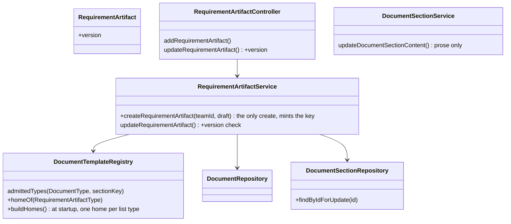
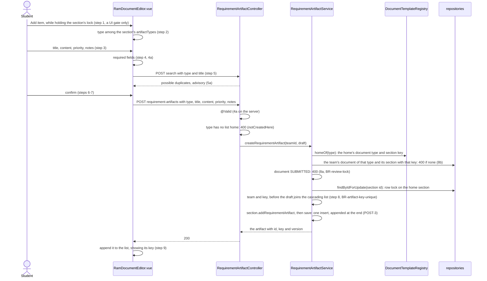

# Requirement Artifacts (ART) Design

> Realizes: UC-ART-create-artifact
> Depends on: BR-artifact-home, BR-artifact-key-unique, BR-edit-lock-required, BR-review-lock, BR-team-scoped-access, DI-concurrency-control, DI-artifact-key-assignment, OI-46 (no ids from the request body)
> See: [use cases](../requirements/use-cases.md#requirement-artifacts), [Business Domain Model](../requirements/software-requirements-specification.md#business-domain-model) (the artifact type → authoring home table), [architectural-design.md](architectural-design.md#domain--aggregate-model) (Domain & aggregate model, Transactions & consistency, Authorization), [doc.md](doc.md) (the DOC area, which owns the document section editor)
> History: first designed 2026-11-16 with new items saved inside the document section save. Revised 2026-11-17 after the spec made requirement artifacts first-class (OI-23): an artifact is created on its own, stored at once, and guarded by versioning instead of the document section's lock.

## Scope

This doc is the ART area's design-of-record. It covers creating a requirement artifact from any authoring surface, resolving its home document section from its type, and the cutover the new model needs in the document section editor: items are created and edited through the artifact endpoints, and the document section save stores prose only.

Not covered here, each to be designed on its own:
- **Removing an item** belongs to UC-ART-delete-artifact (logical delete, refused while referenced). Until it is designed, the document section view hides its Remove button, because today's `DELETE` hard-deletes and cascades links away, against BR-deletion-integrity.
- **Reordering items** (UC-DOC-edit-document 6b) and the order version it needs. Until then the order is creation order.
- **The artifact catalog page** belongs to UC-ART-find-artifacts. The create endpoint already serves it.

## Overview

There is one create endpoint, `POST /teams/{teamId}/requirement-artifacts`, for every surface. The request names the artifact type, and the type alone names the home: every type has exactly one. The section view offers only its own section's types, so the artifact lands in the list the student is looking at. The server resolves the home: the template registry maps the type to one (document type, section key) pair, and the team's document of that type holds the section with that key. No document or section id travels in the body.

The service locks the home document section's row, mints the key, appends the artifact to the section's list (which sets its home), and saves it, so the row is inserted once with its key and home and `artifact_index` is written at the end. The key is minted first because minting runs a query, which may flush pending changes, and the draft must not be in the cascading list by then. It does not check the document section's lock: the section view offers Add and Edit only to the lock holder, as a UI gate (UC-DOC-edit-document, BR-edit-lock-required).

## Components & classes

`+` marks what this design adds. Files:

- **Changed:** [`RequirementArtifact`](../../backend/src/main/java/team/projectpulse/ram/requirement/RequirementArtifact.java) (`@Version`), [`RequirementArtifactDto`](../../backend/src/main/java/team/projectpulse/ram/requirement/dto/RequirementArtifactDto.java) (adds `homeDocumentType`, response only, and `version`; drops `sourceSectionId`), [`RequirementArtifactDtoToRequirementArtifactConverter`](../../backend/src/main/java/team/projectpulse/ram/requirement/converter/RequirementArtifactDtoToRequirementArtifactConverter.java) (no section lookup), [`RequirementArtifactService`](../../backend/src/main/java/team/projectpulse/ram/requirement/RequirementArtifactService.java), [`RequirementArtifactController`](../../backend/src/main/java/team/projectpulse/ram/requirement/RequirementArtifactController.java), [`DocumentSectionRepository`](../../backend/src/main/java/team/projectpulse/ram/document/DocumentSectionRepository.java), [`DocumentTemplateRegistry`](../../backend/src/main/java/team/projectpulse/ram/document/template/DocumentTemplateRegistry.java), [`DocumentSectionService`](../../backend/src/main/java/team/projectpulse/ram/document/DocumentSectionService.java), [`DocumentSectionDto`](../../backend/src/main/java/team/projectpulse/ram/document/dto/DocumentSectionDto.java) (`requirementArtifacts` read-only), [`RequirementArtifactType`](../../backend/src/main/java/team/projectpulse/ram/requirement/RequirementArtifactType.java) (`hasListHome()`, the four interface types, the two business-level types, no `OTHER`) and [`ArtifactKeyPrefix`](../../backend/src/main/java/team/projectpulse/ram/requirement/ArtifactKeyPrefix.java), [`SRS.yml`](../../backend/src/main/resources/requirement-document-templates/SRS.yml), [`VISION_SCOPE.yml`](../../backend/src/main/resources/requirement-document-templates/VISION_SCOPE.yml).
- **Removed:** `resolveSectionItems`, `applySectionItems` and `ResolvedItem` from the document section save, and `DocumentSection.replaceAllRequirementArtifacts`, which has no caller left. `SectionItemRejectedException` is renamed `RequirementArtifactRejectedException` (see Refusals).
- **New:** migration `V11` (see Data model).
- **Frontend, changed:** [`RamDocumentEditor.vue`](../../frontend/src/pages/ram/RamDocumentEditor.vue) (Add creates through the POST, Edit saves through the PUT with the version, Remove hidden, the section save sends prose only), [`apis/ram/index.ts`](../../frontend/src/apis/ram/index.ts) and [`apis/ram/types.ts`](../../frontend/src/apis/ram/types.ts).
- **Reused unchanged:** the artifact search (the duplicate warning), key minting (`createRequirementArtifact` is the only create method since OI-73: a type with no list home is only keyed and inserted), the 409 mapping for `OptimisticLockException` in `ExceptionHandlerAdvice`, the document section lock for the prose save, and the team route rules in `SecurityConfiguration`.

## Homes

Each list section declares the types it admits in its template (`artifactTypes`), and the registry inverts that into each type's homes. Which types belong in a list is said once, on the enum: `RequirementArtifactType.hasListHome()` is false for the five types below and true for every other. The registry and the create path both read it. Every list type has exactly one home. At startup the registry refuses a list type with no home or more than one, and a template that admits a type whose `hasListHome()` is false.

| Template | Section key | Admits |
|---|---|---|
| Vision and Scope | `BUSINESS_OPPORTUNITY` | `BUSINESS_PROBLEM`, `BUSINESS_OPPORTUNITY` |
| Vision and Scope | `BUSINESS_OBJECTIVES` | `BUSINESS_OBJECTIVE` |
| Vision and Scope | `SUCCESS_METRICS` | `SUCCESS_METRIC` |
| Vision and Scope | `RISKS` | `RISK` |
| Vision and Scope | `ASSUMPTIONS_DEPENDENCIES` | `BUSINESS_ASSUMPTION`, `BUSINESS_DEPENDENCY` |
| Vision and Scope | `STAKEHOLDER_PROFILES` | `STAKEHOLDER` |
| Vision and Scope | `EXTERNAL_SYSTEMS` | `EXTERNAL_SYSTEM` |
| Vision and Scope | `MAJOR_FEATURES` | `FEATURE` |
| SRS | `OPERATING_ENVIRONMENT` | `OPERATING_ENVIRONMENT` |
| SRS | `DESIGN_CONSTRAINTS` | `CONSTRAINT` |
| SRS | `ASSUMPTIONS_DEPENDENCIES` | `ASSUMPTION`, `DEPENDENCY` |
| SRS | `NON_USE_CASE_FUNCTIONAL_REQUIREMENTS` | `FUNCTIONAL_REQUIREMENT` |
| SRS | `DATA_REQUIREMENTS` | `DATA_REQUIREMENT` |
| SRS | `USER_INTERFACES` | `USER_INTERFACE` |
| SRS | `SOFTWARE_INTERFACES` | `SOFTWARE_INTERFACE` |
| SRS | `HARDWARE_INTERFACES` | `HARDWARE_INTERFACE` |
| SRS | `COMMUNICATION_INTERFACES` | `COMMUNICATIONS_INTERFACE` |
| SRS | `QUALITY_ATTRIBUTES` | `QUALITY_ATTRIBUTE` |
| Business Rules | `BUSINESS_RULES` | `BUSINESS_RULE` |

`GLOSSARY_TERM`, `USE_CASE`, `PRECONDITION` and `POSTCONDITION` have no list home and are created through their own use cases; `USER_STORY` is deferred. The create endpoint refuses all five.

## Sequence

### UC-ART-create-artifact: creating an artifact in its home

Editing an item from the section view uses `PUT …/requirement-artifacts/{id}` with the item's `version`. A stale version is refused with 409 (UC-ART-edit-artifact 10a), and the editor reloads the item.

## API contract

All routes are under the API base URL and return the `Result` envelope. "Team member" is the existing route rule for requirement artifacts and document sections.

| Endpoint | Caller (who may) | Request | Success | Errors, by extension |
|---|---|---|---|---|
| `POST /teams/{teamId}/requirement-artifacts` (changed) | team member | `type`, `title`, `content`, `priority`, `notes`. Any `id`, `artifactKey`, `version` or `homeDocumentType` in the body is ignored: the type alone names the home | the artifact with its `id`, `artifactKey`, `version` and `homeDocumentType` | 400 field errors (4a); 400 "The request is malformed." for an unknown `type` value (the existing handler); 400 with a message (see Refusals) for a type with no list home, a home document not created (8b), or a home document locked for review (8a) |
| `PUT /teams/{teamId}/requirement-artifacts/{requirementArtifactId}` (changed) | team member | `version` (required) and the editable fields `title`, `content`, `priority`, `notes`; type and home are ignored | the artifact with its new `version` | 400 no `version`; 400 field errors; 400 a type with no list home (a glossary term, use case or condition is edited through its own use case and lock); 400 home document locked for review (UC-ART-edit-artifact PRE-3); 409 stale version (10a); 404 not in the team |
| `GET …/document-sections/{documentSectionId}` (changed) | team member | none | each nested item now also carries its `version`, which the editor sends back on the PUT | unchanged |
| `PUT /teams/{teamId}/documents/{documentId}/document-sections/{documentSectionId}` (changed) | team member holding the document section's lock | `version` and `content`; `requirementArtifacts` is no longer read | the stored document section | the existing lock and version errors |
| `POST /teams/{teamId}/requirement-artifacts/search` (reused) | team member | criteria `type` and `title`, page `size=5` | the team's artifacts of that type whose title contains the text (SQL `LIKE`, case-insensitive through the column's MySQL collation) | none new |

A caller who belongs to the team but whose team has no home document gets the 8b 400, not a 404: the team exists and the student needs the message.

### Refusals

One exception, `RequirementArtifactRejectedException` (the renamed `SectionItemRejectedException`, mapped as it is today: HTTP 400, `StatusCode.INVALID_ARGUMENT`, the message shown to the student). The editor shows the message; it does not branch on the cause. Messages, with the document's title filled in:

| Cause | Message |
|---|---|
| Type with no list home | "A {type label} is not created here: glossary terms are created in the glossary, and use cases and their conditions in the use case editor." |
| 8b | "The team's {home title} has not been created yet. The course admin creates the team's documents." |
| 8a | "The {home title} is locked for review, so it cannot be changed." |
| Home document predates its list (a document created from an older template, staging only) | "The team's {home title} was created from an older template and has no list for {a type label}." |
| PUT with no `version` | "The requirement artifact's version is required to save a change." |
| PUT on a type with no list home | "{A type label} is not edited here: glossary terms are edited in the glossary, and use cases and their conditions in the use case editor." |

### Item rules

- **Required:** `type`, `title` and `content` (`@NotBlank`, so only spaces counts as missing). `title` is at most 255 characters, the column's size (`@Size`). **Optional:** `priority` (one of the `Priority` values; the editor preselects `MEDIUM`) and `notes`. Links are added afterwards through UC-LNK-create-link. The use case's Details table leaves these rules blank, so this design fixes them.
- **Order of checks:** field validation, then the home (type, document, review lock), then the row lock and the write. Nothing is written until every check passes.
- **The editor's dialog is steps 2 to 7.** Pressing Add in it confirms (steps 6 and 7). It first runs the duplicate search for the chosen type and title; with no match the artifact is created on that one confirm, and with matches they are shown as a non-blocking warning and a second press creates it anyway (5a2). Changing the type or the title runs the search again. "Open the existing artifact" opens it read-only in a dialog.
- **A stale edit (10a):** on a 409 the editor GETs the artifact, puts its current details in the dialog with a warning that a teammate changed it, and the student reapplies what she still needs.
- **The editor's list mirrors the server.** `draftArtifacts` no longer holds unsaved items: a create appends the returned artifact, an edit replaces the item with the returned one, and loading the section refreshes it. Only the prose is a draft, so UC-DOC-edit-document's leave prompt (6a), when it is built, tracks unsaved prose only.

## Key decisions

- **One create endpoint, the home resolved from the type alone.** Every type has exactly one home, so the request names neither a document nor a section. Rejected: letting an assumption or dependency live in either document, which made the request name a document, added two refusals, and needed a move between homes; the business-level kinds became their own types instead (decided 2026-11-18). Also rejected: a nested `POST …/document-sections/{id}/requirement-artifacts`, which needs a second route for the catalog and puts a section id in the request (OI-46).
- **Append under a row lock on the home document section.** Two concurrent creates would otherwise both read the same item count and write the same `artifact_index`. `DocumentSectionRepository.findByIdForUpdate` carries `@Lock(PESSIMISTIC_WRITE)` on a one-table `@Query`, as `ArtifactKeySequenceRepository.findForUpdate` does. The service finds the home with a plain team-scoped lookup, then locks it by id, because a lock taken through a join would also lock the document and team rows. The item list is touched only after the lock: the lookup must not initialize `requirementArtifacts` (no fetch join, no access to the list), or the list would be read before the lock and the race would return. **The create runs at `READ COMMITTED`** (`@Transactional(isolation = READ_COMMITTED)` on `createRequirementArtifact`): under MySQL's default `REPEATABLE READ`, the first plain read fixes the transaction's snapshot, so the list loaded after the lock could miss a create committed while this one waited. At `READ COMMITTED` every read sees the latest commit, so the list includes every create that held the lock before. `@OrderColumn` then writes the new item's index from its position in that list, not from a count. Locks are always taken in the order section, then key sequence, and no other path locks a section, so no deadlock cycle exists. Rejected: force-incrementing the section's version, which would make the lock holder's next prose save fail after any teammate's create; and an order-version column, which only reorder needs and which turns a harmless append into a 409 the student must retry.
- **A create does not change the document section's version.** A requirement artifact is its own aggregate (it carries its own `@Version`), so a create is a save of the artifact, not of the document section, and the architecture's rule that the version changes on every accepted save that changes the aggregate applies to the artifact. `DocumentSection.requirementArtifacts` is the `mappedBy` side, and Hibernate does not increment the owner's version for a change to an inverse collection; the old section save had to force the increment for exactly this reason. So nothing needs to opt out, and the "Lock holder undisturbed" test pins it.
- **Locked for review means `SUBMITTED`** (and `ACCEPTED`, once the review use cases add it), per BR-review-lock; `DRAFT` and `RETURNED` are open. Both the create and the PUT check it, on the artifact's home document.
- **The document section lock is a UI gate for items, not a server check,** as BR-edit-lock-required specifies. Rejected: also checking the lock on the artifact endpoints, which would block the catalog and the future graph view.
- **The document section save stores prose only, and the whole-list replace is deleted.** Rejected: keeping the list in the save for its order, which would unlink an artifact created elsewhere by a stale editor.
- **Remove is hidden in the section view** until UC-ART-delete-artifact is designed. Rejected: wiring it to today's `DELETE`, which hard-deletes and cascades links away. No requirement artifact exists in production, so nothing is lost meanwhile.
- **`RequirementArtifact` carries `@Version`, and the PUT compares it with the request** before writing, as the document section save compares its own. Rejected: relying on the merge alone, which has no client version to compare.
- **The interface split and the removal of `OTHER` ship with this design,** because the registry's homes must be unique per type.

## Data model

The home stays `requirement_artifact.source_document_section_id`, nullable at the column because glossary terms, use cases and conditions have none. "Every list type has a home" is enforced by the create path, not the schema. Migration `V11`:

- adds `requirement_artifact.version` (`INT NOT NULL DEFAULT 0`);
- changes the `type` enum on `requirement_artifact` and `artifact_key_sequence`: drops `EXTERNAL_INTERFACE_REQUIREMENT` and `OTHER`, adds `USER_INTERFACE`, `SOFTWARE_INTERFACE`, `HARDWARE_INTERFACE`, `COMMUNICATIONS_INTERFACE`, `BUSINESS_ASSUMPTION` and `BUSINESS_DEPENDENCY`. It converts no row.
- **Before deploying V11,** confirm on staging and production that no row holds a dropped type; production holds no requirement artifacts.

`ArtifactKeyPrefix` maps the four interface types to `UI`, `SI`, `HI` and `CI`; `ASSUMPTION` and `DEPENDENCY` keep `ASM` and `DEP`, and `BUSINESS_ASSUMPTION` and `BUSINESS_DEPENDENCY` take `BAS` and `BDE`. `frontend/src/apis/ram/types.ts` follows the enum.

## Tests

| Use case, flow | Level | Asserts |
|---|---|---|
| Main flow, from a section | integration, `RequirementArtifactControllerTest` | A `RISK` lands at the end of Vision and Scope `RISKS` with the next key and version 0, and the caller holds no document section lock |
| Main flow, from the catalog | integration | A `FEATURE` lands in `MAJOR_FEATURES` |
| Assumptions and dependencies | integration | An `ASSUMPTION` lands in the SRS's `ASSUMPTIONS_DEPENDENCIES`, and a `BUSINESS_DEPENDENCY` in the Vision and Scope's, with key `BDE-1` |
| Type with no list home | integration | `GLOSSARY_TERM`, `USE_CASE`, `PRECONDITION`, `POSTCONDITION` and `USER_STORY` are each refused with 400 and the no-list-home message |
| Unknown enum value | integration | A `type` of `OTHER` gets 400 "The request is malformed." |
| Title length | integration | A 256-character title is refused with a field error |
| Home in the body ignored | integration | A `RISK` sent with `homeDocumentType` `SRS` still lands in the Vision and Scope's `RISKS` |
| Extension 4a | integration | A blank title, a blank content or no type is refused with 400 and field errors |
| Extension 5a | integration | A search by type and part of an existing title, in another letter case, returns that artifact |
| Extension 8a | integration | A home document whose status is `SUBMITTED` refuses the create with 400; nothing is stored |
| Extension 8b | integration | For a team with no SRS, a `FUNCTIONAL_REQUIREMENT` is refused with 400 naming the SRS |
| Append order and body ids | integration | Two creates in a row get positions n and n+1; an id in the body is ignored, so a new row is created and another team's row is untouched |
| Concurrent creates | not automated | Dropped as allowed: `AbstractIntegrationTest` runs each test in one rolled-back transaction, so two concurrent transactions cannot be staged there. The row lock and `READ COMMITTED` are covered by review, and "Append order" pins the sequential case |
| Lock holder undisturbed | integration | A teammate's create leaves the document section's version unchanged, and the lock holder's prose save still succeeds |
| UC-ART-edit-artifact 10a | integration | A PUT with a stale version is refused with 409; with the current one it succeeds and returns the next version; with no version it is refused with 400 |
| PUT under review | integration | A PUT on an artifact whose home document is `SUBMITTED` is refused with 400 |
| Versions in the section GET | integration | Each nested item of a list section carries its `version` |
| Prose-only section save | integration | A `requirementArtifacts` list sent in the document section PUT changes nothing in the list |
| Cross-team | integration | A non-member is refused with 403 |
| PUT on a type with no list home | integration | A glossary term, a use case and a precondition are each refused with 400 |
| Delete leaves no gap | integration | Deleting the middle item of a list leaves the others in order, reloaded from the database |
| Instructor | integration | An instructor of the team's course section can create an artifact; an instructor of another course section is refused with 403 |
| Homes | unit | Every type with `hasListHome()` has exactly one home and every other type none; the business-level kinds map to the Vision and Scope and the plain ones to the SRS; each interface type maps to its own SRS section; no template admits a type without a list home |
| V11 | integration, at startup | Flyway applies V1 to V11 on each test run's fresh database |
| Editor | manual, recorded in the PR | Add and Edit are offered only while holding the lock, Remove is hidden, a new item shows its key at once, and a stale edit reloads the item |

## Open questions / risks

- **Seed data must follow.** `DataInitializer` must hold no `OTHER` or `EXTERNAL_INTERFACE_REQUIREMENT` row; `/implement` checks.
- **The review lock (8a)** reads `RequirementDocument.status`; review itself is not built, so the test sets the status directly.
- **Whether a reorder bumps each artifact's version** is unverified. It matters to the reorder design, not to this one.
- **Reorder and its order version are deferred.** DI-concurrency-control's order version is realized by the reorder design; V11 adds no order column. The editor has no reorder controls today, so nothing needs hiding.
- **The hard-delete `DELETE` stays callable.** Hiding Remove keeps students away from it, but a direct call still hard-deletes and cascades links away, against BR-deletion-integrity. It does take the item out of its home list first, under the same row lock a create takes, so the list keeps no gap in `artifact_index` (a gap would load as a null item). No requirement artifact exists in production, and UC-ART-delete-artifact's design replaces the endpoint's behavior. That design must also close two gaps a code review found on 2026-11-18. (1) The delete takes the row lock at the default `REPEATABLE READ`, so the list it loads after the lock comes from the snapshot fixed by its first read; a create committed while it waited is missed, and the rewritten indexes leave a gap that loads as a null item. It needs `READ COMMITTED`, as the create has. (2) The delete skips both refusals the PUT has: it accepts a type with no list home (deleting a use case's artifact or a referenced condition fails on a foreign key with a 500, and a glossary term bypasses the glossary), and it deletes items of a document locked for review, against BR-review-lock.
- **The UI lock gate can be stale.** If the student's document section lock expires while the Add dialog is open, the create still succeeds, because the server does not check the lock for items. This is the specified behavior (BR-edit-lock-required); the next prose save is what the expired lock refuses.
- **Teammates' creates do not appear live.** An artifact created from the catalog shows in an open section view only when that view reloads, since real-time collaboration (UC-COL-collaborative-edit) is deferred.
- **Logical delete and the indexes.** When UC-ART-delete-artifact adds the logical delete, it decides whether a deleted item keeps its place in the list; indexes come from list position, so this design needs no change for it.
