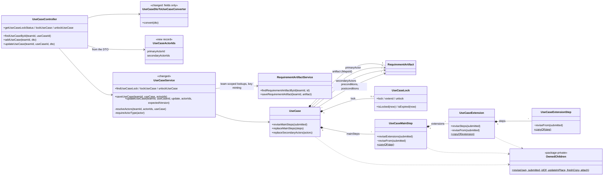
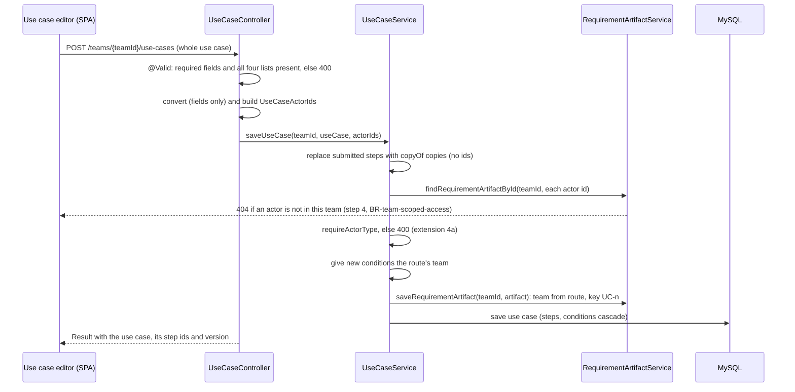
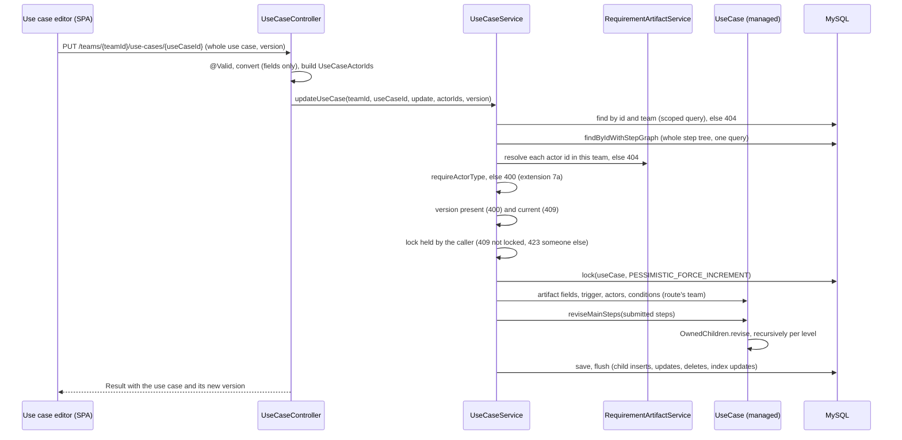
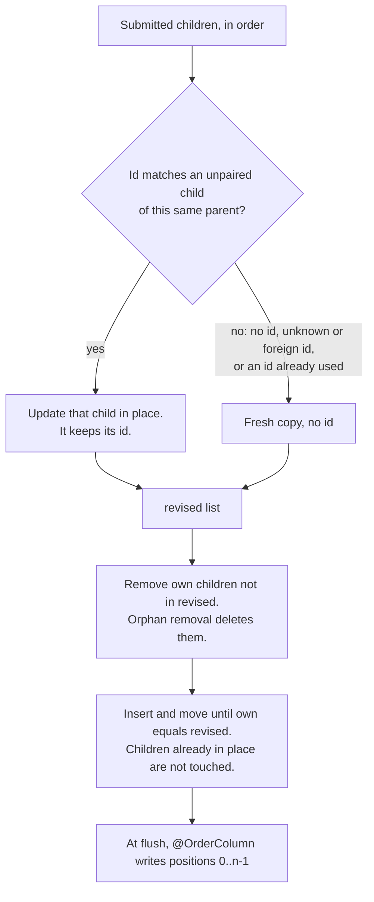
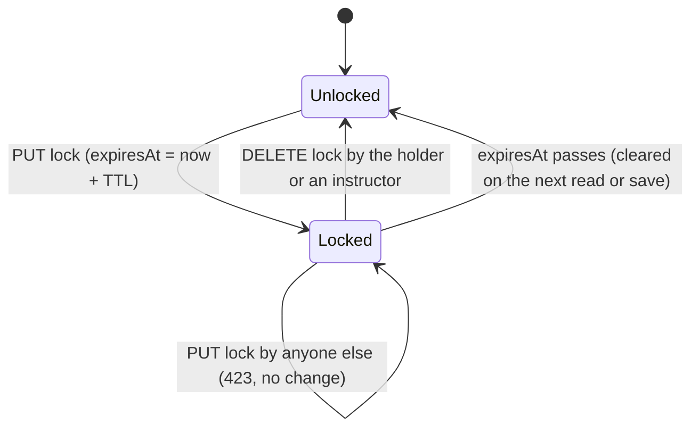

# Requirement Documents (DOC) Design

> Realizes: UC-DOC-create-use-case, UC-DOC-edit-use-case
> Depends on: BR-use-case-actor-types, BR-team-scoped-access, BR-edit-lock-required, BR-lock-expiry, OI-46 (request-body ids), OI-51 (optimistic locking)
> See: [use cases](../requirements/use-cases.md#requirement-documents), [architectural-design.md](architectural-design.md#domain--aggregate-model) (Domain & aggregate model, Transactions & consistency, Authorization)
> History: the step tree was written up after the code was built (2026-11-13). The rest of create and edit, including the actor rules, was designed through `/design` on 2026-11-14; where this doc describes code that already existed, it records the design as built.

## Scope

This doc is the DOC area's design-of-record. It covers creating and editing a use case: the stored aggregate, its actors, its ordered step tree, the use case lock, the version check, and the API the use case editor calls. Preconditions and postconditions are described as they are built today; making them shared references (BR-use-case-condition-shared, BR-shared-condition-wording) is the next design slice. The section-based documents, document-section locking and the Use Cases document were built before the design gate existed and are not written up here yet. Add them as sections of this same doc when they are next designed, rather than starting a second file.

This doc is also the **API contract of record** for these routes. The older SwaggerHub definition is not kept in step with it.

## Overview

A use case is an aggregate, and `UseCase` is its root. It holds:

- **Its artifact.** A `RequirementArtifact` of type `USE_CASE`, shared by id through `@OneToOne @MapsId`, that carries the title, description, priority, notes and artifact key (`UC-n`). This is how a use case takes part in artifact links like any other requirement artifact.
- **The trigger**, a plain field.
- **Actors.** A primary actor (`@ManyToOne`) and secondary actors (`@ManyToMany`), both references to team artifacts of type `STAKEHOLDER` or `EXTERNAL_SYSTEM` (BR-use-case-actor-types). The use case never owns or cascades to an actor.
- **Preconditions and postconditions.** `@ManyToMany` sets of `PRECONDITION` and `POSTCONDITION` artifacts. Today they cascade, and each save stores them as new rows (see Open questions).
- **The step tree.** Three levels of ordered children (main steps, their extensions, and the extensions' steps), each an inverse `@OneToMany` list with `@OrderColumn`, `cascade = ALL` and `orphanRemoval = true`.
- **The lock.** A `UseCaseLock` that says who may save the use case and until when.
- **A `@Version`**, which the editor sends back on every save.

The editor always submits the whole use case and expects the stored use case to match the submission exactly. The server takes the team only from the route and resolves every reference against it (OI-46). The DTO converter maps fields and resolves nothing.

The save does not replace the stored step tree with the submitted one. It **revises** it: every submitted child is paired, by id, with an existing child of the same parent; a paired child is updated in place, and anything unpaired is stored as a new row. One small generic class does this for all three levels, so the rule is written once.

## Components & classes

- [`UseCaseController`](../../backend/src/main/java/team/projectpulse/ram/usecase/UseCaseController.java): builds a `UseCaseActorIds` from the DTO and passes it to the service with the converted use case. It holds no logic.
- `UseCaseActorIds` (new, `ram/usecase/`): carries the actor ids from the request to the service, so the converter never produces an actor reference at all.
- [`UseCaseDtoToUseCaseConverter`](../../backend/src/main/java/team/projectpulse/ram/usecase/converter/UseCaseDtoToUseCaseConverter.java): field mapping only. It injects no repository and never reads the body's `teamId`.
- [`UseCaseService`](../../backend/src/main/java/team/projectpulse/ram/usecase/UseCaseService.java): resolves the actors (`resolveActors`, where the team-scoped load is itself the check) and checks their type (`requireActorType`); runs the version and lock checks; gives new preconditions and postconditions the route's team; calls the domain methods. It holds no step logic.
- [`OwnedChildren`](../../backend/src/main/java/team/projectpulse/ram/usecase/OwnedChildren.java): the pairing algorithm. Its comments walk one worked example ([A, B, C] becomes [C, N, A]) through every phase; read them before changing it.
- `reviseMainSteps`, `reviseExtensions`, `reviseSteps`: each passes its own list and its own level's `reviseFrom`, `copyOf` and back-reference setter to `OwnedChildren`.
- `reviseFrom`: copies a submitted child's fields onto the paired managed child, then revises that child's own list. Package-private, because only the level above calls it.
- `copyOf`: a deep copy without any id, at every level. Used for unpaired children and for every child on create.
- [`UseCaseLock`](../../backend/src/main/java/team/projectpulse/ram/usecase/UseCaseLock.java): its own entity and its own `@Version`, created on first use by `initLockIfMissing`.
- [`RequirementArtifactType`](../../backend/src/main/java/team/projectpulse/ram/requirement/RequirementArtifactType.java) gains `EXTERNAL_SYSTEM`, and [`ArtifactKeyPrefix`](../../backend/src/main/java/team/projectpulse/ram/requirement/ArtifactKeyPrefix.java) maps it to `SYS`.
- Frontend: [`RamUseCases.vue`](../../frontend/src/pages/ram/RamUseCases.vue) offers only stakeholders and external systems in the actor pickers, and [`types.ts`](../../frontend/src/apis/ram/types.ts) lists `EXTERNAL_SYSTEM`, so a student can create one in any LIST document section, as stakeholders are created today.

## Sequence

### UC-DOC-create-use-case: saving a new use case

Every step, extension and extension step is saved as a new row whatever ids the body carried.

### UC-DOC-edit-use-case: saving the edited use case

The checks run in this order: route rule, body validation, use case in team, actors in team, actor type, version, lock. Nothing is written until all of them pass.

### Pairing, at any one level

### UC-DOC-edit-use-case: the use case lock

The TTL is `ram.lock.default-lock-ttl` (15 minutes by default). Expiry is lazy: nothing runs on a timer, and every read of the lock clears an expired one first. A save does not extend the lock; the editor extends it by sending `PUT lock` again.

## API contract

All routes are under the API base URL and return the `Result` envelope ([Architectural conventions](architectural-design.md#architectural-conventions)). "Team member" means the route rule's `TeamSecurityService.canAccessTeam`: a student on that team, or an instructor of the team's course section. A caller who fails it gets 403 before the service runs, and so does an id that names no team.

| Endpoint | Caller (who may) | Request | Success | Errors |
|---|---|---|---|---|
| `GET /teams/{teamId}/use-cases/{useCaseId}` | team member | none | The use case (fields below) | 404 use case not in this team |
| `POST /teams/{teamId}/use-cases` | team member | The use case fields below; `version` is not sent | The stored use case, with its artifact key, step ids and `version` | 400 a required field or list missing; 400 an actor not a stakeholder or external system (4a); 404 an actor not in this team |
| `PUT /teams/{teamId}/use-cases/{useCaseId}` | team member holding the use case lock | The use case fields below and its current `version`; each step, extension and extension step sends back its `id` to keep that row | The stored use case with the **new** `version`, which the next save must send | 400 a required field or list missing, or no `version`; 400 an actor not a stakeholder or external system (7a); 404 the use case or an actor not in this team; 409 stale `version`; 409 not locked by anyone; 423 locked by someone else |
| `GET /teams/{teamId}/use-cases/{useCaseId}/lock` | team member | none | The lock (fields below); an expired lock reads as unlocked | 404 use case not in this team |
| `PUT /teams/{teamId}/use-cases/{useCaseId}/lock` | team member | `reason` (optional) | The lock, held by the caller until `expiresAt`; the holder sending it again extends it | 404 use case not in this team; 423 locked by someone else (the message names the holder and the expiry) |
| `DELETE /teams/{teamId}/use-cases/{useCaseId}/lock` | the lock holder, or any instructor who passes the route rule | none | No data | 403 the caller is a student who does not hold the lock (including when no one does); 404 use case not in this team |

The editor lists a team's use cases through the requirement artifact search, `POST /teams/{teamId}/requirement-artifacts/search` with `type` `USE_CASE`, which the ART area owns.

**Use case fields (request and response).**

- `title`, `description`, `trigger`: required, not empty.
- `primaryActorId`: required; a stakeholder or external system of this team.
- `secondaryActorIds`: required, may be empty; each a stakeholder or external system of this team. The ids form a set: a repeated id is stored once, the order is not kept, and the primary actor may also appear here.
- `preconditions`, `postconditions`: required, may be empty; each entry has `condition` (required), `type`, `priority` and `notes`. An entry's `id` is ignored. The shape changes in the conditions slice.
- `mainSteps`: required, may be empty, in order; each has `id`, `actor`, `actionText` and `extensions` (in order). A step's `actor` is free text, not an artifact reference, so BR-use-case-actor-types does not apply to it. Each extension has `id`, `conditionText`, `kind`, `exit` and `steps` (in order), and each extension step has `id`, `actor` and `actionText`.
- `priority`, `notes`: optional.
- `teamId`: required by validation for compatibility, and **ignored**: the team is always the route's.
- `version`: required on PUT, ignored on POST.
- Response only (ignored in a request): `id`, `artifactKey`, `createdAt`, `updatedAt`, `createdBy`, `updatedBy`, `lock`.

**Actor error messages.** Actors are checked primary first, then each secondary actor, and the first failure is reported. An actor outside the team gives `ObjectNotFoundException("requirement artifact", id)`, the same text the artifact routes give for an id that names nothing. An actor of the wrong type gives a 400 naming the field and the id, for example "Secondary actor 12 must be a stakeholder or an external system.", which is the location extensions 4a1 and 7a1 ask for. The two 409s on PUT differ only in their message: a stale version means reload, and "not locked" means take the lock again.

**Lock fields (response).** `locked`, `useCaseId`, `lockedBy`, `lockedAt`, `expiresAt`, `reason`.

## Key decisions

| Decision | Chosen | Rejected, and why |
|---|---|---|
| How a save sends the use case | The whole use case on every PUT, guarded by one version | Per-field or per-step PATCH routes: the ordered step tree would need insert, move and delete operations of its own, and each would need its own concurrency guard |
| How actor ids reach the service | A `UseCaseActorIds` parameter beside the converted use case | Placeholder artifacts carrying only an id, swapped by the service: fails open, because a path that skipped the swap would let Hibernate link whatever id it carried, from any team |
| What checks that an actor is in the team | The team-scoped load is the check, in one pass | Loading in the converter and re-checking in the service: two lookups, two error messages, and the converter's message showed which ids exist in other teams |
| Order of the actor refusals | Team scope first (404), then type (400) | Type first: a 400 against a 404 would reveal the type of another team's artifact |
| Which artifacts can be actors | `STAKEHOLDER` and `EXTERNAL_SYSTEM` only (BR-use-case-actor-types) | Also `EXTERNAL_INTERFACE_REQUIREMENT`, which the editor used to offer for systems such as an email service: an interface requirement describes an interface, not a participant |
| A list missing from the body | 400 by `@NotNull` | Treating it as empty: on a PUT that would silently remove every secondary actor, condition or step |
| The body's `teamId` | Kept in the DTO and ignored by the server | Removing it: reaches into the frontend for no behavior change; it can go when the DTO is next reshaped |
| Where new conditions get their team | The service sets the route's team | The converter: it has no route variables, which is why it must not resolve anything (OI-46) |
| Key prefix for external systems | `SYS` | `EXT`: reads as "extension" inside a use case |
| How the order of steps is stored | Keep `@OrderColumn` on the inverse lists; Hibernate writes and renumbers the position column | `@OrderBy` on a position field: the lists become bags, and the nested fetch joins (`findByIdWithStepGraph`) then fail with `MultipleBagFetchException`. Hibernate's boot warning HHH160246 about this mapping is accepted; the 7.4 User Guide (Mapping Lists) says the order column must be applied explicitly on the inverse side. |
| Direction of the step associations | Bidirectional (`mappedBy` plus a back-reference on each child) | Unidirectional `@OneToMany` with `@JoinColumn`: workable, but it changes the mapping of all three levels and gains nothing for this flow. |
| How a submitted child finds its stored row | By id, among **this parent's own children only** | By position: inserting one step would rewrite the text of every step after it and lose their ids. Global lookup by id: a request-body id must never select a row outside the parent named by the route (OI-46). |
| An id the parent does not own (stale, foreign, or repeated) | Treated as new: stored as a fresh row | Refuse with 400: a stale id after a concurrent delete is normal editor behavior, not an attack, and refusing would lose the user's text. |
| How the stored step list is edited | Explicit remove, insert and move; never `clear()` and refill | Clear and refill: every save looks like a total rewrite, and keeping ids then depends on JPA `merge` semantics rather than on code we can read. |
| Create path for steps | Every child saved as a `copyOf`, no ids | Saving the submitted objects: a body-supplied child id would reach `save()`. |
| Fields no DTO carries (`label`, `resumeStepNo` on an extension) | Left untouched by `reviseFrom` | Copying them from the submission: it would null them on every save. |
| Version on every accepted save | `entityManager.lock(useCase, PESSIMISTIC_FORCE_INCREMENT)` after the version and lock checks | Rely on Hibernate's dirty check: it bumps the version only when a `UseCase` field or collection changes, and most edits change the artifact or child rows, so stale saves were accepted. `OPTIMISTIC_FORCE_INCREMENT`: writes just before commit, so the response carries the old version (and rolled-back tests cannot see it). |
| Version check and lock check together | Both, version first | The lock alone: a lock that expired, was taken by a teammate who saved, and was then retaken would let the first student's stale form overwrite the teammate's save |
| Where the lock lives | A separate `UseCaseLock` entity with its own version | Lock columns on `use_case`: taking or extending a lock would increment the use case's version and make the holder's own form stale |
| How a lock ends | A TTL with lazy expiry, plus release by the holder or an instructor | No TTL: a closed browser tab would hold the use case forever. A scheduled sweeper: an extra moving part for something every read can check |
| Where the step logic lives | Domain methods on the aggregate plus one generic helper | Three copies of the algorithm, one per level, or the logic in the service: it needs no repository, so it belongs in the domain. |

Two consequences worth knowing:

- The version can go up by 2 in one save, once for the forced increment and once more if a `UseCase` collection (secondary actors, conditions) is also dirty. Only "it changed" matters to the stale-save check.
- `replaceMainSteps` still exists: the DTO converters use it to build the detached submitted tree. Step ids still travel through the converters on purpose, as pairing keys.

## Data model

Two migrations, and no table or column added:

- `V7__add_external_system_artifact_type.sql` adds `EXTERNAL_SYSTEM` to the `type` enum column of `requirement_artifact` and `artifact_key_sequence`, keeping the value list alphabetical to match Hibernate's generated definition (the V4 pattern).
- `V8__rename_secondary_actor_column.sql` renames `use_case_secondary_actor.stakeholder_artifact_id` to `actor_artifact_id`, since a secondary actor may now be an external system. MySQL 8 keeps the foreign key and the composite primary key across `RENAME COLUMN`. Added during implementation, with the developer's agreement; it was not in the approved design.

The step tables and their `*_index` order columns are unchanged. The dev seed adds one team-1 external system, "Email service", as the last artifact it saves, so no seeded id shifts. For the same reason it is not attached to the seeded use case, whose save comes much earlier; tests that need it as an actor attach it themselves.

## Reuse & cross-cutting

- Authorization: the route rule (`TeamMembershipAuthorizationManager`) and the team-scoped query, as the architecture-of-record's [Authorization](architectural-design.md#authorization) requires; `RequirementArtifactService.findRequirementArtifactById` is the scoped finder for actors.
- Use case locking (BR-edit-lock-required, BR-lock-expiry): the save is refused unless the caller holds the lock.
- Optimistic locking (OI-51): `UseCase` is the aggregate root, so its `@Version` covers all three child levels.
- Artifact keys: `RequirementArtifactService.saveRequirementArtifact` mints the use case's key, as it does for every artifact.
- Error mapping: `ExceptionHandlerAdvice` already maps `MethodArgumentNotValidException` and `IllegalArgumentException` to 400, `ObjectNotFoundException` to 404, the two lock exceptions to 409 and 423, and `OptimisticLockException` to 409.
- The same pairing rule (ids only select among the parent's own children) is used by `DocumentSectionService.mergeSubmittedArtifacts` for a document section's requirement artifacts.

## Tests

| Use case, flow | Level | Asserts |
|---|---|---|
| UC-DOC-create-use-case, main flow | integration, `UseCaseControllerTest` | A stakeholder primary actor and an external-system secondary actor are stored; the response shows both |
| UC-DOC-create-use-case, extension 4a (primary) | integration, `UseCaseControllerTest` | A primary actor of another type in the caller's own team (for example a feature) is refused with 400; no use case is stored |
| UC-DOC-create-use-case, extension 4a (secondary) | integration, `UseCaseControllerTest` | One secondary actor of the wrong type is refused with 400, and the message names `Secondary actor` and its id |
| UC-DOC-edit-use-case, extension 7a | integration, `UseCaseControllerTest` | The same two refusals on PUT; the stored actors and version are unchanged |
| Actor from another team (create and edit) | integration, `UseCaseControllerTest` | Refused with 404, with the same message as an id that names nothing |
| Missing fields (create and edit) | integration, `UseCaseControllerTest` | Each of `primaryActorId`, `secondaryActorIds`, `preconditions`, `postconditions` and `mainSteps` omitted gives 400, not 500 |
| Body `teamId` is ignored (OI-46) | integration, `RequestBodyIdIntegrationTest` | With another team's id in the body, every stored condition belongs to the route's team and the other team gains no rows. Written first and run against the unchanged code |
| External system key | unit, `ArtifactKeyPrefixTest`; integration | `ArtifactKeyPrefix.of(EXTERNAL_SYSTEM)` is `SYS`, and no artifact type falls back to `UNK`; the seeded external system has the key `SYS-1` (asserted in the create main-flow test) |
| Pairing rules | unit, `UseCaseStepRevisionTest` | Paired child updated in place; unpaired, foreign and repeated ids become fresh copies; omitted children removed; order follows the submission; extension ids pair only within their own step; `label` and `resumeStepNo` survive |
| How order is stored | integration, `UseCaseStepOrderingIntegrationTest` | Contiguous indexes on create, insert, remove and move; nested lists numbered per parent; the step-graph fetch has no duplicates |
| UC-DOC-edit-use-case, editing scenarios | integration, `UseCaseStepOrderingIntegrationTest` | Two saves in a row; remove an extension; edit an extension's kind and exit; insert an extension step; edit actors; remove every step |
| UC-DOC-edit-use-case, version | integration, `UseCaseStepOrderingIntegrationTest` | A text-only edit increments the stored version; a second save with the returned version succeeds |
| UC-DOC-create-use-case, ids in the body | integration, `UseCaseStepOrderingIntegrationTest` | Steps submitted with existing ids are stored as new rows |
| Request-body step ids (OI-46) | integration, `RequestBodyIdIntegrationTest` | A step id from another team's use case is stored as a new step; the other team's step is unchanged |
| Regression | existing | `UseCaseControllerTest` (including `addUseCase_NotSameTeam`) stays green |

All integration tests flush, clear, and read the database with native SQL, because the test transaction never commits.

## Open questions / risks

- Preconditions and postconditions are still saved with `clear()` and `addAll`, cascade as new rows on every save, take their `type` from the body, and lose their order in a `Set`. Making them shared, ordered references (BR-use-case-condition-shared, BR-shared-condition-wording) and cleaning up the rows already stored is the next design slice.
- `SecurityConfiguration` has route rules for `POST /teams/{teamId}/use-cases/search` and `DELETE /teams/{teamId}/use-cases/{useCaseId}`, but `UseCaseController` handles neither, so both answer 404. UC-DOC-delete-use-case will need the delete handler.
- **Gaps between the spec and the code as built, outside this slice.** The questions test on 2026-11-14 surfaced these; none is built today, and each is tracked as OI-66 to OI-71 in the order listed:
  - BR-use-case-name-unique (create 5a): nothing checks that a use case name is unique in the team, on create or on rename.
  - Edit step 12 and extension 6a: the system is meant to release the lock after a save, and to save and release when the student navigates away. The editor instead has separate Lock and Unlock buttons, and a save leaves the lock held until the TTL.
  - BR-lock-expiry says a lock expires an interval "after it is acquired", but the holder can extend it indefinitely by locking again. Either the rule should say "after it is acquired or last extended", or extending should go.
  - PRE-3 of both use cases (the document is not locked for review, BR-review-lock): not checked, because review and submission are not built yet.
  - Both use cases name only the student as the actor, but the route rule also lets an instructor of the course section create, edit and lock (BR-role-based-access). Decide whether that's intended.
  - POST-2 (authorship metadata): `updatedAt` and `updatedBy` live on the artifact and change only when an artifact field changes, so an edit to steps alone records no editor.
- The SwaggerHub definition of these routes is stale from this change on, until it is reconciled with the contract above.
- `label` and `resumeStepNo` are stored but no DTO or screen uses them.
- With `@OrderColumn`, Hibernate rewrites every child's position on any insert, remove or move. That is fine at use case size; it would matter for long lists such as comment threads.
