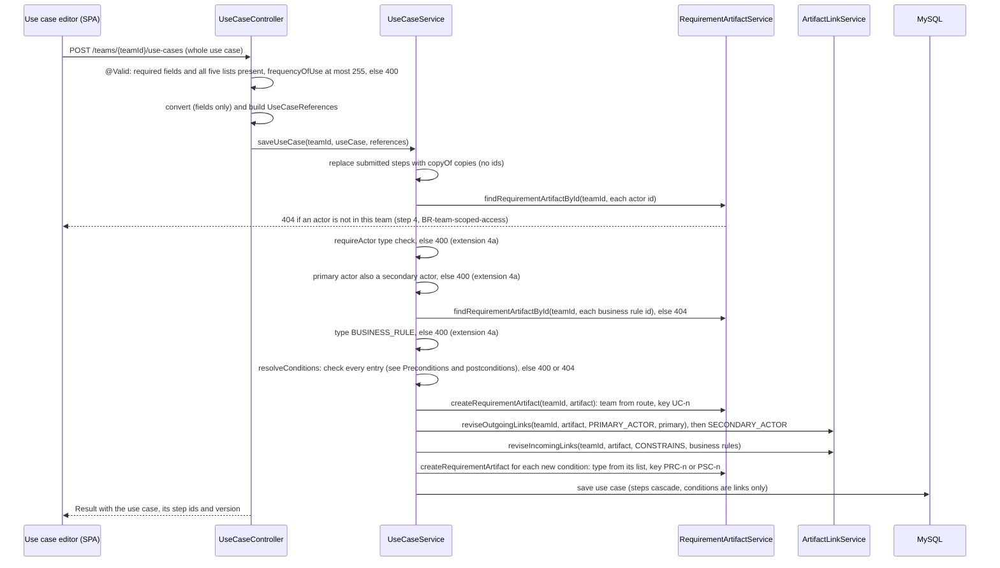
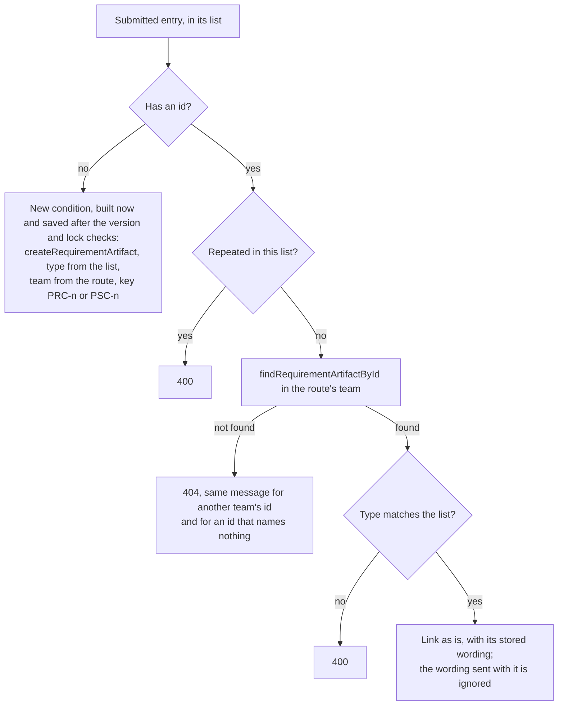
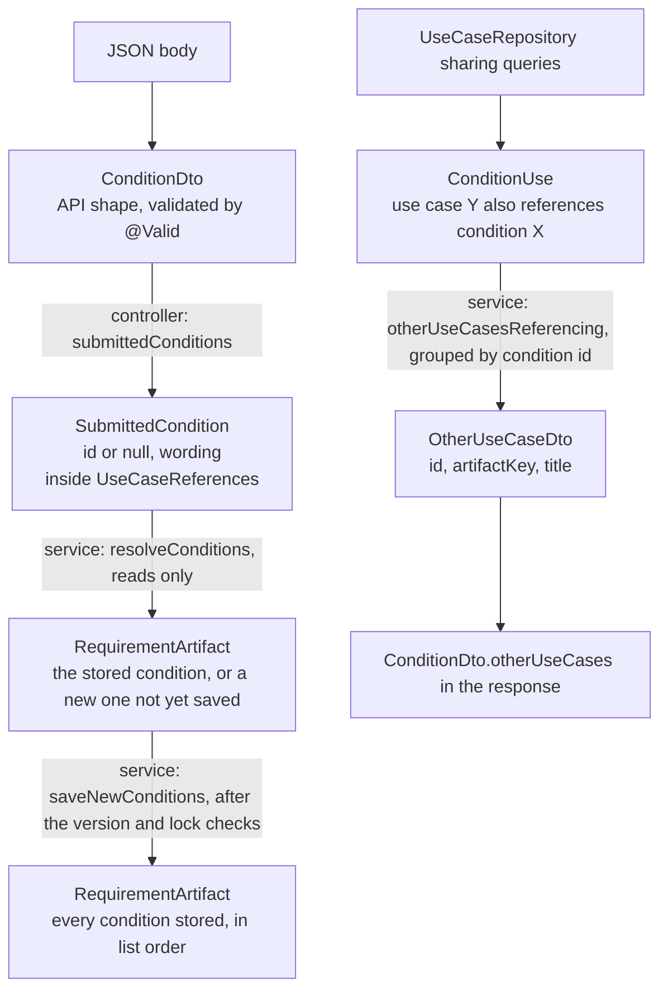
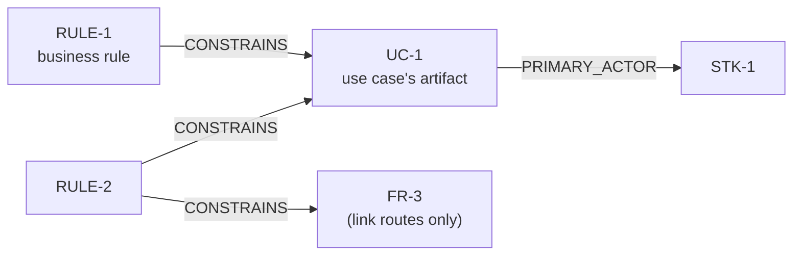
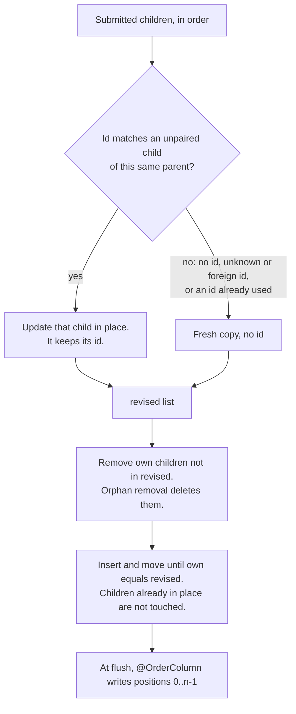
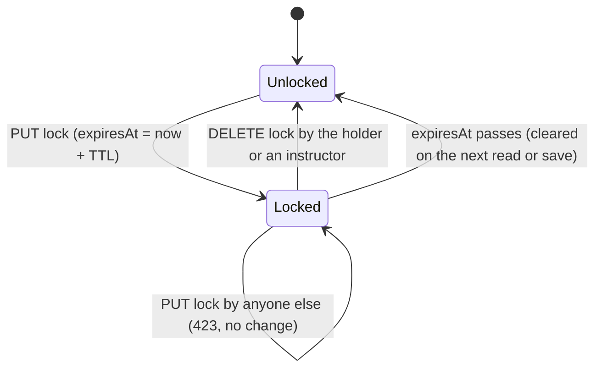
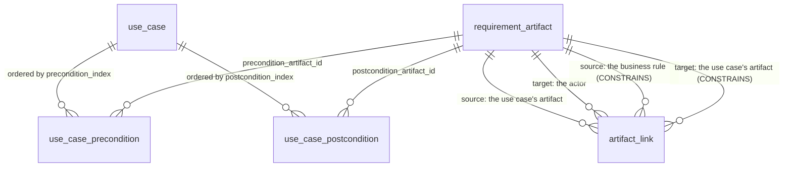

# Requirement Documents (DOC) Design

> Realizes: UC-DOC-create-use-case, UC-DOC-edit-use-case, UC-DOC-view-use-case (the template's text fields and business rules), and UC-ART-create-artifact's actor and business rule entry points (extensions 3a, 3b, 6c and 6d)
> Depends on: BR-use-case-actor-types, BR-use-case-business-rules, BR-link-constraints, BR-artifact-home, BR-review-lock, BR-deletion-integrity, MNT-feature-locality, BR-use-case-condition-shared, BR-shared-condition-wording, BR-team-scoped-access, BR-edit-lock-required, BR-lock-expiry, FR-HIS-authorship-metadata, OI-27, OI-46 (request-body ids), OI-51 (optimistic locking), OI-76, OI-77, OI-78
> See: [use cases](../requirements/use-cases.md#requirement-documents), [architectural-design.md](architectural-design.md#domain--aggregate-model) (Domain & aggregate model, Transactions & consistency, Authorization)
> History: the step tree was written up after the code was built (2026-11-13). The rest of create and edit, including the actor rules and the shared conditions, was designed through `/design` on 2026-11-14; where this doc describes code that already existed, it records the design as built. On 2026-11-15 rewording a condition through a use case was removed altogether (BR-shared-condition-wording), so a condition entry is now only linked or created; rewording a condition for every use case waits on OI-72. On 2026-11-20 the actors moved from `UseCase` fields to `PRIMARY_ACTOR` and `SECONDARY_ACTOR` artifact links (spec PR #149, built in #151). On 2026-11-21 the use case gained Frequency of Use, Associated Information, Assumptions and Open Issues, and its business rules as `CONSTRAINS` links (spec PR #155, design PR #156); built on 2026-11-21.

## Scope

This doc is the DOC area's design-of-record. It covers creating, editing and viewing a use case: the stored aggregate, its actors, its business rules, its template text fields, its shared and ordered preconditions and postconditions, its ordered step tree, the use case lock, the version check, and the API the use case editor calls. Rewording a condition for every use case ("Edit for all", extension 6b2) is not designed yet; see Open questions. The section-based documents, document-section locking and the Use Cases document were built before the design gate existed and are not written up here yet. Add them as sections of this same doc when they are next designed, rather than starting a second file.

This doc is also the **API contract of record** for these routes. The older SwaggerHub definition is not kept in step with it.

## Overview

A use case is an aggregate, and `UseCase` is its root. It holds:

- **Its artifact.** A `RequirementArtifact` of type `USE_CASE`, shared by id through `@OneToOne @MapsId`, that carries the title, description, priority, notes and artifact key (`UC-n`). This is how a use case takes part in artifact links like any other requirement artifact.
- **The trigger**, a plain field, and **the template's text fields**: `frequencyOfUse` (plain text, at most 255 characters) and `associatedInformation`, `assumptions` and `openIssues` (rich text, stored as Tiptap HTML). See [The template's text fields](#the-templates-text-fields).
- **Actors.** Not fields of `UseCase`: `PRIMARY_ACTOR` and `SECONDARY_ACTOR` artifact links from the use case's own artifact to team artifacts of type `STAKEHOLDER` or `EXTERNAL_SYSTEM` (BR-use-case-actor-types, BR-link-constraints). Exactly one primary actor, and no actor in both roles. `UseCase.primaryActor()` and `secondaryActors()` read them off the artifact's outgoing links; only `UseCaseService` writes them, through `ArtifactLinkService.reviseOutgoingLinks`. See [Actors as links](#actors-as-links). A missing actor is created from the picker through the artifact create route, never by the use case save; see [Creating an actor from the picker](#creating-an-actor-from-the-picker-3a-6c).
- **Business rules.** Not fields of `UseCase` either: `CONSTRAINS` artifact links **to** the use case's artifact from team artifacts of type `BUSINESS_RULE` (BR-use-case-business-rules, BR-link-constraints). `UseCase.businessRules()` reads them off the artifact's incoming links; only `UseCaseService` writes them, through `ArtifactLinkService.reviseIncomingLinks`. See [Business rules as links](#business-rules-as-links). A missing rule is created from the picker as an actor is; see [Creating a business rule from the picker](#creating-a-business-rule-from-the-picker-3b-6d).
- **Preconditions and postconditions.** Ordered references to team artifacts of type `PRECONDITION` and `POSTCONDITION`: a `@ManyToMany` `List` each, with an `@OrderColumn` on the join table and no cascade. A condition is shared: any number of the team's use cases may reference it, each at its own position (BR-use-case-condition-shared). See [Preconditions and postconditions](#preconditions-and-postconditions).
- **The step tree.** Three levels of ordered children (main steps, their extensions, and the extensions' steps), each an inverse `@OneToMany` list with `@OrderColumn`, `cascade = ALL` and `orphanRemoval = true`.
- **The lock.** A `UseCaseLock` that says who may save the use case and until when.
- **A `@Version`**, which the editor sends back on every save.

The editor always submits the whole use case and expects the stored use case to match the submission exactly. The server takes the team only from the route and resolves every reference against it (OI-46). The DTO converter maps fields and resolves nothing.

The save does not replace the stored step tree with the submitted one. It **revises** it: every submitted child is paired, by id, with an existing child of the same parent; a paired child is updated in place, and anything unpaired is stored as a new row. One small generic class does this for all three levels, so the rule is written once.

## Components & classes

```mermaid
classDiagram
    direction LR
    class UseCaseController {
        +findUseCaseById(teamId, useCaseId)
        +addUseCase(teamId, dto)
        +updateUseCase(teamId, useCaseId, dto)
        +getUseCaseLockStatus / lockUseCase / unlockUseCase
    }
    class UseCaseReferences {
        <<record>>
        primaryActorId
        secondaryActorIds
        businessRuleIds
        preconditions : List~SubmittedCondition~
        postconditions : List~SubmittedCondition~
    }
    class SubmittedCondition {
        <<record>>
        id
        wording
    }
    class UseCaseDtoToUseCaseConverter {
        <<changed: fields only>>
        +convert(dto)
    }
    class UseCaseService {
        <<changed>>
        +saveUseCase(teamId, useCase, references)
        +updateUseCase(teamId, useCaseId, update, references, expectedVersion)
        +otherUseCasesReferencing(useCase)
        +findUseCaseLock / lockUseCase / unlockUseCase
        -resolveActors(teamId, references) ResolvedActors
        -resolveBusinessRules(teamId, references) Set
        -requireActor(teamId, actorId, role)
        -resolveConditions(teamId, submitted, type) List
        -saveNewConditions(teamId, conditions) List
    }
    class UseCaseRepository {
        +findOtherUseCasesReferencingPreconditions(ids, useCaseId)
        +findOtherUseCasesReferencingPostconditions(ids, useCaseId)
    }
    class RequirementArtifactService {
        +findRequirementArtifactById(teamId, id)
        +createRequirementArtifact(teamId, artifact)
    }
    class ArtifactLinkService {
        +reviseOutgoingLinks(teamId, source, type, targets)
        +reviseIncomingLinks(teamId, target, type, sources)
    }
    class ArtifactLink {
        type : ArtifactLinkType
    }
    class UseCase {
        +reviseMainSteps(submitted)
        +replaceMainSteps(steps)
        +primaryActor() RequirementArtifact
        +secondaryActors() Set
        +businessRules() Set
    }
    class RequirementArtifact
    class UseCaseLock {
        +lock / extend / unlock
        +isLocked(now) / isExpired(now)
    }
    class UseCaseMainStep {
        +reviseExtensions(submitted)
        ~reviseFrom(submitted)
        +copyOf(step)$
    }
    class UseCaseExtension {
        +reviseSteps(submitted)
        ~reviseFrom(submitted)
        +copyOf(extension)$
    }
    class UseCaseExtensionStep {
        ~reviseFrom(submitted)
        +copyOf(step)$
    }
    class OwnedChildren {
        <<package-private>>
        +revise(own, submitted, idOf, updateInPlace, freshCopy, attach)$
    }
    UseCaseController --> UseCaseDtoToUseCaseConverter
    UseCaseController --> UseCaseReferences : from the DTO
    UseCaseReferences --> SubmittedCondition
    UseCaseController --> UseCaseService
    UseCaseService --> RequirementArtifactService : team-scoped lookups, key minting
    UseCaseService --> UseCase
    UseCaseService --> UseCaseRepository : which other use cases share a condition
    UseCaseService --> ArtifactLinkService : actor and business rule links
    UseCase "1" *-- "1" RequirementArtifact : artifact (MapsId)
    RequirementArtifact "1" --> "*" ArtifactLink : outgoing (PRIMARY_ACTOR, SECONDARY_ACTOR, others)
    ArtifactLink "*" --> "1" RequirementArtifact : target (the actor)
    RequirementArtifact "1" --> "*" ArtifactLink : incoming (CONSTRAINS, others)
    ArtifactLink "*" --> "1" RequirementArtifact : source (the business rule)
    UseCase "*" --> "*" RequirementArtifact : preconditions, postconditions (ordered List)
    UseCase "1" *-- "0..1" UseCaseLock : lock
    UseCase "1" *-- "*" UseCaseMainStep : mainSteps
    UseCaseMainStep "1" *-- "*" UseCaseExtension : extensions
    UseCaseExtension "1" *-- "*" UseCaseExtensionStep : steps
    UseCase ..> OwnedChildren
    UseCaseMainStep ..> OwnedChildren
    UseCaseExtension ..> OwnedChildren
```



- [`UseCaseController`](../../backend/src/main/java/team/projectpulse/ram/usecase/UseCaseController.java): builds a `UseCaseReferences` from the DTO and passes it to the service with the converted use case. It puts each use case's other-use-case lists (`otherUseCasesReferencing`) into the response. It holds no logic.
- `UseCaseReferences` and `SubmittedCondition` (`ram/usecase/`): carry every reference the request names (the actor ids, the business rule ids, and each condition as an optional id plus its wording, in order) from the request to the service, so the converter never produces a reference at all. `UseCaseReferences` replaces the `UseCaseActorIds` of the actors slice.
- [`UseCaseDtoToUseCaseConverter`](../../backend/src/main/java/team/projectpulse/ram/usecase/converter/UseCaseDtoToUseCaseConverter.java): field mapping only. It injects no repository, never reads the body's `teamId`, and maps no condition. `ConditionDtoToRequirementArtifactConverter` is deleted.
- [`UseCaseService`](../../backend/src/main/java/team/projectpulse/ram/usecase/UseCaseService.java): resolves the actors (`resolveActors` and `requireActor`, where the team-scoped load is itself the check), the business rules (`resolveBusinessRules`, the same way) and the conditions (`resolveConditions`); runs the version and lock checks; calls the domain methods. It holds no step logic. Both resolve methods only read and return what they found (a private `ResolvedActors` record, and the ordered condition list), so every check comes before every write on create and on edit alike; the actor links are written by `ArtifactLinkService.reviseOutgoingLinks`, and the new conditions saved by `saveNewConditions`, only after the checks pass.
- [`UseCaseRepository`](../../backend/src/main/java/team/projectpulse/ram/usecase/UseCaseRepository.java): two JPQL queries that return, for a set of condition ids, every other use case that references each one (condition id, use case id, artifact key, title), excluding the use case being saved. Its hydration query for the many-valued associations fetches the use case artifact's outgoing links and their targets, which is where the actors now come from, and its incoming links and their sources, which is where the business rules come from; the two actor-referrer queries the delete used are gone (OI-76).
- [`ArtifactLinkService`](../../backend/src/main/java/team/projectpulse/ram/requirement/ArtifactLinkService.java): gains `reviseOutgoingLinks(teamId, source, type, targets)` and its mirror `reviseIncomingLinks(teamId, target, type, sources)`, the only ways `usecase` writes links, so `usecase` keeps to `requirement`'s service layer (MNT-feature-locality). Both call one private helper that is told which end of a link is "this artifact" and which is "the other", so the keep, delete and add algorithm is written once. See [Actors as links](#actors-as-links) and [Business rules as links](#business-rules-as-links). [`ArtifactLinkType`](../../backend/src/main/java/team/projectpulse/ram/requirement/ArtifactLinkType.java) gains `CONSTRAINS`.
- [`OwnedChildren`](../../backend/src/main/java/team/projectpulse/ram/usecase/OwnedChildren.java): the pairing algorithm. Its comments walk one worked example ([A, B, C] becomes [C, N, A]) through every phase; read them before changing it.
- `reviseMainSteps`, `reviseExtensions`, `reviseSteps`: each passes its own list and its own level's `reviseFrom`, `copyOf` and back-reference setter to `OwnedChildren`.
- `reviseFrom`: copies a submitted child's fields onto the paired managed child, then revises that child's own list. Package-private, because only the level above calls it.
- `copyOf`: a deep copy without any id, at every level. Used for unpaired children and for every child on create.
- [`UseCaseLock`](../../backend/src/main/java/team/projectpulse/ram/usecase/UseCaseLock.java): its own entity and its own `@Version`, created on first use by `initLockIfMissing`.
- [`RequirementArtifactType`](../../backend/src/main/java/team/projectpulse/ram/requirement/RequirementArtifactType.java) gains `EXTERNAL_SYSTEM`, and [`ArtifactKeyPrefix`](../../backend/src/main/java/team/projectpulse/ram/requirement/ArtifactKeyPrefix.java) maps it to `SYS`, `PRECONDITION` to `PRC` and `POSTCONDITION` to `PSC` (they were `PRE` and `POST`).
- [`RequirementArtifactCreateDialog.vue`](../../frontend/src/components/RequirementArtifactCreateDialog.vue) (new): a create-only dialog for UC-ART-create-artifact (props `teamId`, `types`, `initialTitle`, and `excludeIds`, which the secondary picker sets to the primary actor so the duplicate warning never offers it; emits `created` and `chosen`), holding the type choice (hidden for one type), title, content, the duplicate check and its warning. The actor pickers use it, and so does the business rule picker, with `types` `['BUSINESS_RULE']`. `RamDocumentEditor.vue` keeps its own create and edit dialog for now.
- Frontend: [`RamUseCases.vue`](../../frontend/src/pages/ram/RamUseCases.vue) offers only stakeholders and external systems in the actor pickers, and leaves the chosen primary actor out of the secondary picker (BR-use-case-actor-types; the server's 400 is the backstop), and [`types.ts`](../../frontend/src/apis/ram/types.ts) lists `EXTERNAL_SYSTEM`, so a student can create one in any LIST document section, as stakeholders are created today. Both condition lists are one component, [`UseCaseConditionList.vue`](../../frontend/src/components/UseCaseConditionList.vue), and the page sends only each condition's `id` and wording. Each condition row has three parts:
  - A select-or-type picker over the team's conditions of that type, loaded by `POST /teams/{teamId}/requirement-artifacts/search` with `type`. It hides conditions already in this list. Picking sets the entry's `id`; typing sets its wording with no `id`.
  - Up and down buttons to reorder.
  - Its display number (`PRE-n` or `POST-n`, from its position) with its artifact key beside it.

  The page also gains a business rule picker (see [Creating a business rule from the picker](#creating-a-business-rule-from-the-picker-3b-6d)), the four text fields, and a read-only "Created by ... on ..." line from the response's `createdBy` and `createdAt` (UC-DOC-view-use-case's "Author and Date Created", FR-HIS-authorship-metadata).
- [`RichTextField.vue`](../../frontend/src/components/RichTextField.vue) (new): Tiptap with StarterKit, which in Tiptap 3 bundles Link and Underline, so Link is configured through it rather than registered a second time as [`RamDocumentEditor.vue`](../../frontend/src/pages/ram/RamDocumentEditor.vue) does; `v-model` is the HTML; an `editable` prop; a small toolbar (bold, italic, bullet list, numbered list, link). An empty editor emits `''`, not `<p></p>`, so an untouched field stays empty. The document editor keeps its own Tiptap setup.

  Every row with an `id` (picked, or saved earlier) is read-only and has a **Make a separate copy** button (6b3), on the create page as on the edit page, since it is one component; only a new row with no `id` can be typed into. A copy saved with unchanged wording is still a new condition (see Key decisions, "Same wording as an existing condition"). A row whose `otherUseCases` is not empty also shows "Also used by" with those use cases' keys and titles (extension 6b1). There is no "Edit for all" button yet.

## Sequence

### UC-DOC-create-use-case: saving a new use case



Every step, extension and extension step is saved as a new row whatever ids the body carried.

### UC-DOC-edit-use-case: saving the edited use case

```mermaid
sequenceDiagram
    participant E as Use case editor (SPA)
    participant C as UseCaseController
    participant S as UseCaseService
    participant R as RequirementArtifactService
    participant L as ArtifactLinkService
    participant U as UseCase (managed)
    participant DB as MySQL
    E->>C: PUT /teams/{teamId}/use-cases/{useCaseId} (whole use case, version)
    C->>C: @Valid, convert (fields only), build UseCaseReferences
    C->>S: updateUseCase(teamId, useCaseId, update, references, version)
    S->>DB: find by id and team (scoped query), else 404
    S->>DB: findByIdWithStepGraph (whole step tree, one query)
    S->>R: resolve each actor id in this team, else 404
    S->>S: requireActor type check, else 400 (extension 7a)
    S->>S: primary actor also a secondary actor, else 400 (extension 7a)
    S->>R: resolve each business rule id in this team, else 404; type BUSINESS_RULE, else 400 (7a)
    S->>S: resolveConditions: check every entry, else 400 (7a) or 404
    S->>S: version present (400) and current (409)
    S->>S: lock held by the caller (409 not locked, 423 someone else)
    S->>DB: lock(useCase, PESSIMISTIC_FORCE_INCREMENT)
    S->>U: artifact fields, trigger, the four text fields
    S->>L: reviseOutgoingLinks for PRIMARY_ACTOR, then SECONDARY_ACTOR (diff: keep, delete, add)
    S->>L: reviseIncomingLinks for CONSTRAINS (the same diff)
    S->>R: saveNewConditions: createRequirementArtifact for each new one (PRC-n, PSC-n)
    S->>U: replace the ordered condition lists (links only)
    S->>U: reviseMainSteps(submitted steps)
    U->>U: OwnedChildren.revise, recursively per level
    S->>DB: save, flush (child inserts, updates, deletes, index updates)
    C-->>E: Result with the use case and its new version
```

The checks run in this order: route rule, body validation, use case in team, actors (each in turn, primary first: in team, then type; then the primary actor is not also a secondary one), business rules (each in turn: in team, then type), conditions, version, lock. Nothing is written until all of them pass. After the save, `otherUseCasesReferencing` runs once more for the response.

### Preconditions and postconditions

Each condition entry in a request is `{ id?, condition }`, in list order, and `resolveConditions` applies one rule to it (BR-use-case-condition-shared, BR-shared-condition-wording):



- An entry with empty wording is a 400 for the whole request, even one with an `id`, whose wording is then ignored.
- A condition already in the team is never reworded through a use case, whether or not another use case references it (BR-shared-condition-wording). The server doesn't compare the wording sent with an `id` at all: it links the stored condition, and the response carries the stored wording. So the rule needs no sharing query and no comparison, and it is the same on create and on edit.
- "Make a separate copy" (extension 6b3) needs no endpoint of its own. The editor replaces the entry, at the same position, with the same wording and no `id`, and the rule stores it as a new condition. This is also how a student rewords a condition for one use case, and why the server never matches conditions on wording.
- Removing an entry removes only the link. The condition stays in the team's requirements graph, and is deleted only through UC-ART-delete-artifact.

**Details of the rule:**
- **Wording is the artifact's `content`.** A condition's `title` stays empty, as the seed already stores it. The request's `condition`, `SubmittedCondition.wording`, the response's `condition` and the picker's label all mean `content`.
- **The order of checks:** actors first, then preconditions in order, then postconditions in order. For each entry with an `id`, the steps are: a repeated id, the scoped lookup (404), then the type. The first failure is reported. Empty wording is caught earlier, by `@NotBlank` on `ConditionDto.condition`, as a body validation 400 with its field path.
- **Error messages** name the list and the 1-based position, which is the display number. Examples:
  - "Precondition 2 is not a precondition."
  - "Postcondition 3 repeats a condition already in this list."
- **A new condition** gets a null `priority`, null `notes`, no document section (`sourceDocumentSection` stays null, since a condition belongs to use cases, not to a document section), and `createdBy` and `createdAt` from JPA auditing. `resolveConditions` builds it unsaved, with only its type, an empty title and its wording exactly as sent (no trimming); `saveNewConditions` saves it after the version and lock checks.
- **`otherUseCases`** is filled on GET, POST and PUT alike, sorted by use case id. It shows each use case's artifact key as stored.
- **The artifact route is unchanged.** `PUT /requirement-artifacts/{id}` (UC-ART-edit-artifact) copies only title, content, priority and notes, so it cannot change a condition's type. It can already reword a condition, for every use case at once, but with no stale-save guard, so the use case editor offers no way to reach it. That guarded path is "Edit for all" (extension 6b2), which is not built until OI-72.

**Keys and display numbers are different things.** A condition's artifact key is `PRC-n` for a precondition and `PSC-n` for a postcondition, minted once per team from that type's counter. It never changes, and it's what links, comments and search show. The display number, `PRE-1`, `PRE-2`, … or `POST-1`, …, is the condition's position in one use case only. A shared condition `PRC-7` can be PRE-1 in UC-3 and PRE-4 in UC-9.

**The condition types, and where each lives.** Four small types carry a condition through a request and back, each at one boundary:



| Type | Layer | Why it is not one of the others |
|---|---|---|
| `ConditionDto` | API | The JSON contract, in both directions |
| `SubmittedCondition` | Controller to service | The service takes no API type; this is the conditions' share of `UseCaseReferences`, as the actors travel as ids |
| `ConditionUse` | Repository | A query row needs the condition id to group by, and a repository builds no API type |
| `OtherUseCaseDto` | API | The JSON shape of one entry of `otherUseCases`, without the internal condition id |

Two could be dropped, and both were kept on purpose: passing `ConditionDto` to the service instead of `SubmittedCondition` would make the service depend on an API type, and returning `ConditionUse` in the response instead of `OtherUseCaseDto` would leak a repository type and a redundant `conditionId` into the JSON.

### Actors as links

A use case's actors are artifact links whose source is the use case's own artifact: one `PRIMARY_ACTOR` link and any number of `SECONDARY_ACTOR` links, each to a stakeholder or external system of the team (BR-use-case-actor-types, BR-link-constraints). There is no actor column or join table.

- **Writing.** After every check passes, `UseCaseService` calls `ArtifactLinkService.reviseOutgoingLinks(teamId, source, type, Set<RequirementArtifact> targets)` once per type (a one-element set for the primary actor) with the team-checked artifacts `resolveActors` returned. It does no team or type check of its own: its callers pass artifacts they already resolved in the route's team, and its Javadoc says so. It compares the use case's current links of that type with the wanted targets: a link whose target stays is kept as it is (its id, notes and created-by survive), a link whose target was dropped is deleted, and a new target gets a new link with the route's team. It keeps the in-memory link sets of the source and of every target in step (`addOutgoingLink`, `addIncomingLink`, `removeOutgoingLink`, `removeIncomingLink`, all existing helpers on `RequirementArtifact`), so the response built in the same transaction shows the new actors. Links of other types, such as the use case's DERIVES_FROM links, are never touched. On create the links are written after `createRequirementArtifact`, since they need the artifact's id.
- **Reading.** `UseCase.primaryActor()` and `secondaryActors()` filter `artifact.getOutgoingArtifactLinks()` by type. The full-graph load fetches those links and their targets in its many-valued query, in place of the old `secondaryActors` fetch, so the DTO converter still triggers no lazy load. The link set is a `Set` and the condition lists are indexed, so the joined rows grow as before (links times preconditions times postconditions) and no bag-fetch error arises. The PUT path loads the links lazily, inside its transaction, when `reviseOutgoingLinks` first reads them.
- **A broken state.** The link routes can leave a use case with no primary actor, two, or one actor in both roles (OI-77). `primaryActor()` then returns the target of the lowest-id `PRIMARY_ACTOR` link, or null, and the response's `primaryActorId` is null with no error. The editor's next save repairs it, since it requires a primary actor and `reviseOutgoingLinks` deletes the extra links. `secondaryActorIds` stays an unordered set in JSON, as today; tests compare it as a set.
- **The rule.** `resolveActors` refuses a missing primary actor and, after both roles are checked for team and type, a primary actor that is also listed as a secondary one. The link use cases do not run these checks (OI-77, and OI-27 for BR-link-constraints in general).
- **Deleting an actor.** A stakeholder or external system named by a use case is the target of one of its links, so the artifact delete's two link queries already list it, as `LINK_TO` with link type `PRIMARY_ACTOR` or `SECONDARY_ACTOR`, and refuse the delete (BR-deletion-integrity; see [art.md](art.md)).

### Creating an actor from the picker (3a, 6c)

When an actor the student needs is missing (UC-DOC-create-use-case 3a, UC-DOC-edit-use-case 6c), she creates it from the actor picker through UC-ART-create-artifact. The editor calls the artifact create route the document editor and catalog use, before and apart from the use case save. Nothing in `usecase` changes, and no backend code is new.

```mermaid
sequenceDiagram
    participant S as student
    participant P as RamUseCases.vue (actor picker)
    participant D as RequirementArtifactCreateDialog.vue
    participant A as RequirementArtifactController
    participant U as UseCaseController
    S->>P: types "Email Service" (step 6)
    P-->>S: matching stakeholders and external systems, then "Create 'Email Service'..."
    S->>P: chooses Create (6c)
    P->>D: open(types STAKEHOLDER and EXTERNAL_SYSTEM, title "Email Service")
    S->>D: type, title, content, confirm (UC-ART-create-artifact steps 3-4)
    D->>A: POST .../requirement-artifacts/search with type and title (step 5)
    A-->>D: possible duplicates; if any, warn (5a): Use this one, or Create anyway
    D->>A: POST .../requirement-artifacts with type, title, content
    A-->>D: SYS-n, appended to Vision and Scope's External Systems (400 for 8a, 8b)
    D-->>P: created(artifact)
    P->>P: add to the options; set as primary, or append to the secondaries (6c2)
    Note over P,U: the use case's form, lock and version are untouched
    S->>P: later saves the use case (step 11)
    P->>U: PUT .../use-cases/{id} with the new id among secondaryActorIds
```

- **No lock on the home.** The create takes no document section edit lock, as from the artifact catalog: the server only takes the home section's row lock to append ([art.md](art.md)), and a teammate editing External Systems is not blocked.
- **Where Create appears.** Each actor `el-select` keeps the typed query (`filter-method`) and shows "Create '<query>'..." in its `#footer` slot, below the matches, only while a query is typed, is not exactly an existing actor's title or key, and the student can edit. She sees the matches first (the "New actors" rule in UC-DOC-create-use-case's Associated Information).
- **Duplicates (5a).** The dialog searches every type it admits (for actors, stakeholders and external systems) for titles containing the new title, so a stakeholder and an external system with the same name are caught. A warning clears when the type or title changes. In the picker, 5a2's "open the existing artifact instead" becomes **Use this one**, which selects that artifact as the actor.
- **Errors.** A 400 (blank content, 8a, 8b) is shown by the request interceptor's toast and the dialog stays open. The use case save is unaffected, and it still refuses a non-actor id with a 400 (BR-use-case-actor-types), so the route serving other types is no gap.
- **Cancel.** Cancelling the dialog changes nothing. An actor created and then left unused, because the use case is cancelled or abandoned, stays in Vision and Scope, as the spec intends (OI-78).
- **One role per actor (6c2, BR-use-case-actor-types).** Selecting an artifact as the primary actor, whether created or chosen with Use this one, removes it from the secondaries, as the existing watch on `primaryActorId` already does. The secondary picker's Use this one never offers the primary actor, since the duplicate list leaves it out. So the form never holds one actor in both roles.
- **The dialog's own checks (4a).** Type, title and content are required `el-form` rules shown at their fields, so the error has a location (4a1). The server's 400 is the backstop. No type is preselected, since the type can never change afterwards.
- **Confirm and report (steps 6 and 9).** The dialog shows the details before the create, and its Create button is the confirmation of step 6. On success it closes and a toast names the new key ("SYS-2 created", as the document editor does), and the picker then shows the actor with its key (step 9, POST-1).
- **Who sees Create.** The picker's footer shows only when the editor's existing `canEdit` is true (a new use case, or the student holds the use case lock).

### Business rules as links

A use case's business rules are artifact links whose **target** is the use case's own artifact: one `CONSTRAINS` link from each business rule of the team (BR-use-case-business-rules, BR-link-constraints). The direction is the reverse of the actors', because the rule is what constrains: Vision and Scope traces "Business Rules -> Use Cases / Functional Requirements", and a `CONSTRAINS` link from a rule to a functional requirement is the same type.



- **Writing.** After every check passes, `UseCaseService` calls `ArtifactLinkService.reviseIncomingLinks(teamId, target, CONSTRAINS, Set<RequirementArtifact> sources)` with the team-checked rules `resolveBusinessRules` returned. It is `reviseOutgoingLinks` seen from the other end: it compares the use case's current incoming `CONSTRAINS` links with the wanted sources, keeps a link whose source stays (its id, notes and created-by survive), deletes a link whose source was dropped, and adds a link from each new source, keeping both ends' in-memory link sets in step. It changes nothing else: RULE-2's link to FR-3 above is an incoming link of FR-3, not of the use case, and the use case's own outgoing links are a different set. Both public methods call one private helper, so the algorithm and its worked-example comments exist once.
- **Reading.** `UseCase.businessRules()` filters `artifact.getIncomingArtifactLinks()` by `CONSTRAINS` **and** by a source of type `BUSINESS_RULE`, and returns the sources. The type filter matters because the link routes do not check the link-type matrix (OI-27): a `CONSTRAINS` link from, say, a feature would otherwise show as a business rule. The editor's next save deletes such a link, since the revise covers every incoming `CONSTRAINS` link. The full-graph load fetches the incoming links and their sources beside the outgoing ones.
- **A business rule's wording is its `title`**: the rule stated so it can be checked, one sentence, which is what UC-DOC-view-use-case and the picker mean by "wording". Its `content` holds the detail the Business Rules template asks for (where the rule comes from, whether it may change). This differs from a condition, whose wording is its `content` and whose title is empty.
- **The API** names the rules by id only, `businessRuleIds`, a set, as `secondaryActorIds` does. The page labels each from the team's business rules it loads, as its artifact key and title, and lists the chosen ones in artifact key order (`RULE-2` before `RULE-10`, by the key's number).
- **Teammates and the link routes.** A rule linked or unlinked through UC-LNK-create-link or UC-LNK-delete-link shows in the use case at once (UC-DOC-view-use-case). If that happens while a student holds the use case lock, her next save revises to her form's set and undoes it, since a link change does not raise the use case's version. Actors behave the same way; accepted.
- **Deleting a rule.** A business rule that constrains a use case is the source of one of its links, so the artifact delete's link queries already list it ("the link RULE-1 CONSTRAINS UC-1") and refuse the delete (BR-deletion-integrity; see [art.md](art.md)).

### Creating a business rule from the picker (3b, 6d)

The same flow as [Creating an actor from the picker](#creating-an-actor-from-the-picker-3a-6c), with these differences:

- The business rule `el-select` is `multiple` and `filterable`, offers the team's `BUSINESS_RULE` artifacts (loaded by `POST .../requirement-artifacts/search` with `type` `BUSINESS_RULE`), and labels each with its artifact key and title.
- "Create '<query>'..." opens `RequirementArtifactCreateDialog` with `types` `['BUSINESS_RULE']`, so the type choice is hidden (the student does not choose it, per UC-ART-create-artifact), and the duplicate search covers business rules only.
- The create route stores the rule as `RULE-n` at the end of the Business Rules document's list (its home from `BUSINESS_RULES.yml`, BR-artifact-home), with no document section lock. A 400 for 8a or 8b is shown by the toast and the dialog stays open.
- "Create '<query>'..." shows, as for actors, while a query is typed that is not exactly the title or key of one of the team's rules, whether or not some rules are already chosen. The dialog's `excludeIds` is the rules already chosen, so Use this one never offers one of them.
- The picker filters on the client, over artifact key and title ("a rule's artifact key or wording" in UC-DOC-create-use-case).
- `created` and Use this one both append the rule's id to `businessRuleIds` (3b2, 6d2); there is no role to choose.
- A rule created and then left unused, because the use case is cancelled (create) or abandoned (6a, 11a), stays in the Business Rules document.

No backend code is new on this path.

### The template's text fields

- **Frequency of Use** is plain text, one line, at most 255 characters (`@Size(max = 255)` on the DTO, 400 keyed to `frequencyOfUse` beyond it, which is 4a or 7a), edited with a one-line `el-input`. A column, not a `@Lob`, since it is short.
- **Associated Information, Assumptions, Open Issues** are rich text, edited and shown with `RichTextField`, stored as the HTML Tiptap produces, in `longtext` columns like the trigger's. Shown read-only through the same component with `editable` false, so the page never puts stored HTML into the DOM with `v-html`: Tiptap parses it into its own schema first. The server stores what it is sent, as it does for a document section's content (see Open questions).
- All four are optional. The server stores exactly what it is sent, null or `''` included, and the response returns it as stored; the page shows null, `''` and `<p></p>` alike as an empty field. A field left out of a PUT arrives as null and clears the stored value, as `priority` and `notes` already do: the editor always sends the whole use case, and the SPA ships in the same jar as the API, so there is no older client that does not know the fields. (The lists answer 400 when missing for a different reason: a missing list would silently delete links or rows.)
- Frequency of Use's limit is `@Size(max = 255)`, which counts UTF-16 code units, so a value with emoji may be refused a little before MySQL's 255 characters. Stricter, never looser, so accepted. It is not trimmed, and the server does not refuse a newline; the one-line input simply never sends one.
- Mapping: Frequency of Use is a plain `String` with `@Column(length = 255)`; the three rich text fields are `@Lob String`, the mapping `useCaseTrigger` has, which Hibernate creates as `longtext` on MySQL, so V13 matches the dev schema.
- `RichTextField` details: a link is entered through a small URL prompt, as the document editor's Link button does; the Link extension accepts only `http`, `https` and `mailto` URLs, so a `javascript:` link can't be stored through the editor; links open in a new tab (`rel="noopener noreferrer"`) only when the field is read-only. A change of `editable` calls `setEditable`, and a new `modelValue` from outside (taking the lock, reloading after a save) is set with `setContent` without emitting an update, and only when it differs from the editor's current HTML, so the cursor does not jump while the student types. They are plain fields of `UseCase`: copied in `updateUseCase` beside the trigger, carried by both converters, and covered by the use case's version like any field.
- **Created By and Date Created** are not fields: the page shows the response's `createdBy` and `createdAt`, which JPA auditing fills on the use case's artifact.

### Pairing, at any one level



### UC-DOC-edit-use-case: the use case lock



The TTL is `ram.lock.default-lock-ttl` (15 minutes by default). Expiry is lazy: nothing runs on a timer, and every read of the lock clears an expired one first. A save does not extend the lock; the editor extends it by sending `PUT lock` again.

## API contract

All routes are under the API base URL and return the `Result` envelope ([Architectural conventions](architectural-design.md#architectural-conventions)). "Team member" means the route rule's `TeamSecurityService.canAccessTeam`: a student on that team, or an instructor of the team's course section. A caller who fails it gets 403 before the service runs, and so does an id that names no team.

| Endpoint | Caller (who may) | Request | Success | Errors |
|---|---|---|---|---|
| `GET /teams/{teamId}/use-cases/{useCaseId}` | team member | none | The use case (fields below) | 404 use case not in this team |
| `POST /teams/{teamId}/use-cases` | team member | The use case fields below; `version` is not sent | The stored use case, with its artifact key, step ids, condition ids and keys, and `version` | 400 a required field or list missing; 400 `frequencyOfUse` over 255 characters (4a); 400 an actor not a stakeholder or external system (4a); 400 a business rule id that is not a business rule (4a); 400 a condition entry with empty wording, a repeated id, or an id of the other list's type (4a); 404 an actor, a business rule or a condition not in this team |
| `PUT /teams/{teamId}/use-cases/{useCaseId}` | team member holding the use case lock | The use case fields below and its current `version`; each step, extension and extension step sends back its `id` to keep that row | The stored use case with the **new** `version`, which the next save must send | 400 a required field or list missing, or no `version`; 400 `frequencyOfUse` over 255 characters (7a); 400 an actor not a stakeholder or external system (7a); 400 a business rule id that is not a business rule (7a); 400 a condition entry as on POST (7a); 404 the use case, an actor, a business rule or a condition not in this team; 409 stale `version`; 409 not locked by anyone; 423 locked by someone else |
| `GET /teams/{teamId}/use-cases/{useCaseId}/lock` | team member | none | The lock (fields below); an expired lock reads as unlocked | 404 use case not in this team |
| `PUT /teams/{teamId}/use-cases/{useCaseId}/lock` | team member | `reason` (optional) | The lock, held by the caller until `expiresAt`; the holder sending it again extends it | 404 use case not in this team; 423 locked by someone else (the message names the holder and the expiry) |
| `DELETE /teams/{teamId}/use-cases/{useCaseId}/lock` | the lock holder, or any instructor who passes the route rule | none | No data | 403 the caller is a student who does not hold the lock (including when no one does); 404 use case not in this team |

The editor lists a team's use cases through the requirement artifact search, `POST /teams/{teamId}/requirement-artifacts/search` with `type` `USE_CASE`, which the ART area owns, and its business rules the same way with `type` `BUSINESS_RULE`. It creates a business rule through `POST /teams/{teamId}/requirement-artifacts` (unchanged), and the link routes accept `CONSTRAINS` (unchanged otherwise; no link-type check, OI-27).

**Use case fields (request and response).**

- `title`, `description`, `trigger`: required, not empty.
- `primaryActorId`: required; a stakeholder or external system of this team.
- `secondaryActorIds`: required, may be empty; each a stakeholder or external system of this team, and never the `primaryActorId` (BR-use-case-actor-types). The ids form a set: a repeated id is stored once, and the order is not kept.
- `businessRuleIds`: required, may be empty; each a business rule of this team (BR-use-case-business-rules). A set, like `secondaryActorIds`. Missing is a 400, so a client that does not know the field can never clear the rules.
- `frequencyOfUse`: optional, plain text, at most 255 characters. `associatedInformation`, `assumptions`, `openIssues`: optional, HTML from the rich text editor, no length limit beyond the column's.
- `preconditions`, `postconditions`: required, may be empty, in order. In a request, each entry is `id` (optional: an existing condition of this team, of the list's type) and `condition` (the wording, required, not empty, and ignored when `id` is given, since the stored wording stands); `type`, `priority` and `notes` are ignored. In a response, each entry also has `artifactKey`, `type`, `priority`, `notes` and `otherUseCases`, the other use cases that reference it, each as `id`, `artifactKey` and `title`.
- `mainSteps`: required, may be empty, in order; each has `id`, `actor`, `actionText` and `extensions` (in order). A step's `actor` is free text, not an artifact reference, so BR-use-case-actor-types does not apply to it. Each extension has `id`, `conditionText`, `kind`, `exit` and `steps` (in order), and each extension step has `id`, `actor` and `actionText`.
- `priority`, `notes`: optional.
- `teamId`: optional, and **ignored**: the team is always the route's. The editor still sends it.
- `version`: required on PUT, ignored on POST.
- Response only (ignored in a request): `id`, `artifactKey`, `createdAt`, `updatedAt`, `createdBy`, `updatedBy`, `lock`.

**Actor error messages.** Actors are checked primary first, then each secondary actor, and the first failure is reported. An actor outside the team gives `ObjectNotFoundException("requirement artifact", id)`, the same text the artifact routes give for an id that names nothing. An actor of the wrong type gives a 400 naming the field and the id, for example "Secondary actor 12 must be a stakeholder or an external system.", which is the location extensions 4a1 and 7a1 ask for. A primary actor also listed as a secondary actor gives a 400 naming the id, for example "Actor 12 cannot be both the primary actor and a secondary actor." The two 409s on PUT differ only in their message: a stale version means reload, and "not locked" means take the lock again.

**Business rule error messages.** Business rules are checked after the actors, in ascending id order (the request's set has no order of its own, so this keeps the reported failure the same from run to run), and the first failure is reported. A rule outside the team gives the same `ObjectNotFoundException("requirement artifact", id)`; an id of another type gives a 400 naming it, for example "Business rule 12 must be a business rule.", the location 4a1 and 7a1 ask for.

**Condition error messages.** A condition outside the team gives the same `ObjectNotFoundException("requirement artifact", id)` as an actor. A repeated id or an id of the other list's type gives a 400 naming the list and the position (see "Details of the rule"), the location extensions 4a1 and 7a1 ask for. A changed wording sent with an `id` is not an error: it is ignored.

**Lock fields (response).** `locked`, `useCaseId`, `lockedBy`, `lockedAt`, `expiresAt`, `reason`.

## Key decisions

| Decision | Chosen | Rejected, and why |
|---|---|---|
| How a save sends the use case | The whole use case on every PUT, guarded by one version | Per-field or per-step PATCH routes: the ordered step tree would need insert, move and delete operations of its own, and each would need its own concurrency guard |
| How actor ids reach the service | A `UseCaseReferences` parameter beside the converted use case (`UseCaseActorIds` in the actors slice) | Placeholder artifacts carrying only an id, swapped by the service: fails open, because a path that skipped the swap would let Hibernate link whatever id it carried, from any team |
| What checks that an actor is in the team | The team-scoped load is the check, in one pass | Loading in the converter and re-checking in the service: two lookups, two error messages, and the converter's message showed which ids exist in other teams |
| Order of the actor refusals | Team scope first (404), then type (400) | Type first: a 400 against a 404 would reveal the type of another team's artifact |
| Which artifacts can be actors | `STAKEHOLDER` and `EXTERNAL_SYSTEM` only (BR-use-case-actor-types) | Also `EXTERNAL_INTERFACE_REQUIREMENT`, which the editor used to offer for systems such as an email service: an interface requirement describes an interface, not a participant |
| Where actors are stored | `PRIMARY_ACTOR` and `SECONDARY_ACTOR` artifact links from the use case's artifact (BR-link-constraints) | The `primaryActor` column and `use_case_secondary_actor` table: every "what refers to this artifact?" question then needs actor queries beside the link queries, and the delete had to read `usecase`'s repository (OI-76) |
| Who writes the actor links | `ArtifactLinkService.reviseOutgoingLinks`, called by `UseCaseService` | `UseCaseService` saving through `ArtifactLinkRepository`: reaches a sibling's data-access layer (MNT-feature-locality). A cascade from the artifact's link sets: removed on purpose so a delete never takes links with it (BR-deletion-integrity) |
| How a save changes the actor links | Keep the unchanged ones, delete the dropped ones, add the new ones | Delete them all and recreate: every save would churn link ids and reset who first named each actor |
| How the response reads the actors | `UseCase.primaryActor()` / `secondaryActors()` over the fetched outgoing links | A separate actor query passed to the converter, as `otherUses` is: a second load path, and the converter's signature grows |
| The API's actor fields | Unchanged: `primaryActorId` and `secondaryActorIds` | Exposing the links themselves: the editor only needs ids, and the storage change stays invisible to it |
| A primary actor also listed as secondary | 400 (4a, 7a) | Dropping the secondary silently: hides the student's mistake, which the use cases call an input validation violation |
| A list missing from the body | 400 by `@NotNull`, at every level of the step tree | Treating it as empty: on a PUT that would silently remove every secondary actor, condition or step |
| The body's `teamId` | Kept in the DTO and ignored by the server | Removing it: reaches into the frontend for no behavior change; it can go when the DTO is next reshaped |
| How a condition is named in a request | `{ id?, condition }` per entry, resolved by the service in the route's team | Conditions as entities built by the converter (as before): every save inserted new rows, and a converter can't scope ids |
| How a new condition is stored | `createRequirementArtifact`, then linked; the cascade is removed | Cascade PERSIST from `UseCase` (as before): skipped the key and let the body choose the type. It is also why the actors slice needed the `giveConditionsTheTeam` stopgap, which is deleted. |
| Same wording as an existing condition | Always a new condition | Reuse by wording: makes "Make a separate copy" impossible, and needs a rule for how exact a match must be |
| Who may reword a condition through a use case | No one, shared or not (BR-shared-condition-wording, since 2026-11-15) | Only while no other use case references it (as first built): needed a sharing query on every save, a check-then-write plan type, and carried a race between rewording and linking. Always: would silently change the other use cases |
| An entry with an `id` and a different wording | The wording is ignored; the stored condition is linked as it is, and the response carries its stored wording (since 2026-11-15) | Refused with a 400 by exact string equality (as first built): a check, an error message and a keyless fallback name for a case the read-only editor never sends, and a misleading "can't be reworded" 400 on an untouched save after a teammate reworded the condition through the artifact route. Entries as `{ id }` or `{ condition }`, never both: loses `@NotBlank`'s field-path error and changes the frontend payload |
| When a new condition is written | Built during the checks, saved after the version and lock checks | Saved during the checks: a test transaction never commits, so a later refusal would leave visible half-writes and break the "nothing written" assertions |
| "Edit for all" (extension 6b2) | Not built yet | Now: it needs the stale-save guard of UC-ART-edit-artifact extension 10a, a `@Version` on `RequirementArtifact` (OI-51), which affects every artifact route |
| How the order of conditions is stored | A `List` with `@OrderColumn` on each join table. Allowed because `UseCase` owns both associations (it declares the `@JoinTable`, and nothing maps them back with `mappedBy`). The Hibernate 7.4 User Guide, §3.9.2 Mapping Lists, requires `@OrderColumn` to keep a list's order and forbids it only on a `@ManyToMany(mappedBy = …)` side; §3.9.12 Ordered Lists puts the order column "in the collection link table". | A `Set` (as before): no order at all, and the request's `Set<ConditionDto>` merged two new entries with the same wording. A position field on the condition: the position belongs to the link, since one condition sits at different positions in different use cases. |
| Join table primary key | `(*_index, use_case_id)`, exactly what Hibernate generates for these `@ManyToMany` lists; a repeated condition is refused by the service. The guide shows such a key only for a `@OneToMany` link table (§3.9.12, "PRIMARY KEY ( Person_id, order_id )"), so `/implement` read the key Hibernate generates in dev before writing V9. It has the two expected columns, with the index column first, and the artifact column gets an index of its own. V9 creates exactly that, so production matches what the tests run against. | Keeping `(artifact_id, use_case_id)`: if Hibernate reorders by updating the artifact at each index, a swap would briefly put one artifact on two rows, a primary key collision. The guide doesn't show the SQL Hibernate runs to reorder an indexed list, so this is inferred, and the reorder test below checks it. |
| Where "shared" is computed | Two JPQL queries in `UseCaseRepository`, run for every response (the "Also used by" display, 6b1) | A reference count stored on the artifact: one more value to keep in sync, for no gain at use case size |
| Condition key prefixes | `PRC` and `PSC`, one counter per type as for every artifact | `PRE` and `POST` (as before): read exactly like the display numbers PRE-1 and POST-1. `CND` for both: would need the two types to share one counter, the only exception in key generation, and the key would not say pre or post. |
| Condition rows already stored | No delete and no key backfill; existing join rows are numbered once by V9 | A cleanup migration: it can't tell an orphan from a condition kept for reuse, which is legitimate from this slice on |
| Key prefix for external systems | `SYS` | `EXT`: reads as "extension" inside a use case |
| How the order of steps is stored | Keep `@OrderColumn` on the inverse lists; Hibernate writes and renumbers the position column | `@OrderBy` on a position field: the lists become bags, and the nested fetch joins (`findByIdWithStepGraph`) then fail with `MultipleBagFetchException`. Hibernate's boot warning HHH160246 about this mapping is accepted; the 7.4 User Guide (Mapping Lists) says the order column must be applied explicitly on the inverse side. |
| Direction of the step associations | Bidirectional (`mappedBy` plus a back-reference on each child) | Unidirectional `@OneToMany` with `@JoinColumn`: workable, but it changes the mapping of all three levels and gains nothing for this flow. |
| How a submitted child finds its stored row | By id, among **this parent's own children only** | By position: inserting one step would rewrite the text of every step after it and lose their ids. Global lookup by id: a request-body id must never select a row outside the parent named by the route (OI-46). |
| An id the parent does not own (stale, foreign, or repeated) | Treated as new: stored as a fresh row | Refuse with 400: a stale id after a concurrent delete is normal editor behavior, not an attack, and refusing would lose the user's text. |
| How the stored step list is edited | Explicit remove, insert and move; never `clear()` and refill | Clear and refill: every save looks like a total rewrite, and keeping ids then depends on JPA `merge` semantics rather than on code we can read. |
| Create path for steps | Every child saved as a `copyOf`, no ids | Saving the submitted objects: a body-supplied child id would reach `save()`. |
| Fields no DTO carries (`label`, `resumeStepNo` on an extension) | Left untouched by `reviseFrom` | Copying them from the submission: it would null them on every save. |
| Version on every accepted save | `entityManager.lock(useCase, PESSIMISTIC_FORCE_INCREMENT)` after the version and lock checks | Rely on Hibernate's dirty check: it bumps the version only when a `UseCase` field or collection changes, and most edits change the artifact or child rows, so stale saves were accepted. `OPTIMISTIC_FORCE_INCREMENT`: writes just before commit, so the response carries the old version (and rolled-back tests cannot see it). |
| Version check and lock check together | Both, version first | The lock alone: a lock that expired, was taken by a teammate who saved, and was then retaken would let the first student's stale form overwrite the teammate's save |
| Where the lock lives | A separate `UseCaseLock` entity with its own version | Lock columns on `use_case`: taking or extending a lock would increment the use case's version and make the holder's own form stale |
| How a lock ends | A TTL with lazy expiry, plus release by the holder or an instructor | No TTL: a closed browser tab would hold the use case forever. A scheduled sweeper: an extra moving part for something every read can check |
| Where a missing actor is created | The artifact create route, called by the editor before the use case save (3a, 6c) | Inside the use case save, as new conditions are: `usecase` would write into Vision and Scope's lists (MNT-feature-locality), and the spec says the save never creates an actor |
| Lock on the actor's home | None, as from the artifact catalog | The External Systems or Stakeholder Profiles section lock: the server never checks it on a create, which only appends, and it would block a teammate for no conflict |
| Where Create appears | The picker's footer, while a query is typed, below the matches | Only when nothing matches: "Admin" matching "Admin Office" would hide it. Always shown: invites creating without searching first |
| The create dialog | A new shared create-only component | Copying the document editor's duplicate check into `RamUseCases.vue`: a second copy, and business rules would add a third. Extracting it from `RamDocumentEditor.vue`, whose dialog also edits: a refactor this use case does not need |
| Where the template's text fields live | Columns on `use_case` | On `RequirementArtifact`: they mean nothing for other artifact types. A generic field table: untyped, and the template is fixed |
| Which of them are rich text | Associated Information, Assumptions, Open Issues; Frequency of Use is one line of plain text | All four rich: a toolbar for one sentence, and harder for export, ReqLint and the AI assistants to read |
| Rich text format | Tiptap HTML, as a document section's content is stored | Markdown: a second rich text format and renderer in one product. A plain textarea: Associated Information needs lists, which the spec's "rich text" asks for |
| The rich text widget | A new `RichTextField.vue` | Extracting it from `RamDocumentEditor.vue`: a refactor this design does not need, as with the create dialog. Converting description and trigger to it as well: out of scope; they stay plain |
| How stored rich text is shown | Through Tiptap read-only, which keeps only its schema's nodes | `v-html`: renders whatever HTML the API was sent |
| Where business rules are stored | `CONSTRAINS` links from each rule to the use case's artifact | A join table on `use_case`: the same reasons as for actors (Key decision above), and a rule's links to functional requirements would need a second mechanism |
| Who writes the rule links | `ArtifactLinkService.reviseIncomingLinks`, sharing one private helper with `reviseOutgoingLinks` | Copying `reviseOutgoingLinks` with the ends swapped: its careful comments would have to be kept in step twice. Flipping the link to use case -> rule to reuse the outgoing method: reads backwards and inverts Vision and Scope's trace (decided in spec PR #155) |
| What `businessRules()` returns | `CONSTRAINS` sources of type `BUSINESS_RULE` only | Every `CONSTRAINS` source: a link the routes let through unchecked (OI-27) would show a non-rule as a business rule |
| How the response names the rules | `businessRuleIds`, labelled by the page from the team's loaded rules, as actors are | Embedding key and title: a second shape for the same kind of reference |
| Fetching the rules | The incoming links and their sources join the existing full-graph query | A separate query: a second load path; the extra rows are few at use case size |
| Where the step logic lives | Domain methods on the aggregate plus one generic helper | Three copies of the algorithm, one per level, or the logic in the service: it needs no repository, so it belongs in the domain. |

Two consequences worth knowing:

- The version can go up by 2 in one save, once for the forced increment and once more if a `UseCase` collection (a condition list) is also dirty. Actor link changes do not dirty `UseCase`; the forced increment covers them. Only "it changed" matters to the stale-save check.
- `replaceMainSteps` still exists: the DTO converters use it to build the detached submitted tree. Step ids still travel through the converters on purpose, as pairing keys.

## Data model

Five migrations; V12 drops a table and adds none:

- `V7__add_external_system_artifact_type.sql` adds `EXTERNAL_SYSTEM` to the `type` enum column of `requirement_artifact` and `artifact_key_sequence`, keeping the value list alphabetical to match Hibernate's generated definition (the V4 pattern).
- `V8__rename_secondary_actor_column.sql` renames `use_case_secondary_actor.stakeholder_artifact_id` to `actor_artifact_id`, since a secondary actor may now be an external system. MySQL 8 keeps the foreign key and the composite primary key across `RENAME COLUMN`. Added during implementation, with the developer's agreement; it was not in the approved design.
- `V9__order_use_case_conditions.sql`, for each of `use_case_precondition` and `use_case_postcondition`:
  1. Adds `precondition_index` (or `postcondition_index`).
  2. Numbers the existing rows per use case from 0, with `ROW_NUMBER() - 1` (`@OrderColumn` is 0-based), ordered by artifact id, since the old order was undefined.
  3. Makes the column `NOT NULL`.
  4. Adds an index on the artifact column, so its foreign key keeps one.
  5. Replaces the primary key with `(precondition_index, use_case_id)` (or the postcondition pair), the key Hibernate generates for the mapping, read from the dev schema in `/implement` (see Key decisions).

- `V12__use_case_actors_as_links.sql` (V10 and V11 are the ART area's; see [art.md](art.md)):
  1. Sets the `type` enum column of `artifact_link` to the full `ArtifactLinkType` list, alphabetical (the V7 pattern). This also adds `ENABLES`, which no migration had added, so an ENABLES link could not be stored outside dev (dev builds its schema with `ddl-auto: create`).
  2. Drops the `primary_actor_id` foreign key, its index and its column, and the `use_case_secondary_actor` table.

  It copies no actor rows: no environment holds RAM data yet (staging and production have no use cases, and dev rebuilds its schema and reseeds through `saveUseCase`, which writes the links itself). A read-only `SELECT COUNT(*) FROM use_case` on staging and production just before the swap confirms that is still true; a nonzero count means stop and add the copy.

  V9 was checked by applying V1 to V9 to a scratch MySQL 8 database with sample rows: each use case's rows were numbered from 0 by artifact id, and both tables then matched Hibernate's generated schema in columns, primary key, key names and foreign keys.

- `V13__use_case_template_fields.sql`:
  1. Sets the `type` enum column of `artifact_link` to the full `ArtifactLinkType` list, alphabetical, which puts `CONSTRAINS` first (the V12 pattern).
  The column stays `DEFAULT NULL`, exactly as V12 left it.
  2. Adds four nullable columns to `use_case`: `frequency_of_use` `varchar(255)`, and `associated_information`, `assumptions` and `open_issues` `longtext`, like `use_case_trigger`.

  It copies no rows: no environment holds RAM data yet, as for V12.



The ER delta only; the tables themselves are the SRS's Business Domain Model.

The step tables and their `*_index` order columns are unchanged. The dev seed adds one team-1 external system, "Email service", as the last artifact it saves, so no seeded id shifts. For the same reason it is not attached to the seeded use case, whose save comes much earlier; tests that need it as an actor attach it themselves. The seeded use case's conditions are passed as `SubmittedCondition`s and saved after its artifact, so they get keys and no seeded id shifts. For V13 the seed adds team 1's Business Rules document and one business rule, RULE-1, as the last things it saves, so no seeded id shifts and the seeded use case does not name it; without the document, creating a rule from the editor (3b, 6d) would be refused with 8b in dev and in tests. Added during implementation; the design did not name it. The seed needs no change for V12: it saves its use case through `saveUseCase`, before it saves its three links, so the use case's two actors become the first two artifact links, so the seed's own three links move from ids 1 to 3 to ids 3 to 5; tests that name a seeded link look its id up instead.

## Reuse & cross-cutting

- Authorization: the route rule (`TeamMembershipAuthorizationManager`) and the team-scoped query, as the architecture-of-record's [Authorization](architectural-design.md#authorization) requires; `RequirementArtifactService.findRequirementArtifactById` is the scoped finder for actors and conditions.
- Use case locking (BR-edit-lock-required, BR-lock-expiry): the save is refused unless the caller holds the lock.
- Optimistic locking (OI-51): `UseCase` is the aggregate root, so its `@Version` covers all three child levels.
- Artifact keys: `RequirementArtifactService.createRequirementArtifact` mints the keys of the use case and of every new condition, as it does for every artifact.
- Error mapping: `ExceptionHandlerAdvice` already maps `MethodArgumentNotValidException` and `IllegalArgumentException` to 400, `ObjectNotFoundException` to 404, the two lock exceptions to 409 and 423, and `OptimisticLockException` to 409.
- A document section's requirement artifacts no longer pair by id at all: the section save stores prose only, and each artifact is created and edited through its own endpoint (see [art.md](art.md)).

## Tests

| Use case, flow | Level | Asserts |
|---|---|---|
| UC-DOC-create-use-case, main flow | integration, `UseCaseControllerTest` | A stakeholder primary actor and an external-system secondary actor are stored; the response shows both |
| UC-DOC-create-use-case, extension 4a (primary) | integration, `UseCaseControllerTest` | A primary actor of another type in the caller's own team (for example a feature) is refused with 400; no use case is stored |
| UC-DOC-create-use-case, extension 4a (secondary) | integration, `UseCaseControllerTest` | One secondary actor of the wrong type is refused with 400, and the message names `Secondary actor` and its id |
| UC-DOC-edit-use-case, extension 7a | integration, `UseCaseControllerTest` | The same two refusals on PUT; the stored actors and version are unchanged |
| Actor from another team (create and edit) | integration, `UseCaseControllerTest` | Refused with 404, with the same message as an id that names nothing; no link is written |
| Actors stored as links (create) | integration, `UseCaseControllerTest` | One `PRIMARY_ACTOR` and one `SECONDARY_ACTOR` link from the use case's artifact to the chosen actors, with the route's team; the response shows both ids |
| Primary actor also secondary (4a, 7a) | integration, `UseCaseControllerTest` | 400 naming the id on POST and PUT; on POST no use case or link is stored, on PUT the links and the version are unchanged |
| Actors changed (edit) | integration, `UseCaseControllerTest` | A dropped actor's link is deleted and the actor stays; a kept actor's link keeps its id and created-by; an added actor gets a new link; the use case's other links (DERIVES_FROM) are untouched |
| `reviseOutgoingLinks` | integration, `ArtifactLinkService` | Changes only links of the given type from the given source; the source's and targets' in-memory link sets match the database in the same transaction |
| Migration V12 | Flyway on the test container, every integration run | V1 to V12 apply on MySQL 8; the enum holds the new types, and the old column and table are gone |
| Missing fields (create and edit) | integration, `UseCaseControllerTest` | Each of `primaryActorId`, `secondaryActorIds`, `preconditions`, `postconditions` and `mainSteps` omitted gives 400, not 500; so does a null nested list in the step tree (a main step's `extensions`, an extension's `steps`), with the error keyed by its field path |
| Body `teamId` is ignored (OI-46) | integration, `RequestBodyIdIntegrationTest` | With another team's id in the body, every stored condition belongs to the route's team and the other team gains no rows. Written first and run against the unchanged code; still holds with new conditions saved through `createRequirementArtifact`. A body with no `teamId` saves too (`UseCaseControllerTest.addUseCase_WithoutTeamId`) |
| A condition id from another team (OI-46) | integration, `RequestBodyIdIntegrationTest` | The update probe naming team 2's artifact as a precondition now gets 404, and team 2's artifact is unchanged |
| External system key | unit, `ArtifactKeyPrefixTest`; integration | `ArtifactKeyPrefix.of(EXTERNAL_SYSTEM)` is `SYS`, and no artifact type falls back to `UNK`; the seeded external system has the key `SYS-1` (asserted in the create main-flow test) |
| Pairing rules | unit, `UseCaseStepRevisionTest` | Paired child updated in place; unpaired, foreign and repeated ids become fresh copies; omitted children removed; order follows the submission; extension ids pair only within their own step; `label` and `resumeStepNo` survive |
| How order is stored | integration, `UseCaseStepOrderingIntegrationTest` | Contiguous indexes on create, insert, remove and move; nested lists numbered per parent; the step-graph fetch has no duplicates |
| UC-DOC-edit-use-case, editing scenarios | integration, `UseCaseStepOrderingIntegrationTest` | Two saves in a row; remove an extension; edit an extension's kind and exit; insert an extension step; edit actors; remove every step |
| UC-DOC-edit-use-case, version | integration, `UseCaseStepOrderingIntegrationTest` | A text-only edit increments the stored version; a second save with the returned version succeeds |
| UC-DOC-create-use-case, ids in the body | integration, `UseCaseStepOrderingIntegrationTest` | Steps submitted with existing ids are stored as new rows |
| UC-DOC-create-use-case, new conditions | integration, `UseCaseConditionIntegrationTest` | Stored with the list's type (a body `type` of `STAKEHOLDER` is ignored), the route's team, keys `PRC-n` and `PSC-n`, in the submitted order |
| UC-DOC-create-use-case, an existing condition picked | integration, `UseCaseConditionIntegrationTest` | Linked by id; no new row |
| UC-DOC-create-use-case, an existing condition picked with changed wording | integration, `UseCaseConditionIntegrationTest` | Saved; the condition is linked by id with its stored wording, which the response shows, and no new condition row is created |
| Two new entries with the same wording | integration, `UseCaseConditionIntegrationTest` | Both stored as separate conditions, in order |
| UC-DOC-edit-use-case, reorder | integration, `UseCaseConditionIntegrationTest` | The order follows the submission and the condition ids are unchanged. Two cases: swap two conditions, and move the last one to the front. Both must save with no constraint error, on MySQL with the primary key V9 creates. |
| UC-DOC-edit-use-case, remove | integration, `UseCaseConditionIntegrationTest` | The link is dropped; the condition row still exists |
| UC-DOC-edit-use-case, a changed wording sent with an existing condition | integration, `UseCaseConditionIntegrationTest` | For an unshared and for a shared condition: saved, with the same condition id, its stored wording unchanged and shown in the response |
| UC-DOC-edit-use-case, extension 6b3, separate copy | integration, `UseCaseConditionIntegrationTest` | The shared wording with no id becomes a new condition at the same position; the other use case still has the original |
| UC-DOC-edit-use-case, extension 6b, the editor | manual, `npm run type-check` and `lint:check` | Every row with an id is read-only and offers "Make a separate copy"; "Also used by" shows only for a shared condition; a new row stays editable until the save |
| `otherUseCases` in the response | integration, `UseCaseConditionIntegrationTest` | Lists every other use case referencing a condition; empty when unshared |
| Condition refusals | integration, `UseCaseConditionIntegrationTest` | Another team's or an unknown condition id gives 404 with the same message. A repeated id, a precondition id in the postcondition list, and empty wording each give 400, with the messages under "Details of the rule". |
| Condition key prefixes | unit, `ArtifactKeyPrefixTest` | `ArtifactKeyPrefix.of` gives `PRC` and `PSC` |
| Seed | integration, `UseCaseConditionIntegrationTest` | The seeded use case keeps id 3. Its three preconditions and two postconditions have `PRC-n` and `PSC-n` keys, in the order `DataInitializer` lists them. |
| Migration V9 | manual, scratch MySQL (done) | V1 to V9 apply in order; existing join rows are numbered 0..n-1 per use case; the primary key is `(*_index, use_case_id)`, as Hibernate generates it |
| Request-body step ids (OI-46) | integration, `RequestBodyIdIntegrationTest` | A step id from another team's use case is stored as a new step; the other team's step is unchanged |
| UC-DOC-edit-use-case, extension 6c | integration, `UseCaseControllerTest` | While the student holds UC-1's lock, creating an `EXTERNAL_SYSTEM` returns its `SYS-n` key, at the end of Vision and Scope's External Systems list; UC-1's version and lock are unchanged; a save naming it as a secondary actor stores the `SECONDARY_ACTOR` link |
| UC-DOC-create-use-case, extension 3a | integration, `UseCaseControllerTest` | A `STAKEHOLDER` created first is accepted as the primary actor of a new use case, with its `PRIMARY_ACTOR` link |
| Actor kept when the use case is abandoned | integration, `UseCaseControllerTest` | An actor created, then UC-1's lock released without a save: the artifact remains, no link targets it, UC-1 is unchanged |
| Actor create, extension 8a | integration, `RequirementArtifactControllerTest` | With Vision and Scope `SUBMITTED`, a `STAKEHOLDER` is refused with 400 and the Vision and Scope message; nothing is stored |
| Actor picker and dialog | manual, running app (no frontend unit harness) | The matches, then Create, show as the student types; Create prefills the title; the duplicate warning offers Use this one and Create anyway; Cancel changes nothing; it works on a new use case and while editing; an actor created or chosen as primary is removed from the secondaries; a blank title or content is marked at its field |
| UC-DOC-create-use-case, the text fields and business rules | integration, `UseCaseTemplateFieldsIntegrationTest` | The four text fields round-trip; one `CONSTRAINS` link from each chosen rule to the new use case's artifact, with the route's team; the response's `businessRuleIds` match |
| UC-DOC-create-use-case 4a, UC-DOC-edit-use-case 7a, not a rule | integration, `UseCaseTemplateFieldsIntegrationTest` | A feature's id among `businessRuleIds` gives 400 naming the id; on POST nothing is stored, on PUT the links and the version are unchanged |
| A business rule from another team (create and edit) | integration, `UseCaseTemplateFieldsIntegrationTest` | 404 with the same message as an id that names nothing; no link is written |
| `businessRuleIds` missing | integration, `UseCaseControllerTest` (`addUseCase_MissingField`, `updateUseCase_MissingField`) | 400, not 500, on POST and PUT |
| `frequencyOfUse` too long (4a, 7a) | integration, `UseCaseTemplateFieldsIntegrationTest` | 256 characters gives 400 keyed to `frequencyOfUse`; 255 saves |
| UC-DOC-edit-use-case, business rules changed | integration, `UseCaseTemplateFieldsIntegrationTest` | A dropped rule's link is deleted and the rule stays; a kept link keeps its id and created-by; an added rule is linked; the rule's `CONSTRAINS` link to a functional requirement and the use case's actor links are untouched |
| UC-DOC-edit-use-case, text fields changed and cleared | integration, `UseCaseTemplateFieldsIntegrationTest` | Changed and emptied values are stored; the version increments |
| `reviseIncomingLinks` | integration, `ArtifactLinkService` | Changes only incoming links of the given type to the given target; both ends' in-memory link sets match the database in the same transaction |
| UC-DOC-view-use-case, business rules | integration, `UseCaseTemplateFieldsIntegrationTest` | A `CONSTRAINS` link created through the link route shows in `businessRuleIds`; one from a feature does not |
| UC-DOC-edit-use-case, extension 6d | integration, `UseCaseTemplateFieldsIntegrationTest` | While the student holds UC-1's lock, creating a `BUSINESS_RULE` returns its `RULE-n` key, at the end of the Business Rules list; UC-1's version and lock are unchanged; a save naming it stores the `CONSTRAINS` link |
| UC-DOC-create-use-case, extension 3b | integration, `UseCaseTemplateFieldsIntegrationTest` | A business rule created first is accepted in a new use case's `businessRuleIds`, with its link |
| Business rule kept when the use case is abandoned (6a, 11a) | integration, `UseCaseTemplateFieldsIntegrationTest` | A rule created, then UC-1's lock released without a save: the rule remains, and no `CONSTRAINS` link targets UC-1 |
| Deleting a rule that constrains a use case | integration, `UseCaseTemplateFieldsIntegrationTest` | Refused, and the message lists "the link RULE-n CONSTRAINS UC-1" |
| Migration V13 | Flyway on the test container, every integration run | V1 to V13 apply on MySQL 8; the enum holds `CONSTRAINS`, and `use_case` has the four columns |
| Business rule picker, text fields, authorship line | manual, running app | Matches, then Create; Use this one; Cancel changes nothing; the rich text fields edit, save and show read-only with lists intact; an untouched rich text field saves as empty; the "Created by" line shows |
| Regression | existing | `UseCaseControllerTest` (including `addUseCase_NotSameTeam`) stays green |

All integration tests flush, clear, and read the database with native SQL, because the test transaction never commits.

## Open questions / risks

- **"Edit for all" (extension 6b2) is not built.** It waits for the stale-save guard of UC-ART-edit-artifact extension 10a, which needs OI-51's decision on `RequirementArtifact`. Tracked as OI-72.
- **`UseCaseService.findUseCaseByIdBasic` has no callers.** It predates this slice and its Javadoc is wrong (it loads the lock too, not only the artifact). Proposed for deletion as a follow-up.
- **Deleting a condition that is still referenced** through UC-ART-delete-artifact hits a foreign key and gives a 500, since BR-deletion-integrity is not built (OI-26). This slice doesn't change that.
- **A typo fix leaves the old condition behind.** Since a use case can't reword a condition, fixing one means a separate copy, and the original stays unlinked in the team's requirements graph, where the picker still offers it. Accepted on 2026-11-15 until "Edit for all" (OI-72) lands.
- **A condition reworded through the artifact route while a use case is open in the editor.** The editor's next save sends back the old wording, which is ignored, so the save succeeds and the response shows the new wording. Nothing to guard against until "Edit for all" (OI-72) lands.
- **Condition rows from before this slice** stay as they are: keyless, and unlinked where a save replaced them. No one had used the editor in production, so there should be few or none. Check with a read-only count before deploying V9.
- **`ENABLES` links** (postcondition to precondition): the actors slice added `ENABLES` to `ArtifactLinkType` and to the `artifact_link.type` column, with `PRIMARY_ACTOR` and `SECONDARY_ACTOR`, and V13 adds `CONSTRAINS`. Checking which types may join which artifacts (BR-link-constraints) is still not built (OI-27).
- **Deleting a use case** has no use case yet. A use case always has an outgoing PRIMARY_ACTOR link, which BR-deletion-integrity would count as a reference. When UC-DOC-delete-use-case is specified, its actor links should be removed with it rather than block it.
- `SecurityConfiguration` has route rules for `POST /teams/{teamId}/use-cases/search` and `DELETE /teams/{teamId}/use-cases/{useCaseId}`, but `UseCaseController` handles neither, so both answer 404. UC-DOC-delete-use-case will need the delete handler.
- **Gaps between the spec and the code as built, outside this slice.** The questions test on 2026-11-14 surfaced these; none is built today, and each is tracked as OI-66 to OI-71 in the order listed:
  - BR-use-case-name-unique (create 5a): nothing checks that a use case name is unique in the team, on create or on rename.
  - Edit step 12 and extension 6a: the system is meant to release the lock after a save, and to ask the student to save or abandon unsaved changes when the student navigates away. The editor instead has separate Lock and Unlock buttons, and a save leaves the lock held until the TTL.
  - BR-lock-expiry says a lock expires an interval "after it is acquired", but the holder can extend it indefinitely by locking again. Either the rule should say "after it is acquired or last extended", or extending should go.
  - PRE-3 of both use cases (the document is not locked for review, BR-review-lock): not checked, because review and submission are not built yet.
  - Both use cases name only the student as the actor, but the route rule also lets an instructor of the course section create, edit and lock (BR-role-based-access). Decide whether that's intended.
  - POST-2 (authorship metadata): `updatedAt` and `updatedBy` live on the artifact and change only when an artifact field changes, so an edit to steps alone records no editor.
- **Authorship of an edit to the new fields (POST-2, FR-HIS-authorship-metadata).** The four text fields live on `UseCase` and the rule links on `ArtifactLink`, so an edit that changes only them, like an edit to steps alone, leaves the artifact's `updatedAt` and `updatedBy` as they were. This widens OI-71 rather than creating a new gap, and this design does not fix it; the fix belongs to OI-71, for every part of the use case at once.
- **A rule link changed through the link routes while the use case is locked** is undone by the editor's next save, as for actors. Accepted; see [Business rules as links](#business-rules-as-links).
- **Rich text is stored unsanitized**, as a document section's content is today. Showing it only through Tiptap keeps the page safe, but any other reader of the API (export, when built) must not render it raw. A server-side allowlist for every rich text field would be one change for all of them, not part of this one; tracked as OI-80.
- **The business rule picker loads at most 500 rules** with the typed search, the same large-team limit as the actor picker's follow-up.
- **Description and trigger stay plain text** beside the new rich text fields. Converting them is a separate decision.
- The SwaggerHub definition of these routes is stale from this change on, until it is reconciled with the contract above.
- `label` and `resumeStepNo` are stored but no DTO or screen uses them.
- With `@OrderColumn`, Hibernate rewrites every child's position on any insert, remove or move. That is fine at use case size; it would matter for long lists such as comment threads.
