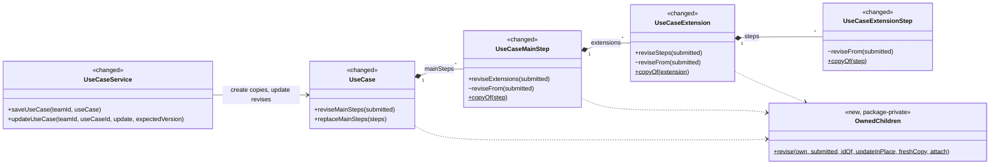
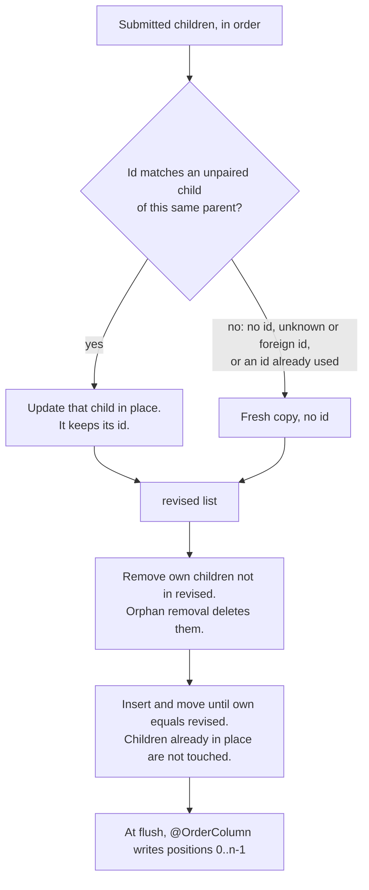
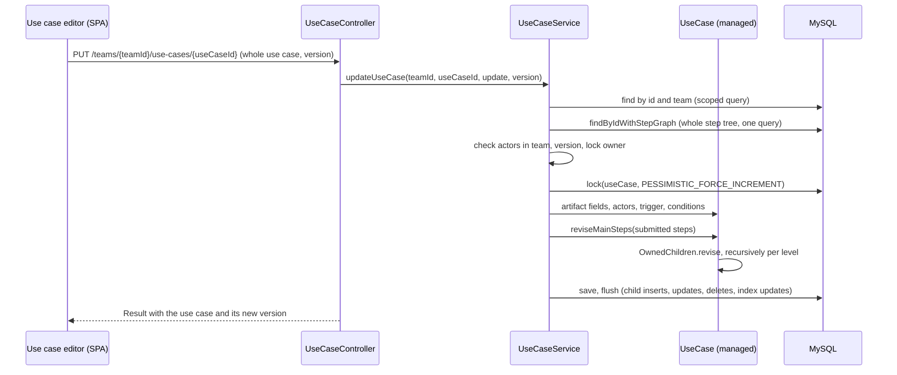

# Requirement Documents (DOC) Design

> Realizes: UC-DOC-create-use-case, UC-DOC-edit-use-case (saving a use case's steps only; see Scope)
> Depends on: BR-edit-lock-required, BR-lock-expiry, OI-46 (request-body ids), OI-51 (optimistic locking)
> See: [use cases](../requirements/use-cases.md#requirement-documents), [architectural-design.md](architectural-design.md#domain--aggregate-model) (Domain & aggregate model, Transactions & consistency)
> Written after the code was built (2026-11-13), not through `/design`, so it has no questions-test record.

## Scope

This doc is the DOC area's design-of-record, but so far it covers only one concern: how saving a use case stores its ordered step tree (main steps, their extensions, and the extensions' steps). The rest of the area (section-based documents, document-section locking, the Use Cases document) was built before the design gate existed and is not yet written up here. Add those concerns as sections of this same doc when they are next designed, rather than starting a second file.

## Overview

A use case is an aggregate. `UseCase` is the root, and it owns three levels of ordered children, each an inverse `@OneToMany` list with `@OrderColumn`, `cascade = ALL` and `orphanRemoval = true`. The editor always submits the whole use case, steps included, and expects the stored step tree to match the submission exactly: same order, same text, omitted children gone.

The save does not replace the stored tree with the submitted one. It **revises** it: every submitted child is paired, by id, with an existing child of the same parent; a paired child is updated in place, and anything unpaired is stored as a new row. One small generic class does this for all three levels, so the rule is written once.

## Components & classes

- [`OwnedChildren`](../../backend/src/main/java/team/projectpulse/ram/usecase/OwnedChildren.java): the pairing algorithm. Its comments walk one worked example ([A, B, C] becomes [C, N, A]) through every phase; read them before changing it.
- `reviseMainSteps`, `reviseExtensions`, `reviseSteps`: each passes its own list and its own level's `reviseFrom`, `copyOf` and back-reference setter to `OwnedChildren`.
- `reviseFrom`: copies a submitted child's fields onto the paired managed child, then revises that child's own list. Package-private, because only the level above calls it.
- `copyOf`: a deep copy without any id, at every level. Used for unpaired children and for every child on create.
- [`UseCaseService`](../../backend/src/main/java/team/projectpulse/ram/usecase/UseCaseService.java): calls the domain methods; holds no step logic of its own.

## Sequence

### Pairing, at any one level

### UC-DOC-edit-use-case: saving the edited use case

On create (UC-DOC-create-use-case), `saveUseCase` replaces the submitted steps with `copyOf` copies before saving, so every step, extension and extension step is a new row whatever ids the body carried.

## API contract

No endpoint was added or changed in shape; the rows record what both sides must agree on for steps.

| Endpoint or job | Caller (who may) | Request | Success | Errors, by extension |
|---|---|---|---|---|
| `POST /teams/{teamId}/use-cases` | team member | Whole use case; step ids, if present, are ignored | Use case with newly assigned step ids | 404 actor not in team |
| `PUT /teams/{teamId}/use-cases/{useCaseId}` | team member holding the use case lock | Whole use case and its current `version`; send back each step's `id` to keep that step | Use case with step ids and the **new** `version`, which the next save must send | 400 no version; 409 stale version; 409 not locked; 423 locked by someone else; 404 use case or actor not in team |

## Key decisions

| Decision | Chosen | Rejected, and why |
|---|---|---|
| How the order is stored | Keep `@OrderColumn` on the inverse lists; Hibernate writes and renumbers the position column | `@OrderBy` on a position field: the lists become bags, and the nested fetch joins (`findByIdWithStepGraph`) then fail with `MultipleBagFetchException`. Hibernate's boot warning HHH160246 about this mapping is accepted; the 7.4 User Guide (Mapping Lists) says the order column must be applied explicitly on the inverse side. |
| Direction of the associations | Bidirectional (`mappedBy` plus a back-reference on each child) | Unidirectional `@OneToMany` with `@JoinColumn`: workable, but it changes the mapping of all three levels and gains nothing for this flow. |
| How a submitted child finds its stored row | By id, among **this parent's own children only** | By position: inserting one step would rewrite the text of every step after it and lose their ids. Global lookup by id: a request-body id must never select a row outside the parent named by the route (OI-46). |
| An id the parent does not own (stale, foreign, or repeated) | Treated as new: stored as a fresh row | Refuse with 400: a stale id after a concurrent delete is normal editor behavior, not an attack, and refusing would lose the user's text. |
| How the stored list is edited | Explicit remove, insert and move; never `clear()` and refill | Clear and refill: every save looks like a total rewrite, and keeping ids then depends on JPA `merge` semantics rather than on code we can read. |
| Create path | Every child saved as a `copyOf`, no ids | Saving the submitted objects: a body-supplied child id would reach `save()`. |
| Fields no DTO carries (`label`, `resumeStepNo` on an extension) | Left untouched by `reviseFrom` | Copying them from the submission: it would null them on every save. |
| Version on every accepted save | `entityManager.lock(useCase, PESSIMISTIC_FORCE_INCREMENT)` after the version and lock checks | Rely on Hibernate's dirty check: it bumps the version only when a `UseCase` field or collection changes, and most edits change the artifact or child rows, so stale saves were accepted. `OPTIMISTIC_FORCE_INCREMENT`: writes just before commit, so the response carries the old version (and rolled-back tests cannot see it). |
| Where the logic lives | Domain methods on the aggregate plus one generic helper | Three copies of the algorithm, one per level, or the logic in the service: it needs no repository, so it belongs in the domain. |

Two consequences worth knowing:

- The version can go up by 2 in one save, once for the forced increment and once more if a `UseCase` collection (secondary actors, conditions) is also dirty. Only "it changed" matters to the stale-save check.
- `replaceMainSteps` still exists: the DTO converters use it to build the detached submitted tree. Payload ids still travel through the converters on purpose, as pairing keys.

## Data model

No delta. The tables and their `*_index` order columns are unchanged, and no migration was needed.

## Reuse & cross-cutting

- Use case locking (BR-edit-lock-required, BR-lock-expiry): the save is refused unless the caller holds the lock.
- Optimistic locking (OI-51): `UseCase` is the aggregate root, so its `@Version` covers all three child levels.
- The same pairing rule (ids only select among the parent's own children) is used by `DocumentSectionService.mergeSubmittedArtifacts` for a document section's requirement artifacts.

## Tests

| Use case, flow | Level | Asserts |
|---|---|---|
| Pairing rules | unit, `UseCaseStepRevisionTest` | Paired child updated in place; unpaired, foreign and repeated ids become fresh copies; omitted children removed; order follows the submission; extension ids pair only within their own step; `label` and `resumeStepNo` survive |
| How order is stored | integration, `UseCaseStepOrderingIntegrationTest` | Contiguous indexes on create, insert, remove and move; nested lists numbered per parent; the step-graph fetch has no duplicates |
| UC-DOC-edit-use-case, editing scenarios | integration, `UseCaseStepOrderingIntegrationTest` | Two saves in a row; remove an extension; edit an extension's kind and exit; insert an extension step; edit actors; remove every step |
| UC-DOC-edit-use-case, version | integration, `UseCaseStepOrderingIntegrationTest` | A text-only edit increments the stored version; a second save with the returned version succeeds |
| UC-DOC-create-use-case, ids in the body | integration, `UseCaseStepOrderingIntegrationTest` | Steps submitted with existing ids are stored as new rows |
| Request-body ids (OI-46) | integration, `RequestBodyIdIntegrationTest` | A step id from another team's use case is stored as a new step; the other team's step is unchanged |

All integration tests flush, clear, and read the database with native SQL, because the test transaction never commits.

## Open questions / risks

- Preconditions and postconditions are still saved with `clear()` and `addAll`; they are a separate OI-46 slice.
- `label` and `resumeStepNo` are stored but no DTO or screen uses them.
- With `@OrderColumn`, Hibernate rewrites every child's position on any insert, remove or move. That is fine at use case size; it would matter for long lists such as comment threads.
