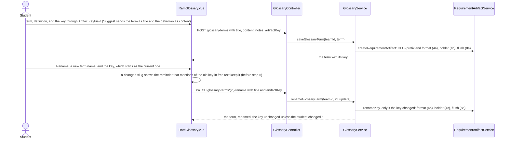

# Glossary (GLO) Design

> Realizes: UC-GLO-create-term and UC-GLO-rename-term, the artifact key only
> Depends on: BR-artifact-key-unique, BR-glossary-term-unique, BR-team-scoped-access, DI-artifact-key-assignment, FR-AI-degradation, SEC-llm-data-minimization
> See: [use cases](../requirements/use-cases.md#glossary), [art.md](art.md#artifact-keys) (the artifact key machinery every type shares), [architectural-design.md](architectural-design.md#ram-components) (RAM component view)
> History: first written 2026-11-24, for name-based artifact keys (spec PR #164). The rest of the glossary was built before this workflow and is not designed here yet.

## Scope

This doc covers only how a glossary term gets and renames its artifact key. The glossary's other behavior (finding, viewing, editing a definition, deleting, the term-name rules) was built before the design workflow and is not recorded here; it is designed when a glossary use case is next changed.

Not covered: the rename preview and the term-name uniqueness of UC-GLO-rename-term, which the built code does not do yet; they are outside the key work.

## Overview

A glossary term is a requirement artifact of type `GLOSSARY_TERM`, with no document section home. Its key is `GLO-<slug>`, chosen by the student through the shared key field, and checked by the same service methods as every other artifact's ([art.md](art.md#artifact-keys)). Creating a term no longer mints `GLO-n`: `GlossaryService` passes the key the request carries to `RequirementArtifactService.createRequirementArtifact`. Renaming a term leaves the key alone; the rename dialog shows the current key, and a changed slug is a deliberate key rename through `renameKey`.

## Components & classes

- **Changed:** [`GlossaryService`](../../backend/src/main/java/team/projectpulse/ram/glossary/GlossaryService.java) (create takes the key from the request; rename calls `renameKey` when the key changed), [`GlossaryController`](../../backend/src/main/java/team/projectpulse/ram/glossary/GlossaryController.java) (Javadoc only: the body's `artifactKey` is read), [`RamGlossary.vue`](../../frontend/src/pages/ram/RamGlossary.vue) (the create and rename dialogs each get `ArtifactKeyField`).
- **Reused:** everything in [art.md, Artifact keys](art.md#artifact-keys): `ArtifactKeys`, `RequirementArtifactService.createRequirementArtifact`, `renameKey`, `findKeyHolder`, the key-holder and key-suggestion routes, and `ArtifactKeyField.vue`.

## Sequence

### Creating and renaming a term's key

## API contract

| Endpoint | Caller (who may) | Request | Success | Errors |
|---|---|---|---|---|
| `POST /teams/{teamId}/glossary-terms` (changed) | team member | adds `artifactKey` (required, `GLO-` and a slug) | the term with its key | 400 a missing or malformed key (4a); 400 a key another artifact of the team holds, with the holder as `data` (4b, 8a) |
| `PATCH /teams/{teamId}/glossary-terms/{glossaryTermId}/rename` (changed) | team member | adds `artifactKey` (required: the current key, or a new one) | the term | 400 a malformed new key (4b); 400 a new key another artifact holds, with the holder as `data` (4c, 8a) |

The messages are the shared ones in [art.md, Refusals](art.md#refusals).

## Key decisions

- **Renaming the term never renames the key on its own.** UC-GLO-rename-term asks for that: a key changes only when the student chooses to. Rejected: deriving the key from the term again on every rename, which would silently change a key that traceability views and free text already show.
- **The rename sends the key every time.** One body shape, and the service compares it with the stored key, so an unchanged key is neither checked nor written. Rejected: an optional field, which makes a missing key ambiguous (keep it, or clear it).

## Tests

| Use case, flow | Level | Asserts |
|---|---|---|
| UC-GLO-create-term, key | integration | A term sent with `GLO-peer-evaluation` is stored with that key |
| UC-GLO-create-term, 4a | integration | A missing key, `GLO-Peer`, and `FR-peer` are each refused with 400; nothing is stored |
| UC-GLO-create-term, 4b | integration | A key another artifact of the team holds is refused with 400 naming it |
| UC-GLO-rename-term, key kept | integration | A new term name with the current key renames the term and keeps the key |
| UC-GLO-rename-term, key renamed (4b, 4c) | integration | A free new key is stored; a malformed one and a held one are refused, and the term's name and key are both unchanged |
| Rename dialog | manual, recorded in the PR | The key starts as the current one; a changed slug shows the reminder; Suggest uses the new term name and the definition |

## Open questions / risks

- **The rest of UC-GLO-rename-term is not built:** the reference preview (steps 5 and 7) and the term-name uniqueness check (4a). Out of scope here; the key work does not depend on them.
