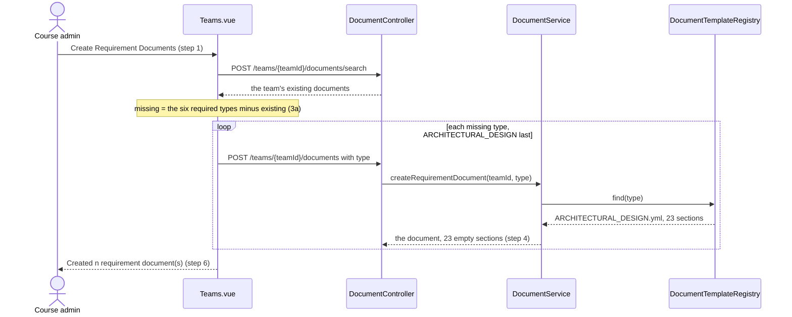
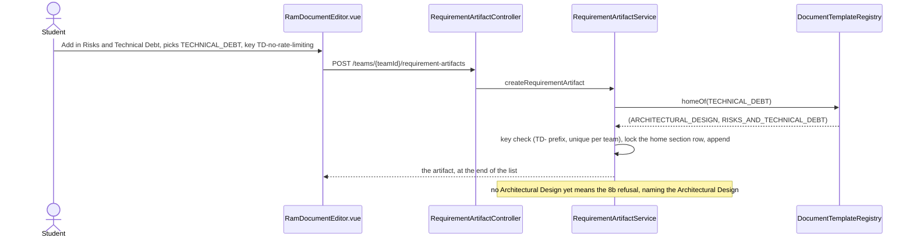
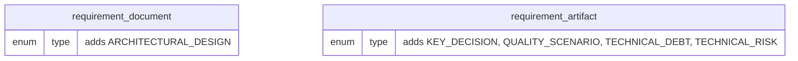

# Templates and Provisioning (TPL) Design

> Realizes: UC-TPL-provision-documents, FR-TPL-enforce-structure, FR-TPL-section-keys, for the Architectural Design document
> Depends on: BR-document-creation, BR-artifact-home, BR-artifact-key-unique, DI-artifact-key-assignment, UC-ART-create-artifact
> See: [use cases](../requirements/use-cases.md#templates-and-provisioning), [SRS Business Domain Model](../requirements/software-requirements-specification.md#ram-requirements-graph) (the document types, the artifact types, and the authoring-home table), [art.md](art.md#homes) (list homes and artifact keys), [architectural-design.md](architectural-design.md#ram-cross-cutting-subsystems) (document templates)
> History: first written 2026-11-26, for the Architectural Design document (OI-21, spec PR #169). Provisioning itself was built before this workflow; this doc records how it works only as far as the new document needs.

## Scope

This doc covers adding the Architectural Design as a team's sixth requirement document: its template, the four artifact types its list sections home, and the four architecture sections that leave the SRS. Template customization (FR-TPL-customize) is deferred and not designed here.

## Overview

A document's structure is data. Each `DocumentType` has a YAML template in `backend/src/main/resources/requirement-document-templates/`, named after the type. [`DocumentTemplateRegistry`](../../backend/src/main/java/team/projectpulse/ram/document/template/DocumentTemplateRegistry.java) loads every template at startup, refuses a LIST section that names no artifact types, and inverts the templates into each list type's one home (BR-artifact-home); [`DocumentService.createRequirementDocument`](../../backend/src/main/java/team/projectpulse/ram/document/DocumentService.java) creates a document's sections from its template. None of that code changes here: the Architectural Design is a new enum value and a new template, and its four artifact types find their homes through the same inversion every other type uses.

## The Architectural Design template

`ARCHITECTURAL_DESIGN.yml`, titled "Architectural Design" (its document key is the type name, as `DocumentService` sets for every type): arc42's twelve sections in arc42's order, with the titles of the course's architectural design template, and arc42's subsections as their own document sections. Like the other templates it is a flat, ordered list of sections with the fields `DocumentTemplate.SectionTemplate` already has (key, title, type, guidance, admitted types); the arc42 numbers are not stored: as in the other templates, a section's number follows from its position (FR-TPL-section-keys). A parent section is a short rich-text section, as the SRS's Functional Requirements is above Use Cases. No section is marked required or optional: no template carries that field today.

**Porting the guidance.** The guidance comes from the course template, with these changes:

- Its checkpoint due dates, its "How to use this template" note, its Identifiers table, and its "Working this document with your agent" section are dropped. The "What this document is" and "What it is not" paragraphs go into `INTRODUCTION_AND_GOALS`.
- Its links and section numbers ("section 9 of your specification", "section 3.1 of vision and scope", `OPEN-ISSUES.md`) become plain references to the document and section title ("the SRS's Quality Attributes").
- Its examples keep the Cafeteria Ordering System, which the other templates share, but cite keys the product can hold: quality attributes are `QA-*` (`QA-payroll-confidential`, not `SEC-payroll-auth`), and open-issue keys such as `OI-4` are dropped, since there is no such type.
- Its Mermaid examples stay out: no template's guidance carries a diagram today. The guidance says what to draw instead.
- The list sections' guidance asks for every field the course template's entries have, written in the artifact's content: a key decision's status (Accepted, or Superseded by another key decision), driving requirements, context, decision, rejected alternative and trade-off; a quality scenario's source and stimulus, environment, response, measure and verifying test; and for each risk or debt, what could go wrong and what it breaks, its mitigation or fix, and what it cites. A superseded decision is marked in its content; no link type records it.

| arc42 | Section key | Title | Type |
|---|---|---|---|
| 1 | `INTRODUCTION_AND_GOALS` | Introduction and Goals | rich text; its guidance says what the document is and is not |
| 1.1 | `REQUIREMENTS_OVERVIEW` | Requirements Overview | rich text; a link to the SRS and use cases |
| 1.2 | `QUALITY_GOALS` | Quality Goals | rich text; a table citing `QA-*` keys |
| 1.3 | `STAKEHOLDERS` | Stakeholders | rich text; a link to the Vision and Scope |
| 2 | `ARCHITECTURE_CONSTRAINTS` | Architecture Constraints | rich text; cites `CO-*` and `OE-*` |
| 3 | `CONTEXT_AND_SCOPE` | Context and Scope | rich text; replaces the SRS's System Context Diagram |
| 4 | `SOLUTION_STRATEGY` | Solution Strategy | rich text |
| 5 | `BUILDING_BLOCK_VIEW` | Building Block View | rich text |
| 5.1 | `CONTAINERS` | Containers | rich text; replaces the SRS's Container Diagram |
| 5.2 | `USE_CASE_AREAS_AND_COMPONENTS` | Use Case Areas and Components | rich text |
| 6 | `RUNTIME_VIEW` | Runtime View | rich text |
| 7 | `DEPLOYMENT_VIEW` | Deployment View | rich text; replaces the SRS's Deployment |
| 8 | `CROSSCUTTING_CONCEPTS` | Crosscutting Concepts | rich text |
| 8.1 | `SECURITY_CONCEPT` | Security | rich text |
| 8.2 | `OTHER_CONCEPTS` | Other Concepts | rich text |
| 9 | `ARCHITECTURE_DECISIONS` | Architecture Decisions | rich text |
| 9.1 | `SIGNIFICANT_REQUIREMENTS` | Architecturally Significant Requirements | rich text; a table citing SRS keys |
| 9.2 | `KEY_DECISIONS` | Key Decisions | list: `KEY_DECISION` |
| 10 | `QUALITY_REQUIREMENTS` | Quality Requirements | rich text |
| 10.1 | `QUALITY_REQUIREMENTS_OVERVIEW` | Quality Requirements Overview | rich text; a link to the SRS's Quality Attributes |
| 10.2 | `QUALITY_SCENARIOS` | Quality Scenarios | list: `QUALITY_SCENARIO` |
| 11 | `RISKS_AND_TECHNICAL_DEBT` | Risks and Technical Debt | list: `TECHNICAL_RISK`, `TECHNICAL_DEBT` |
| 12 | `ARCHITECTURE_GLOSSARY` | Glossary | rich text; a link to the Project Glossary |

`SRS.yml` loses `SOFTWARE_ARCHITECTURE`, `SYSTEM_CONTEXT`, `CONTAINER_DIAGRAM` and `DEPLOYMENT`, so it goes from 30 document sections to 26; no other SRS guidance mentions them. Two Vision and Scope guidance texts change, as the course template has them: `RISKS` says its risks are business-level and points technical risks to the Architectural Design, and `PRODUCT_PERSPECTIVE` says its context diagram is a first draft that moves to the Architectural Design's Context and Scope once the team writes it, leaving a reference behind.

## Components & classes

- **New:** `requirement-document-templates/ARCHITECTURAL_DESIGN.yml`; `db/migration/V15__architectural_design_document.sql`.
- **Changed, data only:**
  - Backend: [`DocumentType`](../../backend/src/main/java/team/projectpulse/ram/document/DocumentType.java) (`ARCHITECTURAL_DESIGN`), [`RequirementArtifactType`](../../backend/src/main/java/team/projectpulse/ram/requirement/RequirementArtifactType.java) (the four types, each with a list home by `hasListHome`'s default), [`ArtifactKeyPrefix`](../../backend/src/main/java/team/projectpulse/ram/requirement/ArtifactKeyPrefix.java) (`KD`, `QS`, `TRI`, `TD`), `SRS.yml`, `VISION_SCOPE.yml`, [`DataInitializer`](../../backend/src/main/java/team/projectpulse/seed/DataInitializer.java) (team 1 gets an empty Architectural Design, saved after the business rule that now ends the seed, so it is the last thing seeded and no other id shifts because of it; the `applyTemplate` Javadoc's "30 document sections ... the 16th" becomes 26 and the 13th).
  - Frontend: [`apis/ram/types.ts`](../../frontend/src/apis/ram/types.ts) (`DocumentType` and the artifact type list), [`utils/artifactKeys.ts`](../../frontend/src/utils/artifactKeys.ts) (the four prefixes, mirroring `ArtifactKeyPrefix`), [`RamDocuments.vue`](../../frontend/src/pages/ram/RamDocuments.vue) (a catalog card), [`Teams.vue`](../../frontend/src/pages/teams/Teams.vue) (`requiredTypes`, the new type last).
- **Checked, no change:** no backend code switches over `DocumentType` or `RequirementArtifactType` except `hasListHome` (whose default covers the new types); the frontend's one exhaustive map over `DocumentType` is `docsByType` in `RamDocuments.vue`, listed above; the editor and dialogs show artifact types by their enum names, as for every other type; export, validation and the AI assistants are not built.
- **Reused unchanged:** `DocumentTemplateRegistry`, `DocumentService`, `DocumentController`, `RequirementArtifactService` (home lookup, key check, home section row lock, and the refusal when the home document is missing), `ArtifactKeySuggester`, `RamDocumentEditor.vue` (it renders any section-based document, and a section with two admitted types already offers the type choice), `ArtifactKeyField.vue`.

## Sequence

### Provisioning a team's documents

### Creating an architecture item

The flow is UC-ART-create-artifact's ([art.md](art.md#uc-art-create-artifact-creating-an-artifact-in-its-home)); only the data is new.

## API contract

No endpoint is added or changed; two existing ones accept new enum values.

| Endpoint | Who | New input | Success | Errors |
|---|---|---|---|---|
| `POST /teams/{teamId}/documents` | course admin (existing rule) | `type` `ARCHITECTURAL_DESIGN` | the document with its 23 sections | a second one for the team is refused (3a, BR-document-creation) |
| `POST /teams/{teamId}/requirement-artifacts` | team member (existing rule) | `type` one of the four, with a key of its prefix | the artifact, at the end of its home list | as for every type: 4a key format (`TRI-x` on a `TECHNICAL_DEBT`), 4b key held, 8a document locked for review, 8b home document not created |

## Key decisions

- **No fields of their own for the architecture items.** A key decision's drivers, decision, rejected alternative and trade-off, and a quality scenario's source, stimulus, response and measure, are written in the artifact's content, prompted by the template's guidance. *Rejected:* typed columns per architecture type, which would add schema and editor forms for a structure no requirement asks the system to check.
- **The tests' SRS section ids are renumbered.** Removing SRS sections 8 to 10 and 28 shifts every later seeded section id: team 1's functional requirement list goes from 16 to 13 and its Assumptions and Dependencies from 13 to 10, and the Vision and Scope's sections each move down by 4. Fifteen test references change: five in `DocumentSectionControllerTest` (four to 16, one to 13), six in `RequestBodyIdIntegrationTest` and four in `RequirementArtifactControllerTest` (all to 16). No test names a Vision and Scope section by id. *Rejected:* keeping the removed sections in the SRS to hold the ids still, which keeps what the spec removed; looking every section up by key in the tests, which is a much larger change for the same result.
- **`ARCHITECTURE_GLOSSARY`, not `GLOSSARY`,** keys arc42's twelfth section, so the key never reads as the Glossary document. Its title stays "Glossary".
- **No pointer section in the SRS** to the Architectural Design. The course's SRS template has none. *Rejected:* a rich-text pointer like the SRS's `PROJECT_GLOSSARY`, one more section for students to leave empty.
- **The frontend keeps its own list of the document types** a team gets (`Teams.vue`) and its catalog (`RamDocuments.vue`). *Rejected:* an endpoint listing the configured templates. That fits template customization (FR-TPL-customize), but no requirement needs it now.

## Data model

`V15__architectural_design_document.sql` widens the only two columns that hold these enums, restating each column's full value list from the migration that last set it (V2 for `requirement_document.type`, V11 for `requirement_artifact.type`; the old `artifact_key_sequence` table went in V14) and keeping the values alphabetical to match Hibernate's generated definition, as V10 and V11 do: `requirement_document.type` gains `ARCHITECTURAL_DESIGN`, and `requirement_artifact.type` gains `KEY_DECISION`, `QUALITY_SCENARIO`, `TECHNICAL_DEBT` and `TECHNICAL_RISK`. No row is converted, and no existing SRS is reshaped: production and staging hold no requirement documents.

## Tests

| Flow | Level | Asserts |
|---|---|---|
| UC-TPL-provision-documents, the Architectural Design | integration, `DocumentControllerTest` | Creating `ARCHITECTURAL_DESIGN` for team 2 returns "Architectural Design" with 23 sections in template order; `KEY_DECISIONS`, `QUALITY_SCENARIOS` and `RISKS_AND_TECHNICAL_DEBT` are lists with their admitted types; the rest are rich text |
| UC-TPL-provision-documents, extension 3a | integration, `DocumentControllerTest` | A second `ARCHITECTURAL_DESIGN` for team 1, which the seed gives one, is refused; nothing is stored |
| The SRS without architecture | integration, `DocumentControllerTest` | A new SRS has 26 sections and none of the four moved keys |
| Homes of the four types | unit, `DocumentTemplateRegistryTest` | With the real templates, `homeOf` gives `KEY_DECISIONS`, `QUALITY_SCENARIOS`, and `RISKS_AND_TECHNICAL_DEBT` for both `TECHNICAL_RISK` and `TECHNICAL_DEBT` |
| Prefixes | unit, `ArtifactKeyPrefixTest` | `KD`, `QS`, `TRI`, `TD` |
| UC-ART-create-artifact, each new type | integration, `RequirementArtifactControllerTest` | `KD-deployment-shape` lands at the end of team 1's `KEY_DECISIONS`; a `QUALITY_SCENARIO` in `QUALITY_SCENARIOS`; a `TECHNICAL_RISK` then a `TECHNICAL_DEBT` both in `RISKS_AND_TECHNICAL_DEBT`, in that order |
| UC-ART-create-artifact 4a, the prefix belongs to the type | integration, `RequirementArtifactControllerTest` | `TRI-no-rate-limiting` on a `TECHNICAL_DEBT` is refused with 400; nothing is stored |
| UC-ART-create-artifact 8b | integration, `RequirementArtifactControllerTest` | Team 2, with no Architectural Design, creating a `KEY_DECISION` is refused, and the message names the Architectural Design |
| Renumbered SRS section ids | integration, the existing tests | The fifteen references use 13 and 10 and otherwise pass unchanged |
| Migration V15 | Flyway on the test container, every integration run | V1 to V15 apply on MySQL 8 |
| Provisioning and the editor | manual, running app | Create Requirement Documents makes six documents for a new team, and only the missing ones for team 2 (which the seed gives a Vision and Scope and an SRS); its card opens the editor; Risks and Technical Debt offers both types; `npm run type-check` passes |

## Open questions / risks

- The section id renumbering touches three test classes. A missed reference fails loudly, on a wrong section key, not silently.
